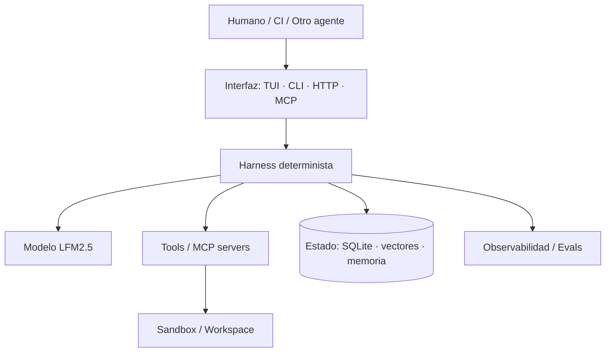
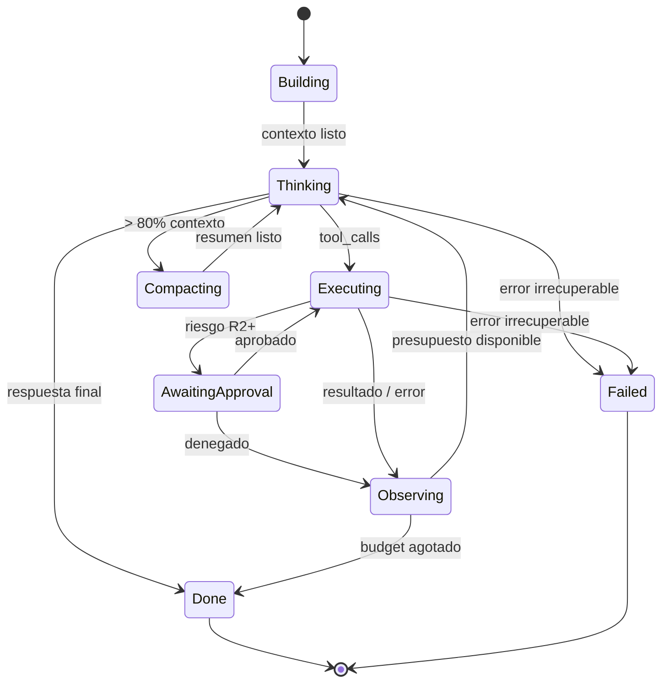

# 01 — Investigación: Harnesses agénticos, componentes, herramientas y protocolos

> **Estado:** Baseline de investigación · **Última verificación:** 2026-10-28
> **Alcance:** Estado del arte de los *agent harnesses* y su traducción en decisiones concretas para
> LiquidHarness. No es una encuesta exhaustiva de productos: es un análisis de arquitectura
> comparada orientado a decisiones.

---

## 1. Definición: qué es un harness (y qué no)

En 2026 el consenso industrial es que un **harness** es la capa determinista de runtime que envuelve
a un modelo de lenguaje y convierte texto probabilístico en acciones seguras, observables y
repetibles. No es el modelo, no es un framework de orquestación y no es un workflow DAG.

> "The model generates text; the harness decides what the model sees (context management), what the
> model can do (tool system), whether the model is allowed to do it (permission architecture), and how
> multiple model instances coordinate (agent orchestration)."
> — *A Source-Level Study of Claude Code* (DuoCode, 2026)

| Concepto | Responsabilidad | Ejemplo |
| :--- | :--- | :--- |
| **Modelo** | Predecir el siguiente token; proponer llamadas a herramientas | LFM2.5-2.6B |
| **Harness** | Loop, contexto, herramientas, permisos, estado, UI, auditoría | LiquidHarness |
| **Framework** | Abstracciones para *construir* agentes (grafos, chains, agentes) | LangGraph, CrewAI |
| **Orquestador** | Enrutar eventos, reintentos durables, colas | Inngest, Temporal |
| **Sandbox** | Aislar la ejecución de efectos secundarios | Docker, microVM, Seatbelt |
| **Protocolo** | Contrato de descubrimiento/ejecución de capacidades | MCP, function calling |
| **IDE/CLI host** | Superficie de interacción humana | TUI, VS Code, web |

**Tesis central:** el modelo se está commoditizando; la diferenciación está en el harness. Un modelo
pequeño (2.6B) con un harness excelente supera a un modelo grande con un harness ingenuo en tareas
acotadas. Esto justifica el proyecto.

### 1.1 Las cuatro capas



La frontera crítica es **modelo → harness**: el modelo *propone*, el harness *dispone*. Ninguna
llamada a herramienta se ejecuta porque el modelo la emitió; se ejecuta porque el harness la validó,
la autorizó y la registró.

---

## 2. Anatomía de un harness moderno

La literatura y los productos convergentes (Claude Code, Codex CLI, OpenHands, Gemini CLI) coinciden
en un conjunto de componentes. Los agrupamos en **12 bloques**:

### 2.1 Control loop / query engine

El corazón. Un bucle con presupuestos y condiciones de parada explícitas. No es un DAG: el modelo
decide el siguiente paso; el harness impone los límites.

```text
turn = start(user_input)
context = build_context(system, tools, history, retrieval)
budget = Budgets{steps: 24, wall: 10m, tokens: 60k, tool_calls: 32}

loop:
  if budget.exhausted()        -> stop(reason=budget)
  if ctx.cancelled()           -> stop(reason=cancelled)
  response = model.chat(context, tools)
  if response.tool_calls.empty():
      return final(response.text)
  for call in response.tool_calls (parallel if safe):
      decision = policy.authorize(call, session)
      if decision == ask:
          decision = await_human(call)
      if decision == deny:
          context.append(tool_error(call, "permission denied"))
          continue
      result = sandbox.execute(call, deadline)
      context.append(tool_result(call, truncate(result)))
  context = context_manager.fit(context)
```

Propiedades que un loop de producción **debe** tener:

1. **Presupuestos múltiples** (pasos, tiempo, tokens, coste, llamadas a tools) y *soft warnings*
   antes del corte.
2. **Condiciones de parada** separadas: respuesta final, presupuesto agotado, cancelación, error
   irrecuperable, aprobación rechazada.
3. **Recuperación de overflow** de contexto sin gastar un paso: compactar y reintentar.
4. **Reentrada**: si el proceso muere, el turno se reanuda desde el último checkpoint.
5. **Determinismo del control**: misma secuencia de mensajes + mismas tools ⇒ mismas decisiones de
   policy (el modelo puede variar; la seguridad no).

### 2.2 Gestor de contexto

Es donde fallan la mayoría de los agentes. Un tool result de 200 KB puede destruir el turno. Las
técnicas que la industria ha convergido en usar:

| Técnica | Cuándo | Efecto |
| :--- | :--- | :--- |
| **Pruning suave** (head+tail) | Resultado de tool > N tokens | Conserva señal, recorta ruido |
| **Hard clear** | Resultado antiguo (> 3 iteraciones) | Libera ventana |
| **Summarization / compaction** | Presupuesto global > 80 % | Resume historia preservando decisiones y aprobaciones |
| **Stable prefix** | Siempre | System prompt + tools primero, sin cambios, para reutilizar KV cache |
| **Overflow recovery** | Error `context_length_exceeded` | Compacta y reintenta una vez |
| **Budget warnings** | > 75 % de pasos | El modelo prioriza cerrar |
| **Retrieval on demand** | Contexto insuficiente | RAG inyecta solo lo relevante, con citas |

Regla de diseño: **nunca truncar silenciosamente**. Todo recorte se marca en el mensaje
(`[truncated: 42 KB → 8 KB, use fs_read with offset]`) para que el modelo pueda pedir más.

### 2.3 Gateway de modelo

Abstrae el proveedor y normaliza:

- streaming (SSE), cancelación, timeouts;
- formato de mensajes y de tool calls;
- conteo de tokens y ventana disponible;
- errores transitorios vs permanentes;
- uso (prompt/completion tokens) y latencia;
- capacidades (tools, JSON mode, reasoning, visión).

El harness **no** debe filtrar el formato propietario del proveedor al resto del sistema. Un modelo
canónico interno (ver arquitectura §5) y adaptadores por proveedor es la práctica dominante.

### 2.4 Registro y dispatcher de herramientas

Contrato uniforme para todas las tools: identidad, descripción, esquema, validación, permisos,
ejecución, presentación. Claude Code lo demuestra con ~40 tools que comparten interfaz; añadir una
tool no toca el loop.

Responsabilidades del dispatcher:

- resolver nombre → tool (y detectar colisiones/namespaces);
- validar JSON Schema **antes** de ejecutar;
- clasificar riesgo y consultar policy;
- aplicar timeout, cancelación y límite de concurrencia;
- truncar y envolver el resultado;
- registrar auditoría y telemetría;
- convertir errores en observaciones accionables para el modelo.

### 2.5 Motor de permisos y aprobaciones

Dos capas que no deben confundirse:

| Capa | Pregunta | Mecanismo |
| :--- | :--- | :--- |
| **Sandbox** | ¿Qué *puede* hacer técnicamente? | SO: Seatbelt, Landlock, seccomp, Job Objects, contenedor |
| **Policy / approval** | ¿Qué *debe* hacer sin preguntar? | Reglas, riesgo, contexto, allowlists, humano |

Codex CLI popularizó la combinación `sandbox_mode` + `approval_policy` (`read-only`,
`workspace-write`, `danger-full-access`; `on-request`, `never`). Claude Code usa un modelo de
permisos por tool con decisiones `allow/ask/deny` y hooks `PreToolUse` que pueden reescribir la
entrada. La lección: **el default debe ser seguro y el escape hatch debe ser explícito, ruidoso y
auditado**.

### 2.6 Sandbox de ejecución

| Plataforma | Mecanismo nativo | Notas |
| :--- | :--- | :--- |
| macOS | Seatbelt (`sandbox-exec`) | Perfil por proceso; usado por Codex |
| Linux | Landlock + seccomp + namespaces (bubblewrap) | Requiere kernel moderno |
| Windows | Restricted token / AppContainer / Job Objects | Codex usa tokens restringidos |
| Portable | Contenedor (Docker/Podman) | Aislado pero pesado; no default local |
| Proceso | `exec.CommandContext` + cwd + env limpio | Suficiente si no hay shell en v1 |

Para un harness local-first, el sandbox de sistema es deseable pero **no sustituye** la validación de
paths ni la aprobación. Un sandbox mal configurado da falsa sensación de seguridad.

### 2.7 Estado y durabilidad

Tres niveles:

1. **Sesión en memoria**: mensajes, tool calls, presupuesto, estado de UI.
2. **Persistencia local**: SQLite (sesiones, mensajes, aprobaciones, memorias, índice RAG).
3. **Checkpoints**: eventos append-only que permiten reanudar un turno tras crash.

El patrón "cada paso es una unidad reintentable" (Inngest, Temporal) es ideal, pero para un binario
local se simplifica a: **journal de eventos + idempotencia por `call_id`**. Si el proceso muere
durante una tool, al reanudar se consulta el journal: si hay resultado, se reutiliza; si no, se
re-ejecuta solo si la tool es idempotente o se pide confirmación.

### 2.8 Memoria

| Tipo | Vida | Contenido | Política |
| :--- | :--- | :--- | :--- |
| **Working memory** | Turno | Mensajes, resultados | Se compacta |
| **Session memory** | Sesión | Decisiones, archivos tocados, TODOs | Se persiste y resume |
| **Long-term memory** | Entre sesiones | Preferencias, hechos, correcciones | Escritura explícita, dedupe, TTL |
| **Shared memory** | Entre agentes/procesos | Hechos verificados, contratos | Namespaces, permisos, versionado |

Mem0 y similares popularizaron "memoria como ledger": no todo se guarda; se guarda lo que reduce
trabajo futuro. Para LiquidHarness: **la memoria es una tool, no un efecto colateral invisible**.
Cada escritura debe ser auditable, inspeccionable y borrable.

### 2.9 RAG

Pipeline estándar: ingesta → normalización → chunking → embedding → índice → recuperación híbrida →
rerank → inyección con citas.

Lecciones de producción:

- **Chunking por estructura** (headings, funciones) supera a chunking ciego por caracteres.
- **Híbrido** (BM25/FTS5 + vector) es más robusto que solo vectorial, sobre todo con nombres propios
  y código.
- **Citas obligatorias**: el modelo debe poder decir de qué archivo/línea salió un dato.
- **El índice es derivado**: se puede reconstruir; la fuente de verdad son los documentos.
- **Privacidad**: embeddings locales, nada de enviar documentos a APIs por defecto.

### 2.10 Planificación y delegación

Dos escuelas:

- **Plan explícito** (todo/todo_write): el modelo mantiene una lista de tareas y la actualiza. Barato,
  transparente, ideal para 2.6B.
- **Subagentes**: contextos aislados y paralelismo (Claude Code, Codex, OpenHands). Potente pero
  multiplica coste, latencia y superficie de error.

Para v1: **plan explícito + una sola sesión**. Subagentes post-1.0, con presupuestos por hijo y
"context firewall".

### 2.11 Observabilidad

Un harness sin trazas es imposible de depurar. Mínimo:

- log estructurado (`slog`) con `session_id`, `turn_id`, `step_id`, `tool_call_id`;
- traza por paso: tokens in/out, latencia, modelo, tool, decisión de policy;
- auditoría append-only de acciones con parámetros redactados;
- métricas: pasos/turno, tool error rate, compactaciones, overflow, aprobaciones;
- `pprof` opcional y perfil de goroutines.

### 2.12 Evaluación

La eval no es un extra: es el **test suite del comportamiento no determinista**. Se compone de:

- **golden sets** (entrada + herramientas + expectativas);
- **assertions deterministas** (tool llamada, argumentos, JSON válido, regex);
- **assertions semánticas** (LLM-as-judge con rúbrica calibrada);
- **métricas de trayectoria** (pasos, tools innecesarias, bucles);
- **regresión en CI** con umbrales por release.

---

## 3. El loop canónico, con presupuestos y recuperación



### 3.1 Presupuestos recomendados (v1)

| Presupuesto | Default | Máximo configurable | Motivo |
| :--- | ---: | ---: | :--- |
| Pasos por turno | 24 | 64 | Evita bucles infinitos |
| Llamadas a tools | 32 | 96 | Controla efectos secundarios |
| Tokens de contexto | 32 768 | 131 072 | Calidad/coste; LFM soporta 131K |
| Tokens de salida por paso | 2 048 | 8 192 | Respuestas accionables |
| Duración del turno | 10 min | 60 min | UX y recursos |
| Concurrencia de tools | 4 | 8 | Solo tools read-only |
| Reintentos de modelo | 2 | 4 | Backoff + jitter |
| Compactaciones por turno | 3 | 6 | Evita bucles de resumen |

### 3.2 Condiciones de parada

1. El modelo responde sin `tool_calls` y con contenido no vacío → **Done**.
2. Se agota cualquier presupuesto → **Done(budget)** con resumen parcial.
3. El usuario cancela (`Esc`, `Ctrl+C` dos veces, señal) → **Cancelled**.
4. Policy deniega una acción crítica y no hay alternativa → **Blocked**.
5. Error de modelo no reintentable o de tool fatal → **Failed**.
6. Se detecta un bucle (misma tool + mismos args 3 veces) → **Done(loop_detected)**.

---

## 4. Contrato de herramienta: lo que la industria ha aprendido

Un buen contrato de tool tiene **siete** propiedades:

| Propiedad | Pregunta | Implementación |
| :--- | :--- | :--- |
| **Identidad** | ¿Quién es? | `name` único, `title`, versión |
| **Intención** | ¿Para qué sirve? | `description` breve y accionable |
| **Esquema** | ¿Qué acepta? | JSON Schema 2020-12, `additionalProperties: false` |
| **Riesgo** | ¿Qué puede romper? | Clase R0–R5 + `read_only`, `destructive`, `idempotent` |
| **Ejecución** | ¿Cómo corre? | timeout, cancelación, concurrencia, sandbox |
| **Resultado** | ¿Qué devuelve? | envelope tipado, tamaño máximo, errores accionables |
| **Presentación** | ¿Cómo se ve? | resumen para humano, diff, expandible |

### 4.1 Errores como observaciones

El error no es una excepción que mata el turno: es **información para que el modelo se corrija**.

```json
{
  "ok": false,
  "error": {
    "code": "PATH_OUTSIDE_WORKSPACE",
    "message": "Path '/etc/passwd' is outside the workspace '/home/dev/project'.",
    "retryable": false,
    "hint": "Use a path relative to the workspace root.",
    "details": { "root": "/home/dev/project", "requested": "/etc/passwd" }
  }
}
```

Reglas:

- `code` estable y documentado; `message` para el modelo; `hint` accionable.
- Nunca incluir stack traces ni rutas internas del harness en el mensaje al modelo.
- `retryable` debe ser honesto: un path inválido no se arregla reintentando igual.
- Errores de validación deben indicar el campo y el esquema esperado.

### 4.2 Salidas grandes

- Límite por defecto: 32 KiB o 8 000 tokens por resultado.
- Estrategia: head + tail + marcador de truncado + `next_cursor`.
- Para archivos: `fs_read` con `offset`/`limit` y `fs_search` para localizar.
- Para diffs: resumen de hunks + posibilidad de expandir en UI.
- Nunca devolver binarios: detectar y responder `BINARY_FILE` con metadatos.

### 4.3 Idempotencia y reintentos

| Tool | Idempotente | Reintento automático |
| :--- | :---: | :---: |
| `fs_read`, `fs_list`, `fs_search`, `rag_search` | ✅ | ✅ |
| `fs_create` (con `fail_if_exists`) | ❌ | ❌ |
| `fs_edit` (con hash precondición) | ✅ | ⚠️ solo si el hash coincide |
| `fs_delete` | ❌ | ❌ |
| `shell_exec` | ❌ | ❌ |
| `memory_add` (con `dedupe_key`) | ✅ | ✅ |

---

## 5. Comparativa de harnesses de referencia

> Nota: la comparación es arquitectónica, no un benchmark. Las licencias y capacidades cambian;
> verificar antes de citar en material comercial.

| Harness | Modelo de control | Tools | Aislamiento | Extensibilidad | Lección para LiquidHarness |
| :--- | :--- | :--- | :--- | :--- | :--- |
| **Claude Code** | Query engine propietario, loop con "continue sites" | ~40 tools, interfaz uniforme, permisos por tool | Permisos + hooks; sandbox del host | MCP, hooks, subagentes, skills | La interfaz de tool y el sistema de permisos son el producto |
| **Codex CLI** | Loop simple + sandbox fuerte | Shell, patch, MCP | Seatbelt/Landlock/token restringido | MCP, config TOML | Separar `sandbox_mode` de `approval_policy`; defaults seguros |
| **Gemini CLI** | Loop + herramientas integradas | FS, shell, web, MCP | Sandbox opcional | MCP, extensiones | Integración profunda con el host, pero riesgo de acoplamiento |
| **OpenHands** | Agent server + event stream | FS, shell, browser, MCP | Docker por sesión | SDK, workspaces | Separar loop de ejecución; event stream como fuente de verdad |
| **Aider** | Loop orientado a edición de código | Edición por bloques, git | Proceso local | Modelos vía API | El diff como ciudadano de primera clase |
| **Goose** | Loop + extensiones | MCP nativo | Local | MCP | MCP como mecanismo principal de extensión |
| **SWE-agent** | Loop de investigación/edición | Comandos acotados | Contenedor | Configuración | Interfaces restringidas mejoran la fiabilidad del modelo pequeño |
| **Mecatl** | Loop separado del entorno de ejecución | Backend + frontends | Kubernetes/local | TUI + web | Un backend, muchos clientes; separación de confianza |

### 5.1 Qué copiar y qué evitar

**Copiar:**

- Interfaz de tool uniforme y declarativa.
- Permisos por tool con `allow/ask/deny` y hooks.
- Sandbox + approval como capas independientes.
- Compactación multinivel y recuperación de overflow.
- Trazas por paso y auditoría.
- Un solo backend para TUI/CLI/headless.

**Evitar:**

- Frameworks pesados para el core (el proyecto exige stdlib primero).
- DAGs rígidos que impiden al modelo decidir.
- Auto-aprobación de tools de escritura por conveniencia.
- Dependencia de un único proveedor o de un formato propietario.
- UI que oculta lo que el agente está haciendo.
- "Memoria mágica" no inspeccionable.

---

## 6. Protocolos

### 6.1 Function calling nativo

Cada proveedor tiene su formato. OpenAI popularizó:

```json
{
  "type": "function",
  "function": {
    "name": "fs_read",
    "description": "Read a UTF-8 text file inside the workspace.",
    "parameters": {
      "type": "object",
      "properties": {
        "path": { "type": "string" },
        "offset": { "type": "integer", "minimum": 0 },
        "limit": { "type": "integer", "minimum": 1, "maximum": 2000 }
      },
      "required": ["path"],
      "additionalProperties": false
    }
  }
}
```

LFM2.5 usa un formato propio basado en tokens especiales (ver documento 02). El harness debe
normalizar ambos a un **modelo canónico**.

### 6.2 Model Context Protocol (MCP)

MCP es un estándar abierto basado en **JSON-RPC 2.0** para que aplicaciones LLM descubran y ejecuten
capacidades externas. Versión de referencia: **2026-07-28**.

**Primitivas del servidor:**

| Primitiva | Control | Uso |
| :--- | :--- | :--- |
| **Tools** | Modelo | Acciones con efectos (`tools/list`, `tools/call`) |
| **Resources** | Aplicación | Datos contextuales por URI (`resources/list`, `resources/read`) |
| **Prompts** | Usuario | Plantillas seleccionables (`prompts/list`, `prompts/get`) |

**Transportes:** `stdio` (proceso hijo) y **Streamable HTTP** (POST + SSE opcional). Existe
negociación de capacidades, versionado de protocolo, paginación (`cursor`), `ttlMs`/`cacheScope` y
resultados que requieren input del usuario (`input_required`, elicitation).

**Implicaciones de seguridad:**

- Un servidor MCP es **código de terceros**: se trata como no confiable.
- Las descripciones de tools son **entrada no confiable** (tool poisoning / prompt injection).
- Un servidor puede cambiar su lista de tools (`notifications/tools/list_changed`): hay que
  re-validar y re-aprobar.
- El transporte HTTP debe ser loopback por defecto, con auth y sin exponer a la red.
- Los resultados pueden ser enormes: truncar y validar.

**Go SDK oficial:** `github.com/modelcontextprotocol/go-sdk` (v1.8+), con `mcp.NewServer`,
`mcp.AddTool`, transportes `StdioTransport` y `StreamableClientTransport`, middleware y sesiones
concurrentes. Es Tier 1 y debe ser la base del puente MCP.

### 6.3 AGENTS.md y convenciones de instrucciones

El ecosistema converge en archivos de instrucciones por repositorio (`AGENTS.md`, `CLAUDE.md`,
`.cursor/rules`). Para LiquidHarness:

- soportar `AGENTS.md` en la raíz del workspace como contexto de proyecto;
- permitir `--instructions <file>` y `.liquidharness/instructions.md`;
- **marcar** estas instrucciones como no confiables si el repo es de terceros;
- nunca dejar que instrucciones de repo cambien la policy de seguridad.

### 6.4 Agent Skills / plugins

El estándar emergente de *skills* (instrucciones + recursos + scripts) es útil para extender
comportamiento sin recompilar. Para v1: **no** cargar scripts automáticamente; un skill es texto +
referencias, y cualquier script pasa por la policy de `shell_exec`.

### 6.5 Protocolos internos que el proyecto necesita

Aunque no sean estándar externo, deben especificarse:

1. **Tool protocol** (documento 05): descriptor, call, result, error, riesgo.
2. **Event protocol** (arquitectura §8): eventos de sesión para TUI, headless y auditoría.
3. **Eval dataset schema** (documento 11).
4. **Theme token schema** (documento 06).

---

## 7. Modos de fallo y mitigaciones

| Fallo | Síntoma | Causa raíz | Mitigación |
| :--- | :--- | :--- | :--- |
| **Bucle de tools** | Misma llamada 5+ veces | Resultado no accionable | Detección de repetición + mensaje de corrección + corte |
| **Tool inventada** | Nombre inexistente | Alucinación / schema confuso | Lista cerrada, error con tools disponibles |
| **Argumentos inválidos** | JSON no valida | Modelo pequeño | Validación estricta + error con esquema + reintento |
| **Context rot** | Ignora instrucciones antiguas | Historia larga | Compactación + recordatorio de objetivos |
| **Overflow** | Error del backend | Resultados grandes | Pruning + presupuesto + recuperación |
| **Prompt injection** | Acción no solicitada | Documento/web malicioso | Separar datos de instrucciones, aprobación, allowlist |
| **Ejecución destructiva** | Borra archivos | `fs_delete`/shell sin gate | Riesgo R2+, aprobación, backup/trash |
| **Fuga de secretos** | Clave en logs/prompt | Redacción ausente | Redactor, keyring, nunca enviar `.env` |
| **Coste/latencia** | Turnos eternos | Sin presupuestos | Budgets duros + warnings |
| **No determinismo** | Resultado distinto | Sampling | Temp baja, seeds cuando el backend lo permita, evals |
| **Dependencia de red** | Falla offline | Runtime remoto | Runtime local por defecto, modo offline |
| **Corrupción de estado** | Sesión ilegible | Escritura no atómica | WAL, transacciones, migraciones, backups |

### 7.1 Antipatrones específicos de modelos pequeños

LFM2.5-2.6B es capaz pero no es un modelo de razonamiento profundo. Evitar:

- prompts de sistema de 5 000 tokens con 40 tools;
- instrucciones ambiguas tipo "haz lo que creas mejor";
- pedirle planes de 20 pasos;
- tools con esquemas anidados complejos;
- resultados de tools de 50 KB;
- tareas de código/knowledge-heavy (el propio model card lo desaconseja).

Diseñar para: **pocas tools, esquemas planos, descripciones literales, ejemplos, un objetivo por
turno, verificación explícita**.

---

## 8. Implicaciones directas para LiquidHarness

### 8.1 Decisiones que se derivan de la investigación

| ID | Decisión | Justificación |
| :--- | :--- | :--- |
| R-01 | Un solo binario, loop propio, sin framework | KISS, control total, rendimiento |
| R-02 | Modelo canónico interno + adaptadores | Evita lock-in y permite LFM/OpenAI |
| R-03 | Policy + approval + workspace jail desde v1 | La seguridad no se añade después |
| R-04 | Tools de FS con esquemas planos y riesgo explícito | Fiabilidad con 2.6B |
| R-05 | Compactación y presupuestos desde el primer loop | Sin esto no hay producción |
| R-06 | SQLite como única dependencia de estado | Simplicidad operativa, transacciones |
| R-07 | RAG híbrido con citas | Precisión y confianza |
| R-08 | Memoria como tool inspeccionable | Privacidad y control |
| R-09 | Eval como paquete y gate de release | Regresión de prompts/modelos |
| R-10 | TUI que muestra el trabajo, no solo el resultado | Confianza y depuración |
| R-11 | MCP cliente y servidor | Ecosistema y automatización |
| R-12 | Headless primero, TUI después | Permite CI y pruebas |

### 8.2 No-objetivos de v1

- No es un IDE ni un agente de coding autónomo (limitación explícita de LFM2.5).
- No entrena ni hace fine-tuning.
- No ejecuta shell por defecto.
- No soporta multi-usuario ni servidor remoto multi-tenant.
- No tiene marketplace de plugins.
- No promete paridad con Claude Code/Codex en tareas de software.

### 8.3 Posicionamiento recomendado

> **LiquidHarness es un agente local de conocimiento y archivos**: organiza, busca, resume, edita y
> conecta documentos locales con memoria persistente, RAG y evaluaciones, funcionando offline en
> hardware de consumo con LFM2.5.

Esto es coherente con `project.md`, con las capacidades reales del modelo y con un mercado
diferenciado (privacidad + coste cero + hardware modesto).

---

## 9. Métricas de referencia para el harness

| Métrica | Definición | Objetivo v1 |
| :--- | :--- | :--- |
| **Task success rate** | % de tareas del golden set completadas | ≥ 80 % (2.6B, tareas acotadas) |
| **Tool selection accuracy** | % de tool calls correctas | ≥ 90 % |
| **Argument accuracy** | % de argumentos válidos y correctos | ≥ 85 % |
| **Loop overhead** | Latencia del harness sin modelo | < 15 ms p95 |
| **Tool error rate** | Errores no intencionados | < 5 % |
| **Compaction rate** | Turnos que compactan | < 20 % |
| **Crash-free sessions** | Sesiones sin corrupción | ≥ 99.5 % |
| **Install success** | Instalaciones correctas por plataforma | ≥ 98 % |
| **Time to first token** | Desde Enter hasta primer token | < 1.5 s (local) |

---

## 10. Referencias

### Harness y arquitectura

1. Inngest — *Your Agent Needs a Harness, Not a Framework* (mar. 2026):
   <https://www.inngest.com/blog/your-agent-needs-a-harness-not-a-framework>
2. DuoCode — *The Harness That Makes the Model Useful: A Source-Level Study of Claude Code*:
   <https://duocodetech.com/blog/claude-code-harness-engineering>
3. Stacklok — *Best Agent Harnesses for Enterprise AI in 2026*:
   <https://stacklok.com/blog/best-agent-harnesses-for-enterprise-ai-in-2026/>
4. *Natural-Language Agent Harnesses* (arXiv 2603.25723):
   <https://arxiv.org/html/2603.25723v1>
5. *The Design Space of Today's and Future AI Agent Systems* (arXiv 2604.14228):
   <https://arxiv.org/html/2604.14228v1>
6. Anthropic — *Building effective agents*:
   <https://www.anthropic.com/research/building-effective-agents>

### Productos de referencia

7. OpenHands — arquitectura del Agent Server:
   <https://docs.openhands.dev/openhands/usage/agent-canvas/architecture>
8. OpenAI Codex — *Agent approvals & security*:
   <https://learn.chatgpt.com/docs/agent-approvals-security>
9. OpenAI — *Building a safe, effective sandbox to enable Codex on Windows*:
   <https://openai.com/index/building-codex-windows-sandbox/>
10. Claude Code — documentación de permisos y hooks:
    <https://docs.anthropic.com/en/docs/claude-code>

### Protocolos

11. MCP — especificación 2026-07-28:
    <https://modelcontextprotocol.io/specification/2026-07-28>
12. MCP — Tools:
    <https://modelcontextprotocol.io/specification/2026-07-28/server/tools>
13. MCP — Go SDK:
    <https://github.com/modelcontextprotocol/go-sdk>
14. JSON-RPC 2.0:
    <https://www.jsonrpc.org/specification>

### Evaluación y seguridad

15. OWASP — *Top 10 for LLM Applications*:
    <https://genai.owasp.org/llm-top-10/>
16. DeepEval — *LLM-as-a-Judge in 2026*:
    <https://deepeval.com/blog/llm-as-a-judge>
17. Braintrust — *LLM evaluation guide*:
    <https://www.braintrust.dev/articles/llm-evaluation-guide>
