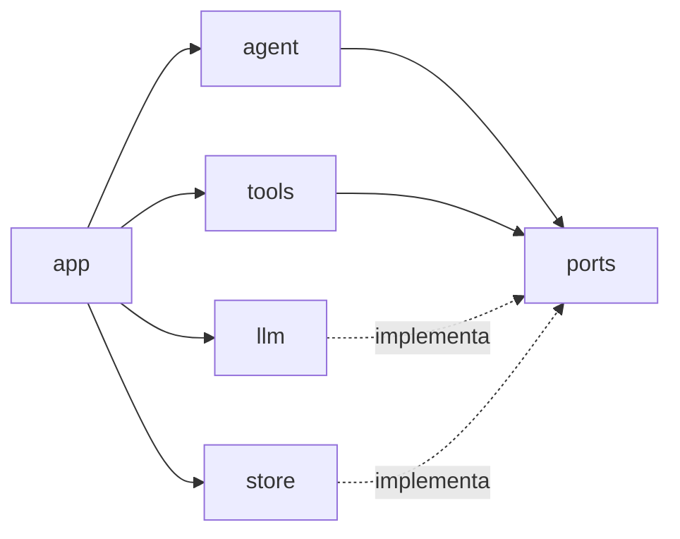
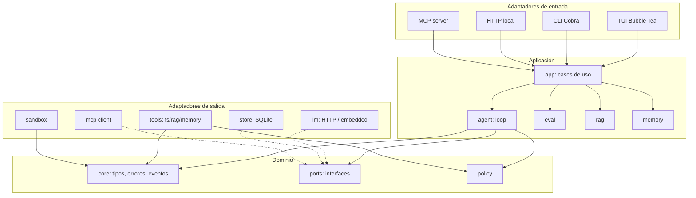
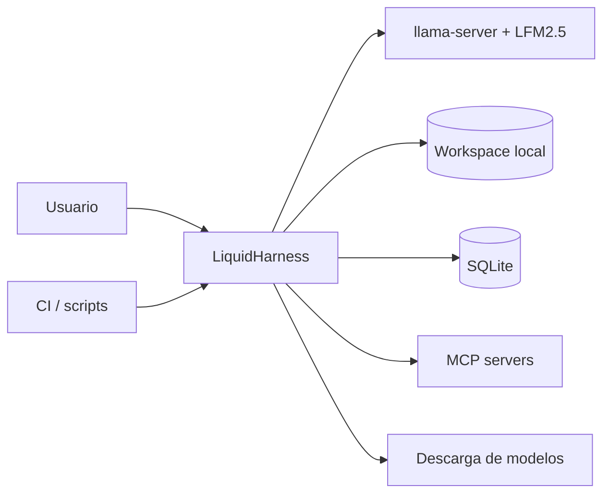
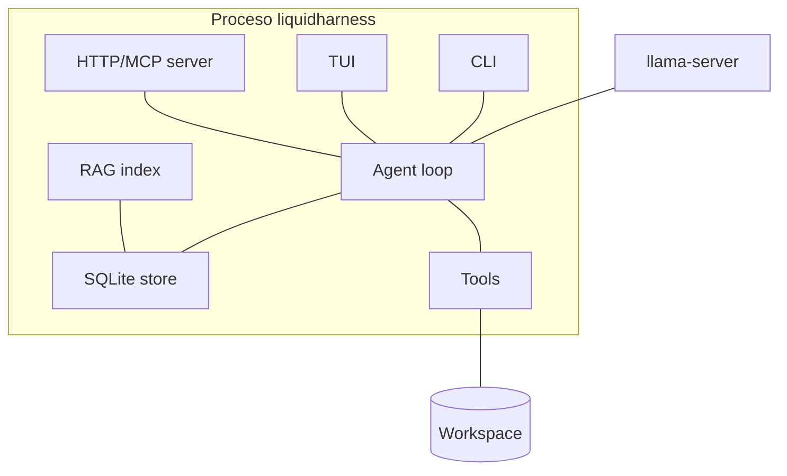
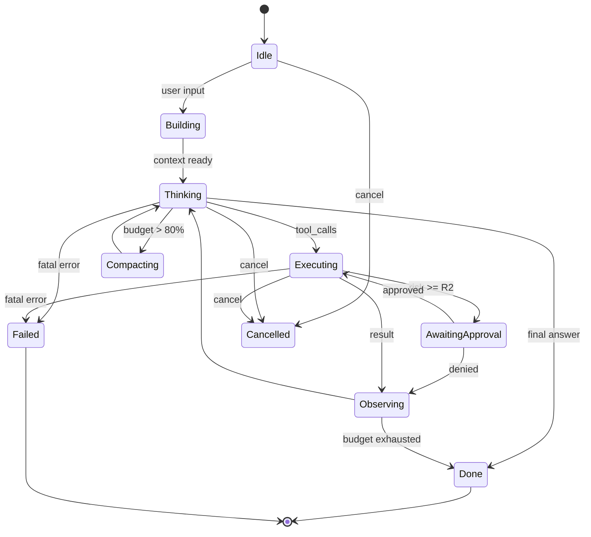
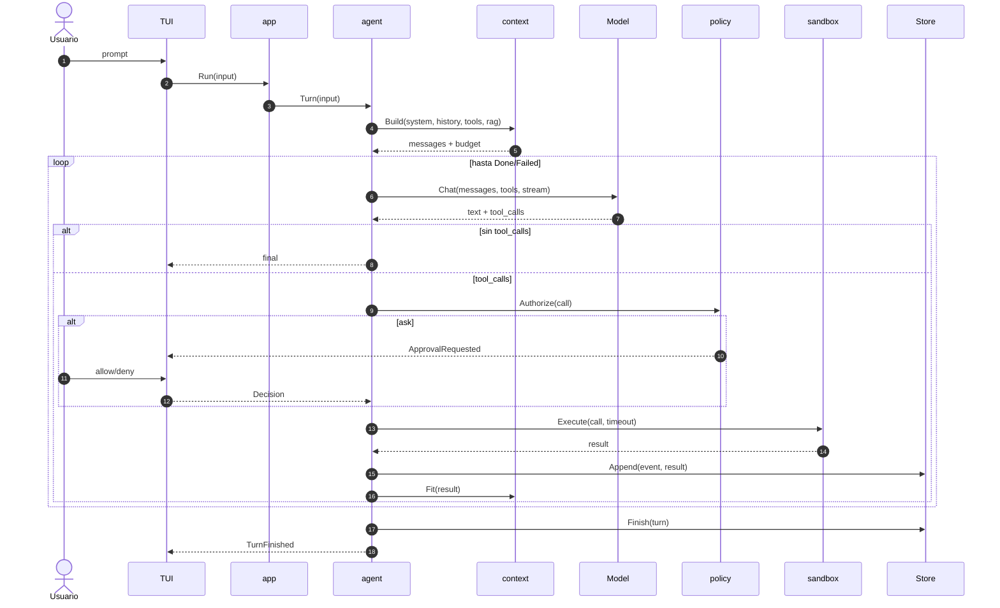
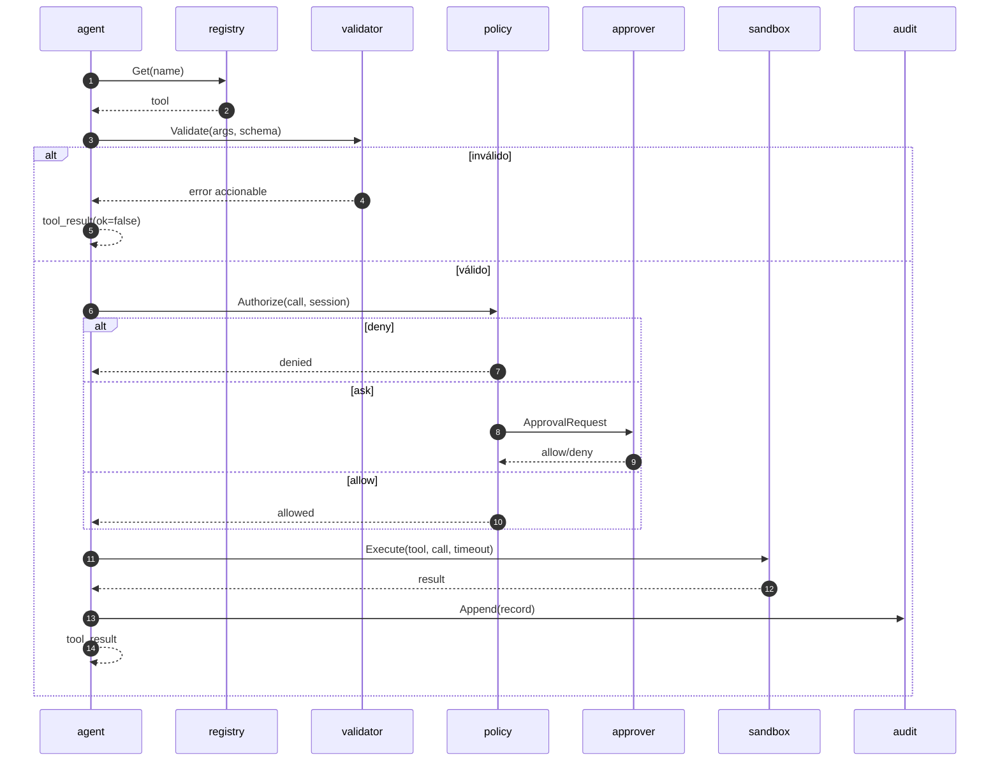
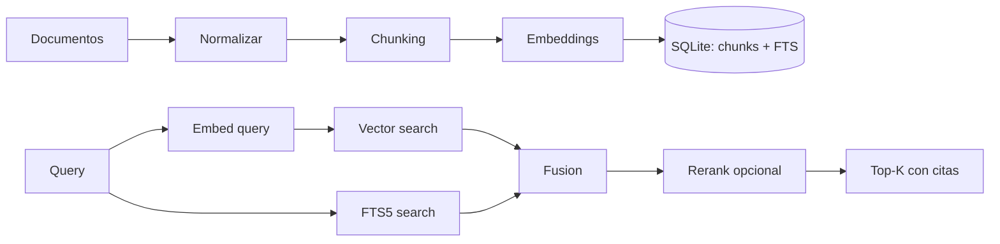
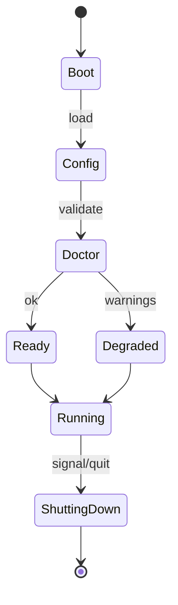

# 04 — Diseño de arquitectura

> **Estado:** Propuesta aceptada (ADR-0001 … ADR-0010) · **Versión:** 1.0 · **Fecha:** 2026-10-28
> **Alcance:** Arquitectura de v1. Las decisiones se registran en [`09-adr.md`](./09-adr.md).
> **Regla:** si este documento y el código discrepan, el código gana *hasta* que se corrige uno de los
> dos en el mismo PR.

---

## 1. Objetivos y restricciones

### 1.1 Objetivos

| ID | Objetivo | Criterio de éxito |
| :--- | :--- | :--- |
| O-01 | Ejecución local-first, sin servicios externos obligatorios | Funciona offline con un GGUF local |
| O-02 | Un solo binario para CLI, TUI y modo headless | `liquidharness` < 30 MB sin modelo |
| O-03 | Loop agéntico seguro y observable | Toda acción pasa por policy + auditoría |
| O-04 | Herramientas de archivos fiables | 0 escapes del workspace en tests adversariales |
| O-05 | RAG y memoria persistentes | Índice reconstruible; memoria inspeccionable |
| O-06 | Evaluación de comportamiento | Golden sets en CI con umbrales |
| O-07 | Extensibilidad sin recompilar el core | MCP cliente/servidor |
| O-08 | Instalación y actualización verificables | Checksums + firma + rollback |

### 1.2 Restricciones

- **Lenguaje:** Go 1.27, `CGO_ENABLED=0` en el binario principal.
- **Modelo:** LFM2.5 (2.6B como referencia), contexto 131K, tool calling nativo.
- **Plataformas:** Windows 10/11, macOS 13+, Linux x64/arm64.
- **Dependencias:** ≤ 15 directas; stdlib primero.
- **Licencia:** Apache-2.0 para el harness; LFM Open License para pesos.
- **No-objetivos:** multi-tenant, cloud, coding agent autónomo, fine-tuning.

### 1.3 Atributos de calidad (SLOs)

| Atributo | SLO v1 | Cómo se mide |
| :--- | :--- | :--- |
| Arranque | < 150 ms p95 | `doctor --bench` |
| RAM idle (sin modelo) | < 60 MB | `runtime.MemStats` |
| Overhead del loop | < 15 ms p95/paso | trazas |
| Primer token | < 1.5 s (modelo caliente) | TUI/headless |
| Tool read (1 MB) | < 100 ms p95 | benchmark |
| RAG search (10k chunks) | < 50 ms p95 | benchmark |
| Crash-free sessions | ≥ 99.5 % | telemetría local opt-in |
| Cobertura domain/agent/policy | ≥ 85 % | `go test -cover` |

---

## 2. Principios de diseño

### 2.1 SOLID, aplicado (no invocado)

| Principio | Cómo se materializa | Ejemplo concreto |
| :--- | :--- | :--- |
| **S** — Single Responsibility | Un paquete = una razón de cambio | `policy` decide; `sandbox` ejecuta; `agent` orquesta |
| **O** — Open/Closed | Nuevas tools/proveedores sin tocar el loop | Registro de tools + adaptadores de modelo |
| **L** — Liskov | Contratos explícitos y tests de conformidad | Toda `Tool` valida antes de mutar; todo `Store` devuelve `ErrNotFound` |
| **I** — Interface Segregation | Interfaces pequeñas y por consumidor | `Approver`, `Recorder`, `EventSink`; no `AgentService` |
| **D** — Dependency Inversion | El core depende de puertos, no de SDKs | `agent` usa `ports.Model`; `llm` lo implementa |

#### S — Single Responsibility

```text
internal/policy     → decide allow/ask/deny          (no ejecuta)
internal/sandbox    → ejecuta con límites            (no decide)
internal/tools      → implementa capacidades         (no autoriza)
internal/agent      → orquesta el turno              (no sabe de HTTP ni SQL)
internal/tui        → presenta y captura input       (no llama al modelo)
```

Si un paquete necesita explicar dos responsabilidades en su doc comment, se divide.

#### O — Open/Closed

Añadir `fs_move` no debe modificar `agent/loop.go`:

```go
registry := tools.NewRegistry(
    tools.NewFSRead(jail),
    tools.NewFSList(jail),
    tools.NewFSWrite(jail),
    tools.NewFSEdit(jail),
    tools.NewFSDelete(jail),
)
loop := agent.New(agent.Deps{Model: m, Tools: registry, Policy: p, ...})
```

Añadir un proveedor de modelo no debe modificar `agent`:

```go
var model ports.Model = llm.NewOpenAICompatible(cfg)
// o llm.NewEmbedded(...) con build tag
```

#### L — Liskov

Todo adaptador debe cumplir el contrato, no solo la firma:

- `Tool.Execute` **no muta** si la validación falla.
- `Tool.Execute` devuelve `ToolResult` con `OK=false` para errores de negocio, y `error` solo para
  fallos internos.
- `Store.Get` devuelve `core.ErrNotFound` (no `nil, nil`).
- `Model.Chat` respeta `context` y no deja goroutines vivas.
- `Approver.Approve` nunca devuelve `(true, error)`.

Se verifica con **tests de conformidad** reutilizables (`porttest`).

#### I — Interface Segregation

Mal:

```go
type AgentService interface {
    Run(...); Chat(...); Store(...); Search(...); Eval(...); Render(...)
}
```

Bien:

```go
type Approver interface { Approve(context.Context, ApprovalRequest) (Decision, error) }
type Recorder interface { Record(context.Context, Event) error }
type Retriever interface { Search(context.Context, Query) ([]Chunk, error) }
type Model interface { Chat(...); Stream(...); Info(...) }
```

#### D — Dependency Inversion



`agent` nunca importa `llm`, `store`, `tui` ni `sqlite`. `app` es el único que conoce concretos.

### 2.2 DRY con límites

**Fuentes únicas de verdad:**

| Dato | Fuente | Consumidores |
| :--- | :--- | :--- |
| Tipos de mensaje/tool | `internal/core` | agent, llm, store, tui |
| Esquemas de tools | `internal/tools/*` (`Descriptor`) | registry, MCP, TUI, docs |
| Tokens de diseño | `internal/tui/theme/tokens.go` | TUI, docs, tests |
| Errores y códigos | `internal/core/errors.go` | todos |
| Defaults de config | `internal/config/defaults.go` | CLI, docs, tests |
| Versión | `internal/version` (ldflags) | CLI, MCP, HTTP |
| Migraciones | `internal/store/migrations/*.sql` | store, tests |

**Dónde se permite duplicar:**

- DTOs de wire (`llm/wire.go`) vs tipos de dominio: **no** compartir; el adaptador traduce.
- Schemas de tools vs docs: los docs se generan o se validan en CI.
- Código de UI vs lógica: la UI tiene sus propios view models.

> DRY mal aplicado acopla capas. Preferimos duplicación local y explícita antes que un `utils`
> compartido que todo lo importa.

### 2.3 KISS

- Sin framework de DI: constructores explícitos en `app`.
- Sin ORM: SQL a mano + `database/sql`.
- Sin message broker: canales + journal en SQLite.
- Sin microservicios: un proceso (más el `llama-server` opcional).
- Sin sistema de plugins dinámico: registro en compile-time + MCP en runtime.
- Sin genéricos decorativos: solo donde eliminan duplicación real.
- Sin `internal/pkg` ni `utils`: nombres que digan algo.

### 2.4 Buenas prácticas Go

| Práctica | Aplicación |
| :--- | :--- |
| Aceptar interfaces, devolver structs | Constructores devuelven `*Loop`, no `Loop` |
| Interfaces pequeñas | 1–3 métodos |
| `context.Context` primero | Todo I/O |
| Errores envueltos | `fmt.Errorf("read config: %w", err)` |
| Sin estado global | Dependencias inyectadas |
| Paquetes por dominio | `agent`, `policy`, `store`, no `models`/`services` |
| `internal/` | Todo lo no público |
| `main` mínimo | Solo parsea y delega |
| Comentarios de paquete | Todos los paquetes exportados |
| Tests table-driven | Especialmente policy y parsers |
| `-race` siempre | CI |
| `slog` | Logs estructurados con IDs |
| Graceful shutdown | `signal.NotifyContext` + `Close()` |
| Sin `panic` en librerías | Solo en `main` o bugs imposibles |

---

## 3. Estilo arquitectónico

**Monolito modular hexagonal** con un **núcleo de dominio** y **adaptadores**.



### 3.1 C4 — Contexto



### 3.2 C4 — Contenedores



### 3.3 Regla de dependencias

```text
cmd/  →  internal/app  →  {agent, eval, rag, memory}  →  {core, ports, policy}
                                      ↓
                    {llm, store, tools, sandbox, mcpclient}
```

- `core` no importa nada interno.
- `ports` solo importa `core` y stdlib.
- `agent` no importa adaptadores.
- `app` es el **composition root**: el único que conoce concretos.
- Ningún paquete importa `cmd/`.
- Sin ciclos: `go vet` + `depguard` en `golangci-lint`.

---

## 4. Estructura de paquetes

```text
liquidharness/
├── cmd/
│   └── liquidharness/
│       └── main.go                 # bootstrap mínimo
├── internal/
│   ├── app/                        # composition root, casos de uso, lifecycle
│   │   ├── app.go
│   │   ├── run.go                  # turno one-shot / interactivo
│   │   ├── serve.go                # HTTP + MCP
│   │   ├── models.go               # gestión de modelos
│   │   ├── init.go                 # first-run / wizard
│   │   ├── update.go               # update / rollback
│   │   ├── rag.go                  # index / search / reindex
│   │   ├── memory.go               # memoria
│   │   └── doctor.go
│   ├── core/                       # dominio puro
│   │   ├── message.go
│   │   ├── tool.go
│   │   ├── event.go
│   │   ├── risk.go
│   │   ├── errors.go
│   │   └── ids.go
│   ├── ports/                      # interfaces (puertos)
│   │   ├── model.go
│   │   ├── store.go
│   │   ├── tool.go
│   │   ├── policy.go
│   │   ├── retriever.go
│   │   ├── approver.go
│   │   ├── recorder.go
│   │   ├── ids.go
│   │   └── clock.go
│   ├── agent/                      # loop, contexto, presupuestos
│   │   ├── loop.go
│   │   ├── turn.go
│   │   ├── context.go
│   │   ├── budget.go
│   │   ├── parse.go                # tool call parsing (LFM/JSON)
│   │   ├── compact.go
│   │   └── prompt.go
│   ├── policy/                     # decisiones de seguridad
│   │   ├── engine.go
│   │   ├── rules.go
│   │   ├── risk.go
│   │   └── path.go
│   ├── tools/                      # tools integradas
│   │   ├── registry.go
│   │   ├── fs_read.go
│   │   ├── fs_list.go
│   │   ├── fs_search.go
│   │   ├── fs_create.go
│   │   ├── fs_edit.go
│   │   ├── fs_delete.go
│   │   ├── fs_move.go
│   │   ├── rag_search.go
│   │   ├── memory.go
│   │   ├── todo.go
│   │   ├── ask.go                  # ask_user
│   │   ├── http.go                 # http_fetch (opt-in)
│   │   └── shell.go                # opt-in
│   ├── llm/                        # adaptadores de modelo
│   │   ├── openai.go
│   │   ├── stream.go
│   │   ├── wire.go
│   │   ├── parse_lfm.go
│   │   ├── supervisor.go           # arranque de llama-server
│   │   └── embedded/               # build tag
│   ├── store/                      # SQLite
│   │   ├── sqlite.go
│   │   ├── sessions.go
│   │   ├── messages.go
│   │   ├── toolcalls.go
│   │   ├── approvals.go
│   │   ├── events.go
│   │   ├── memories.go
│   │   ├── documents.go
│   │   ├── evals.go
│   │   ├── migrations/
│   │   └── migrate.go
│   ├── rag/                        # ingesta, chunking, búsqueda
│   │   ├── indexer.go
│   │   ├── chunker.go
│   │   ├── embedder.go
│   │   ├── search.go
│   │   └── hybrid.go
│   ├── memory/                     # política de memoria
│   │   ├── manager.go
│   │   ├── extract.go
│   │   └── dedupe.go
│   ├── eval/                       # runner de evaluaciones
│   │   ├── runner.go
│   │   ├── dataset.go
│   │   ├── assert.go
│   │   ├── judge.go
│   │   └── report.go
│   ├── sandbox/                    # ejecución limitada
│   │   ├── exec.go
│   │   ├── limits.go
│   │   └── platform_*.go
│   ├── mcpclient/                  # cliente MCP
│   │   ├── client.go
│   │   ├── bridge.go
│   │   └── policy.go
│   ├── tui/                        # Bubble Tea
│   │   ├── app.go
│   │   ├── keys.go
│   │   ├── theme/
│   │   ├── components/
│   │   └── screens/
│   ├── cli/                        # Cobra
│   │   ├── root.go
│   │   ├── run.go
│   │   ├── serve.go
│   │   ├── init.go
│   │   ├── models.go
│   │   ├── rag.go
│   │   ├── memory.go
│   │   ├── sessions.go
│   │   ├── eval.go
│   │   ├── doctor.go
│   │   ├── config.go
│   │   ├── update.go
│   │   ├── policy.go
│   │   └── exit.go
│   ├── config/                     # carga y validación
│   │   ├── config.go
│   │   ├── defaults.go
│   │   ├── env.go
│   │   └── paths.go
│   ├── fsx/                        # utilidades de FS seguras
│   │   ├── jail.go
│   │   ├── atomic.go
│   │   ├── detect.go
│   │   └── walk.go
│   ├── telemetry/                  # slog, trazas, auditoría
│   │   ├── log.go
│   │   ├── trace.go
│   │   ├── audit.go
│   │   └── redact.go
│   └── version/
│       └── version.go
├── docs/
│   ├── files/
│   └── screenshots/
├── scripts/
│   ├── install.sh
│   ├── install.ps1
│   └── dev/
├── testdata/
├── .env.example
├── .golangci.yml
├── .goreleaser.yaml
├── LICENSE
├── Makefile
├── README.md
├── SECURITY.md
├── go.mod
└── go.sum
```

### 4.1 Responsabilidades y límites

| Paquete | Puede importar | No puede importar | Razón |
| :--- | :--- | :--- | :--- |
| `core` | stdlib | todo lo interno | Dominio puro |
| `ports` | `core`, stdlib | adaptadores | Contratos |
| `policy` | `core`, `fsx` | `agent`, `llm`, `store` | Decisión pura |
| `agent` | `core`, `ports`, `policy` | `llm`, `store`, `tui`, `cli` | Orquestación |
| `tools` | `core`, `ports`, `fsx`, `policy` | `agent`, `tui` | Capacidades; solo tipos de riesgo, no el engine |
| `llm` | `core`, `ports` | `agent`, `tools` | Adaptador |
| `store` | `core`, `ports` | `agent`, `tui` | Persistencia |
| `app` | todos | `cmd` | Composition root |
| `cli` | `app`, `config`, `version` | `store`, `llm` | Entrada |
| `tui` | `app`, `core`, `theme` | `store`, `llm` | Presentación |

`depguard` falla el build si se rompe esta tabla.

---

## 5. Modelo canónico

### 5.1 Mensajes

```go
package core

type Role string

const (
	RoleSystem    Role = "system"
	RoleUser      Role = "user"
	RoleAssistant Role = "assistant"
	RoleTool      Role = "tool"
)

type Message struct {
	ID         string
	SessionID  string
	TurnID     string
	Seq        int
	Role       Role
	Content    string
	Reasoning  string
	ToolCalls  []ToolCall
	ToolCallID string
	ToolName   string
	Tokens     int
	CreatedAt  time.Time
	Metadata   map[string]string
}

type ToolCall struct {
	ID        string
	Name      string
	Arguments json.RawMessage // validado contra el schema
	Raw       string          // bloque original, para auditoría
}

type ToolResult struct {
	CallID    string
	OK        bool
	Data      json.RawMessage
	Error     *ToolError
	Meta      ResultMeta
	Truncated bool
}

type ResultMeta struct {
	Bytes      int
	DurationMS int64
	Truncated  bool
	Citations  []Citation
}
```

### 5.2 Por qué un modelo canónico

| Problema | Sin modelo canónico | Con modelo canónico |
| :--- | :--- | :--- |
| Cambiar de proveedor | Reescribir el loop | Nuevo adaptador |
| Persistencia | Depende del wire format | Estable |
| Tests | Requieren el proveedor | Fakes triviales |
| UI | Conoce formatos propietarios | Solo `core` |
| Evals | Acopladas al proveedor | Reutilizables |

### 5.3 Mapeo LFM2.5 ↔ canónico

| Canónico | LFM2.5 |
| :--- | :--- |
| `RoleSystem` | `<|im_start|>system` |
| `RoleUser` | `<|im_start|>user` |
| `RoleAssistant` | `<|im_start|>assistant` + ` thinking` |
| `RoleTool` | `<|im_start|>tool` |
| `Content` | Texto antes/después de la llamada |
| `Reasoning` | Contenido dentro de ` thinking…</think>` |
| `ToolCalls` | Bloque `<|tool_call_start|>…<|tool_call_end|>` |
| `ToolCallID` | Generado por el harness (LFM no siempre lo emite) |

El adaptador `llm` es el único que conoce los tokens especiales. Si el backend aplica la plantilla,
el adaptador solo envía `messages` + `tools` en formato OpenAI.

---

## 6. Agent loop

### 6.1 Máquina de estados



### 6.2 Secuencia de un turno



### 6.3 Implementación

> Nota de F3: el bloque siguiente es el diseño original. La implementación real está en
> `internal/agent/loop.go` y difiere en cuatro puntos: `Deps` recibe `ports.Emitter`, `ports.Policy`,
> `ports.Approver` y funciones `Now`/`NewID` inyectables; `Run(ctx, sessionID, input)` devuelve
> `agent.Result` con `stop_reason`, pasos, tool calls, uso y número de eventos; el modelo se consume
> con `Model.Stream` para emitir `model.delta`; y la autorización ocurre antes de ejecutar cada tool
> (`tool.requested` → `tool.approved`/`tool.denied` → `tool.started` → `tool.finished`). La
> auditoría es un decorador de `ports.Emitter` en `internal/app`, no un `Recorder` dentro del loop;
> el `Recorder` persistente llega con la base de datos de F4.

```go
package agent

type Deps struct {
	Model    ports.Model
	Tools    ports.ToolRegistry
	Policy   ports.Policy
	Approver ports.Approver
	Recorder ports.Recorder
	Context  *ContextManager
	Clock    ports.Clock
	IDs      ports.IDGenerator
	Log      *slog.Logger
}

type Loop struct {
	deps Deps
}

func (l *Loop) Run(ctx context.Context, s *core.Session, input string) (core.TurnResult, error) {
	turn := newTurn(s, input, l.deps.IDs.New())
	defer turn.Close()

	for {
		if err := turn.Budget.Check(); err != nil {
			return turn.Finish(core.StopBudget, err), nil
		}
		if err := ctx.Err(); err != nil {
			return turn.Finish(core.StopCancelled, err), err
		}

		msgs, err := l.deps.Context.Build(ctx, turn)
		if err != nil {
			return turn.Finish(core.StopFailed, err), err
		}

		resp, err := l.deps.Model.Chat(ctx, ports.ChatRequest{
			Messages:    msgs,
			Tools:       l.deps.Tools.Descriptors(),
			Temperature: turn.Sampling.Temperature,
			MaxTokens:   turn.Sampling.MaxTokens,
		})
		if err != nil {
			if errors.Is(err, core.ErrContextOverflow) {
				if cerr := l.deps.Context.Compact(ctx, turn); cerr == nil {
					continue // reintento sin gastar paso
				}
			}
			return turn.Finish(core.StopFailed, err), err
		}

		turn.Append(resp.Message)

		if len(resp.Message.ToolCalls) == 0 {
			return turn.Finish(core.StopAnswer, nil), nil
		}

		if err := l.executeTools(ctx, turn, resp.Message.ToolCalls); err != nil {
			return turn.Finish(core.StopFailed, err), err
		}
	}
}
```

### 6.4 Ejecución de tools

```go
func (l *Loop) executeTools(ctx context.Context, t *Turn, calls []core.ToolCall) error {
	ordered := make([]core.ToolResult, len(calls))
	parallel := l.canRunParallel(calls)

	run := func(i int, call core.ToolCall) error {
		decision, err := l.deps.Policy.Authorize(ctx, t.Session, call)
		if err != nil {
			return fmt.Errorf("authorize %s: %w", call.Name, err)
		}
		if decision.NeedsApproval() {
			decision, err = l.deps.Approver.Approve(ctx, decision.Request())
			if err != nil {
				return fmt.Errorf("approve %s: %w", call.Name, err)
			}
		}
		if decision.Denied() {
			ordered[i] = core.DeniedResult(call, decision.Reason)
			return nil
		}

		tool, ok := l.deps.Tools.Get(call.Name)
		if !ok {
			ordered[i] = core.UnknownToolResult(call, l.deps.Tools.Names())
			return nil
		}

		res, err := tool.Execute(ctx, call)
		if err != nil {
			ordered[i] = core.InternalToolError(call, err)
			return nil // el modelo recibe el error y se corrige
		}
		ordered[i] = res
		return nil
	}

	if !parallel {
		for i, call := range calls {
			if err := run(i, call); err != nil {
				return err
			}
			t.Observe(ordered[i])
		}
		return nil
	}

	g, gctx := errgroup.WithContext(ctx)
	g.SetLimit(l.maxParallel())
	for i, call := range calls {
		i, call := i, call
		g.Go(func() error { return run(i, call) })
	}
	if err := g.Wait(); err != nil {
		return err
	}
	for _, res := range ordered {
		t.Observe(res)
	}
	return nil
}
```

`canRunParallel` solo devuelve `true` si **todas** las calls son R0/R1 read-only, del mismo workspace y
sin dependencias declaradas.

### 6.5 Detección de bucles

```text
key = hash(tool_name + canonical_json(args))
if seen[key] >= 3:
    inject system-observation:
      "You have called <tool> with identical arguments 3 times.
       The result will not change. Try a different approach or answer with what you have."
    if seen[key] >= 4: stop(loop_detected)
```

No se aplica a tools con resultados variables (p. ej. `fs_read` tras una edición) sin comparar también
el hash del resultado.

### 6.6 Presupuestos

```go
// internal/agent/budget.go
type Budget struct {
	MaxSteps     int       // 0 disables the limit
	MaxToolCalls int       // 0 disables the limit
	Deadline     time.Time // zero disables the limit
}

func (b Budget) Check(now time.Time, steps, toolCalls int) error
```

El presupuesto de tokens no es un contador aparte: `ContextManager` deriva el espacio disponible de
`context_window - reserva_de_salida - system_prompt - tool_schemas` y compacta o devuelve
`CONTEXT_OVERFLOW` (código 10) cuando no cabe.

Los warnings se inyectan como mensaje de sistema al 75 % y 90 %:

```text
[budget] 18/24 steps used. Prioritize a final answer.
```

---

## 7. Gestor de contexto

### 7.1 Reparto del presupuesto

| Bloque | % | Notas |
| :--- | ---: | :--- |
| System prompt | 8 % | Estable, cacheable |
| Tool schemas | 12 % | Se pueden diferir (post-1.0) |
| Retrieval (RAG) | 15 % | Solo si hay query |
| Historial | 55 % | Mensajes + resultados |
| Reserva de salida | 10 % | Para la respuesta |

Si un bloque no se usa, su presupuesto se reasigna al historial.

### 7.2 Pipeline de `Build`

```text
1. system prompt (estable) + tools
2. resumen de sesión (si existe)
3. últimos N mensajes completos
4. resultados de tools recientes (completos)
5. resultados antiguos → soft trim (head 40 % + tail 40 %)
6. si aún no cabe → hard clear de resultados antiguos
7. si aún no cabe → compactar (resumen)
8. si aún no cabe → error ErrContextOverflow (recuperable)
9. añadir RAG al final, con citas, antes del último user
```

### 7.3 Compactación

```go
type Compactor interface {
	Compact(ctx context.Context, in []core.Message, targetTokens int) ([]core.Message, error)
}
```

Reglas:

- Preservar: objetivo del turno, decisiones tomadas, archivos tocados, aprobaciones, errores
  pendientes.
- Resumir: conversación, resultados ya consumidos.
- Nunca resumir el mensaje del usuario actual.
- Guardar el resumen en `sessions.summary` para reutilizarlo.
- Marcar el mensaje con `metadata["compacted"]="true"`.

### 7.4 Prefijo estable y KV cache

El orden **no debe cambiar** entre pasos:

```text
[system][tools][session summary][history...][retrieval][user]
```

Mover el retrieval al principio invalida el cache. Por eso va al final, justo antes del usuario, y se
reemplaza (no se acumula) en cada paso.

---

## 8. Pipeline de ejecución de tools



### 8.1 Etapas y responsabilidades

| Etapa | Componente | Falla si |
| :--- | :--- | :--- |
| Lookup | `registry` | nombre desconocido → `UNKNOWN_TOOL` |
| Validate | `tools` + `jsonschema` | schema inválido → `INVALID_ARGUMENT` |
| Authorize | `policy` | regla deny → `POLICY_DENIED` |
| Approve | `approver` | timeout/rechazo → `NOT_APPROVED` |
| Execute | `sandbox` | timeout/panic → `TOOL_FAILED` |
| Post-condition | tool | no se cumple → `POSTCONDITION_FAILED` |
| Truncate | `agent` | > límite → `truncated=true` |
| Audit | `telemetry` | error de escritura → log, no bloquea |

### 8.2 Post-condiciones

Cada tool declara `PostCheck` opcional:

```go
type PostCheck func(ctx context.Context, call ToolCall, res ToolResult) error
```

Ejemplos:

- `fs_edit`: releer el rango y comprobar que el texto nuevo está.
- `fs_create`: comprobar que el archivo existe y el hash coincide.
- `rag_index`: comprobar que el número de chunks > 0.

Si falla, se devuelve `POSTCONDITION_FAILED` con el estado observado.

---

## 9. Concurrencia

### 9.1 Modelo

```text
                 ┌─────────────────────────────┐
   TUI/CLI/HTTP →│  Session actor (1 goroutine) │→ Store
                 │  - estado de sesión          │
                 │  - orden de eventos          │
                 │  - presupuesto               │
                 └──────────────┬──────────────┘
                                │
                ┌───────────────┼────────────────┐
                ▼               ▼                ▼
          Tool read #1    Tool read #2     Tool write (serial)
```

- **Un solo escritor** del estado de sesión.
- Lecturas de tools en paralelo (máx. 4).
- Escrituras en serie.
- Eventos al exterior en orden de secuencia.
- `context` propaga cancelación a todo.

### 9.2 Reglas

1. Ningún `go func()` sin `ctx` y sin `recover`.
2. Canales con buffer pequeño; si se llenan, se bloquea el productor (backpressure).
3. `errgroup.SetLimit` para paralelismo acotado.
4. No compartir `*sql.DB` con escrituras concurrentes; una conexión de escritura.
5. `sync.Pool` solo para buffers medidos; no por defecto.
6. Tests con `-race` y `synctest`.

### 9.3 Cancelación

- `Esc` en TUI → cancela el turno, no la app.
- `Ctrl+C` una vez → cancela; dos veces en < 2 s → sale.
- `SIGTERM` → graceful shutdown (cerrar modelo, DB, terminal).
- El modelo y las tools reciben `ctx`; ningún `Close` bloquea indefinidamente.

---

## 10. Persistencia

### 10.1 Esquema

```sql
PRAGMA journal_mode = WAL;
PRAGMA foreign_keys = ON;

CREATE TABLE schema_migrations (
  version     INTEGER PRIMARY KEY,
  applied_at  TEXT NOT NULL
);

CREATE TABLE sessions (
  id            TEXT PRIMARY KEY,
  title         TEXT NOT NULL,
  workspace     TEXT NOT NULL,
  model         TEXT NOT NULL,
  profile       TEXT NOT NULL,
  summary       TEXT NOT NULL DEFAULT '',
  state         TEXT NOT NULL DEFAULT 'active',
  created_at    TEXT NOT NULL,
  updated_at    TEXT NOT NULL,
  metadata      TEXT NOT NULL DEFAULT '{}'
);

CREATE TABLE messages (
  id            TEXT PRIMARY KEY,
  session_id    TEXT NOT NULL REFERENCES sessions(id) ON DELETE CASCADE,
  turn_id       TEXT NOT NULL,
  seq           INTEGER NOT NULL,
  role          TEXT NOT NULL,
  content       TEXT NOT NULL DEFAULT '',
  reasoning     TEXT NOT NULL DEFAULT '',
  tool_call_id  TEXT,
  tool_name     TEXT,
  tokens        INTEGER NOT NULL DEFAULT 0,
  created_at    TEXT NOT NULL,
  metadata      TEXT NOT NULL DEFAULT '{}',
  UNIQUE(session_id, seq)
);
CREATE INDEX idx_messages_session ON messages(session_id, seq);

CREATE TABLE tool_calls (
  id            TEXT PRIMARY KEY,
  session_id    TEXT NOT NULL REFERENCES sessions(id) ON DELETE CASCADE,
  message_id    TEXT NOT NULL REFERENCES messages(id) ON DELETE CASCADE,
  name          TEXT NOT NULL,
  arguments     TEXT NOT NULL,
  risk          TEXT NOT NULL,
  status        TEXT NOT NULL,
  result        TEXT,
  error_code    TEXT,
  approved_by   TEXT,
  started_at    TEXT NOT NULL,
  finished_at   TEXT,
  duration_ms   INTEGER
);
CREATE INDEX idx_tool_calls_session ON tool_calls(session_id, started_at);

CREATE TABLE approvals (
  id            TEXT PRIMARY KEY,
  session_id    TEXT NOT NULL REFERENCES sessions(id) ON DELETE CASCADE,
  tool_call_id  TEXT NOT NULL,
  decision      TEXT NOT NULL,
  scope         TEXT NOT NULL,
  reason        TEXT NOT NULL DEFAULT '',
  created_at    TEXT NOT NULL
);

CREATE TABLE events (
  id            INTEGER PRIMARY KEY AUTOINCREMENT,
  session_id    TEXT NOT NULL,
  turn_id       TEXT NOT NULL,
  seq           INTEGER NOT NULL,
  type          TEXT NOT NULL,
  payload       TEXT NOT NULL,
  created_at    TEXT NOT NULL
);
CREATE INDEX idx_events_session ON events(session_id, seq);

CREATE TABLE memories (
  id            TEXT PRIMARY KEY,
  namespace     TEXT NOT NULL,
  key           TEXT NOT NULL,
  value         TEXT NOT NULL,
  kind          TEXT NOT NULL,
  confidence    REAL NOT NULL DEFAULT 0.5,
  source        TEXT NOT NULL DEFAULT '',
  hash          TEXT NOT NULL,
  created_at    TEXT NOT NULL,
  updated_at    TEXT NOT NULL,
  expires_at    TEXT,
  UNIQUE(namespace, key)
);

CREATE TABLE documents (
  id            TEXT PRIMARY KEY,
  path          TEXT NOT NULL UNIQUE,
  sha256        TEXT NOT NULL,
  size          INTEGER NOT NULL,
  mime          TEXT NOT NULL,
  indexed_at    TEXT NOT NULL
);

CREATE TABLE chunks (
  id            TEXT PRIMARY KEY,
  document_id   TEXT NOT NULL REFERENCES documents(id) ON DELETE CASCADE,
  ordinal       INTEGER NOT NULL,
  heading       TEXT NOT NULL DEFAULT '',
  content       TEXT NOT NULL,
  tokens        INTEGER NOT NULL,
  hash          TEXT NOT NULL,
  embedding     BLOB
);
CREATE INDEX idx_chunks_doc ON chunks(document_id, ordinal);

CREATE VIRTUAL TABLE chunks_fts USING fts5(
  content, path UNINDEXED, chunk_id UNINDEXED,
  tokenize = 'unicode61 remove_diacritics 2'
);

CREATE TABLE eval_runs (
  id            TEXT PRIMARY KEY,
  dataset       TEXT NOT NULL,
  model         TEXT NOT NULL,
  prompt_hash   TEXT NOT NULL,
  started_at    TEXT NOT NULL,
  finished_at   TEXT,
  passed        INTEGER NOT NULL DEFAULT 0,
  total         INTEGER NOT NULL DEFAULT 0,
  report        TEXT
);
```

### 10.2 Reglas de persistencia

- Timestamps en UTC ISO-8601.
- IDs ULID/UUIDv7 para orden temporal.
- `metadata` JSON solo para datos no consultables; lo consultable va en columnas.
- Escrituras en transacción por evento/turno.
- Migraciones **forward-only**, embebidas y testeadas contra una DB vacía y una DB v1.
- Backup con `VACUUM INTO` antes de migrar.
- Retención configurable; `session delete` borra en cascada; `--purge` borra todo.

### 10.3 Repositorios

```go
type SessionStore interface {
	Create(ctx context.Context, s *core.Session) error
	Get(ctx context.Context, id string) (*core.Session, error)
	List(ctx context.Context, f SessionFilter) ([]*core.Session, error)
	UpdateSummary(ctx context.Context, id, summary string) error
	Delete(ctx context.Context, id string) error
}

type MessageStore interface {
	Append(ctx context.Context, m *core.Message) error
	List(ctx context.Context, sessionID string, fromSeq int) ([]core.Message, error)
}

type MemoryStore interface {
	Upsert(ctx context.Context, m *core.Memory) error
	Search(ctx context.Context, q MemoryQuery) ([]core.Memory, error)
	Forget(ctx context.Context, id string) error
}
```

`store.SQLite` implementa todas; `agent` solo consume las que necesita.

---

## 11. Memoria

### 11.1 Tipos

| Tipo | Namespace | Escritura | TTL |
| :--- | :--- | :--- | :--- |
| Preferencia | `user.preference` | Explícita o aprobada | Sin TTL |
| Hecho de proyecto | `project.fact` | Tool `memory_add` | 180 días |
| Corrección | `user.correction` | Automática tras feedback | Sin TTL |
| Resumen de sesión | `session.summary` | Automática | Ligado a sesión |
| Compartida | `shared.<scope>` | Explícita + permisos | Configurable |

### 11.2 Flujo de escritura

```text
modelo propone memory_add
  → validar schema
  → normalizar (trim, lower key, hash)
  → dedupe por (namespace, key) y similitud > 0.95
  → policy: ¿contiene secretos? → redactar/rechazar
  → store.Upsert
  → auditar
```

### 11.3 Flujo de lectura

- Al inicio del turno: top-K memorias relevantes por similitud + recencia + confianza.
- Se inyectan en el system prompt como bloque `<memory>` con fuente y fecha.
- El modelo puede llamar `memory_search` para ampliar.
- La UI permite inspeccionar, editar y borrar.

### 11.4 Privacidad

- Nada de memoria se envía fuera del equipo.
- `memory export` en JSON/Markdown.
- `memory forget --all` con confirmación.
- Redacción de patrones tipo API key, email, teléfono (configurable).

---

## 12. RAG

### 12.1 Pipeline



### 12.2 Chunking

- Markdown: por headings (`#`, `##`, `###`), luego por párrafos.
- Código: por funciones/clases si el parser está disponible; fallback por líneas.
- Texto: por párrafos, 512 tokens, overlap 64.
- Metadatos: path, heading, ordinal, hash, mtime.
- Nunca chunkear binarios; detectar y omitir.

### 12.3 Búsqueda híbrida

```text
score = 0.6 * cosine(query, chunk) + 0.4 * normalize(bm25(query, chunk))
```

- Filtro por path/glob antes de vectorizar.
- `top_k=6` por defecto, `max_tokens=3000`.
- Deduplicar chunks solapados.
- Devolver `Citation{Path, StartLine, EndLine, Heading}`.

### 12.4 Indexación

- `rag index <path>` incremental por `sha256`.
- `rag reindex` reconstruye.
- Ignora `.git`, `node_modules`, `vendor`, binarios, > 5 MB.
- Lock de indexación para no correr dos a la vez.
- Progreso en TUI/CLI.

---

## 13. Evaluación

### 13.1 Componentes

```text
eval/
├── dataset.go   # carga JSONL/YAML, validación
├── runner.go    # ejecuta casos con presupuesto
├── assert.go    # deterministas
├── judge.go     # LLM-as-judge
└── report.go    # JSON + Markdown + tabla TUI
```

### 13.2 Flujo

```text
dataset → para cada caso:
  - crear workspace temporal con fixtures
  - ejecutar el agente con tools reales/fake
  - capturar trayectoria (tool calls, args, resultados)
  - evaluar assertions
  - evaluar judge (opcional)
  - agregar métricas
→ report + exit code (threshold)
```

### 13.3 Integración

- `liquidharness eval run --dataset core --model local`
- En CI: mock model para PR, modelo real en nightly.
- Resultados en `eval_runs` para comparar tendencias.
- Gate de release: no publicar si baja > 3 % el pass rate del golden set.

Detalle completo en [`11-testing-eval.md`](./11-testing-eval.md).

---

## 14. Configuración, paths y lifecycle

### 14.1 Paths

| Dato | Windows | macOS | Linux |
| :--- | :--- | :--- | :--- |
| Config | `%APPDATA%\LiquidHarness` | `~/Library/Application Support/LiquidHarness` | `$XDG_CONFIG_HOME/liquidharness` |
| Data | `%LOCALAPPDATA%\LiquidHarness\data` | `~/Library/Application Support/LiquidHarness/data` | `$XDG_DATA_HOME/liquidharness` |
| Cache | `%LOCALAPPDATA%\LiquidHarness\cache` | `~/Library/Caches/LiquidHarness` | `$XDG_CACHE_HOME/liquidharness` |
| Models | `<cache>/models` | `<cache>/models` | `<cache>/models` |
| Logs | `<data>/logs` | `<data>/logs` | `<data>/logs` |
| Workspace config | `<workspace>/.liquidharness/` | idem | idem |

### 14.2 Lifecycle



- `Boot`: parse flags, init logger, detect TTY/color.
- `Config`: cargar y validar; errores con campo y archivo.
- `Doctor`: comprobar DB, modelo, permisos, disco, red (si aplica).
- `Running`: TUI o headless.
- `ShuttingDown`: cancelar contexto, cerrar modelo, flush DB, restaurar terminal.

### 14.3 Supervisor del modelo

```text
Stopped → Starting → Healthy → Degraded → Restarting → Failed
```

- Backoff: 1 s, 2 s, 4 s (máx. 3 intentos).
- Health check cada 10 s.
- Si el endpoint es externo, no se gestiona el proceso.
- Al salir, SIGTERM y espera 5 s; luego kill.

---

## 15. Errores y códigos de salida

| Código | Significado | Ejemplo |
| ---: | :--- | :--- |
| 0 | Éxito | Turno completado |
| 1 | Error genérico | Bug interno |
| 2 | Uso inválido | Flag desconocido |
| 3 | Policy | Acción denegada |
| 4 | Modelo | Backend caído |
| 5 | Tool | Fallo de ejecución |
| 6 | Config | TOML inválido |
| 7 | Cancelado | Usuario canceló |
| 8 | No encontrado | Sesión/modelo inexistente |
| 9 | Conflicto | Hash de edición no coincide |
| 10 | Contexto | Overflow no recuperable |

```go
type CodedError interface {
	error
	Code() string
	ExitCode() int
	Retryable() bool
	UserMessage() string
}
```

En `--json`:

```json
{
  "ok": false,
  "error": {
    "code": "POLICY_DENIED",
    "message": "fs_delete requires approval",
    "exit_code": 3,
    "retryable": false
  }
}
```

---

## 16. Observabilidad

### 16.1 Logs

```json
{
  "time": "2026-10-28T12:00:00.123Z",
  "level": "INFO",
  "msg": "tool finished",
  "session_id": "01J...",
  "turn_id": "01J...",
  "step": 3,
  "tool": "fs_read",
  "call_id": "01J...",
  "duration_ms": 12,
  "bytes": 4096,
  "risk": "R0"
}
```

- `slog` con handler JSON en producción, text en TTY.
- Redacción de secretos antes de escribir.
- Rotación por tamaño (10 MB × 3).
- Nunca loguear contenido completo de archivos.

### 16.2 Trazas

- Una traza por turno; spans por paso y tool.
- Atributos: modelo, tokens, temperatura, tool, riesgo, decisión.
- Export opcional a OTLP (post-1.0); por defecto JSONL local.

### 16.3 Auditoría

`events` en SQLite + JSONL append-only:

```json
{"ts":"...","session":"...","turn":"...","type":"tool.executed","tool":"fs_edit","args_hash":"...","decision":"allow","approved_by":"user","result":"ok"}
```

- Hash de argumentos, no argumentos completos (privacidad).
- Retención configurable.
- Export firmado opcional.

### 16.4 Métricas

- `lh_turns_total`, `lh_tool_calls_total{tool,status}`, `lh_tokens_total{kind}`,
  `lh_compactions_total`, `lh_approvals_total{decision}`, `lh_turn_duration_ms`.
- Endpoint `/metrics` solo en `serve` y solo loopback.

---

## 17. Seguridad (resumen)

Detalle en [`10-security.md`](./10-security.md). Principios arquitectónicos:

1. El modelo es **no confiable**; sus salidas se validan.
2. Los resultados de tools son **datos**, no instrucciones.
3. La policy se evalúa **fuera** del modelo y no se puede sobrescribir por prompt.
4. El workspace jail se aplica en resolución de paths, no en el prompt.
5. Las tools destructivas requieren aprobación explícita.
6. Shell y red están deshabilitados por defecto.
7. Secretos en keyring; nunca en prompts ni logs.
8. Releases firmadas; modelos verificados por hash.

---

## 18. Extensibilidad

### 18.1 Añadir una tool

1. Crear `internal/tools/fs_move.go`.
2. Implementar `ports.Tool` (Descriptor + Execute + PostCheck).
3. Registrarla en `tools.NewRegistry`.
4. Añadir tests de schema, jail y errores.
5. Actualizar `05-tool-protocol.md` (catálogo) y el golden set de evals.

No se toca `agent`.

### 18.2 Añadir un proveedor

1. Crear `internal/llm/<provider>.go`.
2. Implementar `ports.Model` y `ports.Stream`.
3. Añadir tests con `httptest`.
4. Registrar en `app` según config.
5. Documentar diferencias de tool calling.

### 18.3 Añadir una pantalla TUI

1. Crear `internal/tui/screens/<screen>.go`.
2. Implementar `tea.Model` con `Init/Update/View`.
3. Registrar ruta y keybinding.
4. Añadir golden test a 80×24 y 120×40.
5. Añadir screenshot en `docs/screenshots`.

### 18.4 MCP

- Cliente: configuración `[[mcp.servers]]` con comando/URL, allowlist y timeout.
- Servidor: `serve --mcp` con tools de solo lectura por defecto.
- Namespaces y aprobación obligatoria para escritura.

---

## 19. Trade-offs y alternativas descartadas

| Decisión | Alternativa | Por qué se descartó |
| :--- | :--- | :--- |
| Monolito modular | Microservicios | Latencia, complejidad, local-first |
| SQLite | bbolt / Postgres | SQL + FTS + transacciones; zero-ops |
| HTTP al modelo | CGO embebido | Cross-compile, aislamiento, flexibilidad |
| Bubble Tea | tview / web UI | Testeable, ecosistema, terminal-first |
| Registro compile-time | Plugins dinámicos | Seguridad y simplicidad |
| Vectores BLOB | sqlite-vec obligatorio | CGO/extensión; se mantiene opcional |
| Un solo writer | Mutex distribuidos | Simplicidad y determinismo |
| `slog` | zap/zerolog | Stdlib suficiente |
| TOML + env | Viper | Menos magia y dependencias |
| Aprobación explícita | Auto-approve | La seguridad no es opcional |

---

## 20. Definición de "arquitectura lista"

- [ ] Todos los paquetes tienen doc comment y test.
- [ ] `depguard` pasa con la tabla de dependencias.
- [ ] El loop tiene tests de: respuesta final, tool call, approval, deny, overflow, budget, cancel.
- [ ] El path jail pasa el suite adversarial (symlinks, `..`, UNC, ADS, case-insensitive).
- [ ] La DB migra desde cero y desde la versión anterior.
- [ ] La TUI funciona a 80×24 y 120×40, con `NO_COLOR` y sin TTY.
- [ ] El binario compila para las 6 plataformas con `CGO_ENABLED=0`.
- [ ] `go vet`, `golangci-lint`, `govulncheck`, `-race` limpios.
- [ ] Un turno completo se reanuda tras matar el proceso.
- [ ] La documentación de arquitectura coincide con el código (revisión en PR).
