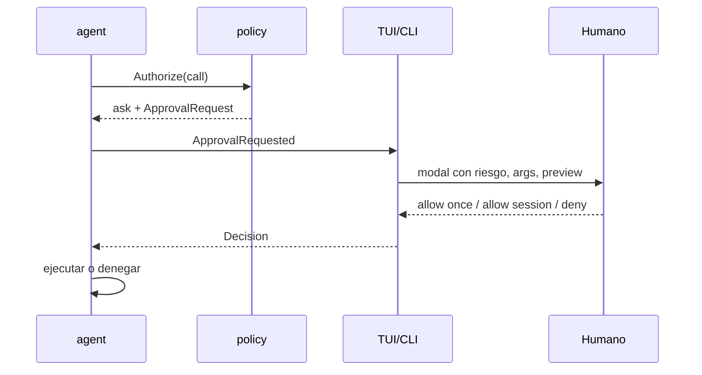

# 05 — Protocolo de herramientas (Tool Protocol v1)

> **Estado:** Especificación normativa v1.0 · **Fecha:** 2026-10-28
> **Implementación:** `internal/core`, `internal/tools`, `internal/policy`, `internal/mcpclient`
> **Compatibilidad:** LFM2.5 (Pythonic/JSON), OpenAI-compatible function calling, MCP 2026-07-28.

---

## 1. Objetivos

| ID | Objetivo |
| :--- | :--- |
| T-01 | Un contrato único para todas las tools, sin importar el proveedor |
| T-02 | Validación estricta antes de cualquier efecto secundario |
| T-03 | Riesgo explícito y aprobación humana para acciones peligrosas |
| T-04 | Resultados acotados, tipados y accionables para el modelo |
| T-05 | Auditoría completa y redactada |
| T-06 | Compatibilidad con MCP sin filtrar su modelo de confianza |
| T-07 | Versionado y evolución sin romper sesiones existentes |

**Principio:** *el modelo propone; el harness valida, autoriza, ejecuta y registra.*

---

## 2. Descriptor de herramienta

### 2.1 Estructura

```json
{
  "name": "fs_edit",
  "title": "Edit a text file",
  "description": "Replace exact text in a UTF-8 file inside the workspace. Requires the current SHA-256 of the file. Returns a unified diff.",
  "version": "1.0",
  "input_schema": {
    "$schema": "https://json-schema.org/draft/2020-12/schema",
    "type": "object",
    "properties": {
      "path": { "type": "string", "minLength": 1, "maxLength": 1024 },
      "expected_sha256": { "type": "string", "pattern": "^[a-f0-9]{64}$" },
      "edits": {
        "type": "array",
        "minItems": 1,
        "maxItems": 20,
        "items": {
          "type": "object",
          "properties": {
            "old": { "type": "string", "minLength": 1 },
            "new": { "type": "string" },
            "replace_all": { "type": "boolean", "default": false }
          },
          "required": ["old", "new"],
          "additionalProperties": false
        }
      }
    },
    "required": ["path", "expected_sha256", "edits"],
    "additionalProperties": false
  },
  "output_schema": {
    "type": "object",
    "properties": {
      "path": { "type": "string" },
      "sha256": { "type": "string" },
      "applied": { "type": "integer" },
      "diff": { "type": "string" }
    },
    "required": ["path", "sha256", "applied", "diff"]
  },
  "risk": "R1",
  "annotations": {
    "read_only": false,
    "destructive": false,
    "idempotent": true,
    "requires_workspace": true,
    "requires_network": false
  },
  "timeout_ms": 10000,
  "max_result_bytes": 32768
}
```

### 2.2 Reglas de nombres

- `snake_case`, verbo primero: `fs_read`, `rag_search`, `memory_add`.
- ≤ 48 caracteres, `[a-z][a-z0-9_]*`.
- Único globalmente; el namespace MCP usa `mcp__<server>__<tool>`.
- Estable: renombrar rompe evals y sesiones. Si es inevitable, alias + deprecación.

### 2.3 Descripción

- 1–3 frases; qué hace, qué **no** hace y límites.
- Sin markdown complejo; el modelo pequeño se distrae.
- Incluir el formato de error si es relevante.
- Mencionar unidades y defaults.
- No incluir instrucciones de seguridad (la policy no se negocia por prompt).

### 2.4 Esquema

- JSON Schema **2020-12**.
- `additionalProperties: false` siempre.
- Tipos explícitos; sin `any`.
- `enum` para valores cerrados.
- Límites `minLength`/`maxLength`, `minimum`/`maximum`.
- Máximo 2 niveles de anidación.
- `default` documentado, aplicado por el harness (no por el modelo).
- Sin `$ref` remotos; todo inline o en el mismo documento.

---

## 3. Llamada y resultado

### 3.1 Llamada canónica

```json
{
  "id": "call_01JB7Z3K9V8Q4M2N6P1R5S0T7W",
  "name": "fs_read",
  "arguments": {
    "path": "docs/notes.md",
    "offset": 0,
    "limit": 200
  }
}
```

- `id`: generado por el harness si el modelo no lo emite.
- `arguments`: JSON ya parseado y validado.
- `raw`: bloque original conservado para auditoría y debugging.

### 3.2 Resultado

```json
{
  "ok": true,
  "data": {
    "path": "docs/notes.md",
    "content": "# Notes\n...",
    "lines": 42,
    "sha256": "9f2c...",
    "next_offset": null
  },
  "meta": {
    "duration_ms": 12,
    "bytes": 4096,
    "truncated": false,
    "citations": []
  }
}
```

Reglas:

- `ok=true` ⇒ `data` conforme a `output_schema`.
- `ok=false` ⇒ `error` presente, `data` ausente.
- `meta` siempre presente.
- `truncated=true` ⇒ incluir `next_cursor` o instrucción de paginación.
- Tamaño máximo: 32 KiB por defecto, configurable por tool.

### 3.3 Error

```json
{
  "ok": false,
  "error": {
    "code": "CONFLICT",
    "message": "File changed since it was read: expected sha256 9f2c..., found 1a7b...",
    "hint": "Call fs_read again, then retry the edit with the new hash.",
    "retryable": true,
    "details": {
      "path": "docs/notes.md",
      "expected": "9f2c...",
      "actual": "1a7b..."
    }
  },
  "meta": { "duration_ms": 3, "bytes": 210, "truncated": false }
}
```

### 3.4 Catálogo de códigos

| Código | Retryable | Significado | Acción del modelo |
| :--- | :---: | :--- | :--- |
| `INVALID_ARGUMENT` | ✅ | Schema o valor inválido | Corregir args |
| `UNKNOWN_TOOL` | ❌ | Tool inexistente | Usar una listada |
| `POLICY_DENIED` | ❌ | Regla de seguridad | Pedir al usuario o abortar |
| `NOT_APPROVED` | ❌ | Humano rechazó | No reintentar igual |
| `NOT_FOUND` | ⚠️ | Path/recurso no existe | Descubrir con `fs_list` |
| `CONFLICT` | ✅ | Hash/estado desactualizado | Releer y reintentar |
| `OUTSIDE_WORKSPACE` | ❌ | Path fuera del jail | Usar ruta relativa |
| `BINARY_FILE` | ❌ | No es texto | Usar otra estrategia |
| `TOO_LARGE` | ✅ | Excede límite | Paginar |
| `TIMEOUT` | ✅ | Excedió deadline | Reducir alcance |
| `CANCELLED` | ❌ | Usuario canceló | Terminar |
| `EXEC_FAILED` | ⚠️ | Fallo de proceso | Leer stderr |
| `POSTCONDITION_FAILED` | ✅ | El efecto no se verificó | Revisar y corregir |
| `INTERNAL` | ⚠️ | Bug del harness | Reportar, no reintentar ciego |

`retryable` es una **promesa**: el harness no reintenta automáticamente una tool no idempotente,
aunque el código sea retryable; solo informa al modelo.

---

## 4. Clases de riesgo

| Clase | Definición | Ejemplos | Default policy |
| :--- | :--- | :--- | :--- |
| **R0** | Lectura pura, sin efectos | `fs_read`, `fs_list`, `fs_search`, `rag_search` | Allow |
| **R1** | Escritura local reversible | `fs_create`, `fs_edit`, `memory_add`, `rag_index` | Ask (una vez por sesión) |
| **R2** | Destrucción o sobrescritura | `fs_delete`, `fs_move --overwrite`, `fs_create --overwrite` | Ask siempre |
| **R3** | Ejecución de código | `shell_exec`, scripts | Deny por defecto; ask si se habilita |
| **R4** | Red / exfiltración potencial | `http_fetch`, `web_search` | Deny por defecto; ask con allowlist |
| **R5** | Secretos / credenciales | `secret_read`, `keyring_*` | Deny; solo tools internas |

### 4.1 Anotaciones

| Anotación | Significado |
| :--- | :--- |
| `read_only` | No muta estado |
| `destructive` | Puede perder datos |
| `idempotent` | Repetir con los mismos args da el mismo estado |
| `requires_workspace` | Necesita un workspace válido |
| `requires_network` | Puede salir a la red |
| `requires_approval` | Fuerza ask independientemente de la config |

### 4.2 Matriz de decisión

```text
if tool.annotations.requires_approval      -> ASK
if tool.risk >= R5                         -> DENY
if tool.risk == R4 && !policy.allow_network -> DENY
if tool.risk == R3 && !policy.allow_shell   -> DENY
if tool.risk == R2                         -> ASK
if tool.risk == R1 && policy.mode == "read-only" -> DENY
if tool.risk == R1 && policy.mode == "ask" -> ASK (scope=session)
if tool.risk == R0                         -> ALLOW
default                                    -> ASK
```

---

## 5. Policy engine

### 5.1 Modos

| Modo | Lectura | Escritura | Shell/Red | Uso |
| :--- | :--- | :--- | :--- | :--- |
| `read-only` | ✅ | ❌ | ❌ | Auditoría, revisión |
| `ask` (default) | ✅ | ⚠️ ask | ❌ | Uso normal |
| `allow` | ✅ | ✅ dentro del jail | ⚠️ según flags | Solo con configuración explícita |

`allow` debe imprimir una advertencia visible y quedar registrado en la auditoría. No existe un flag
para saltarse la policy, el jail ni la auditoría; `allow` solo cambia el veredicto por defecto dentro
de esos límites.

### 5.2 Reglas

```toml
# .liquidharness/policy.toml
mode = "ask"

[[rules]]
tool = "fs_read"
action = "allow"

[[rules]]
tool = "fs_*"
action = "allow"
when = "path.within_workspace"

[[rules]]
tool = "fs_delete"
action = "ask"
scope = "once"

[[rules]]
tool = "mcp__github__*"
action = "ask"
when = "tool.risk >= R1"

[[rules]]
tool = "shell_exec"
action = "deny"
```

### 5.3 Evaluación

1. Reglas específicas antes que globs.
2. `deny` gana sobre `allow`.
3. `ask` gana sobre `allow` si el riesgo es mayor.
4. Sin coincidencia → default por riesgo/modo.
5. La decisión se registra con la regla que la produjo (`rule_id`).

### 5.4 Condiciones disponibles

| Condición | Ejemplo |
| :--- | :--- |
| `path.within_workspace` | `true` |
| `path.glob` | `docs/**` |
| `tool.risk` | `>= R2` |
| `session.mode` | `interactive` |
| `call.args.size` | `< 1MiB` |
| `mcp.server` | `github` |

No se admiten condiciones que dependan del contenido generado por el modelo (sería circular).

---

## 6. Aprobaciones

### 6.1 Flujo



### 6.2 Contenido del modal

- Tool y resumen de la acción en lenguaje natural.
- Path(s) afectados y si están dentro del workspace.
- Diff/preview para escrituras.
- Riesgo (R1/R2/…) con color y glifo.
- Alcance: **una vez**, **esta sesión**, **este workspace** (solo si la config lo permite).
- Botones/teclas: `a` allow once, `s` allow session, `d` deny, `Esc` deny.
- Timeout: 5 min → deny (no auto-allow).

### 6.3 Headless

- Sin TTY: `--yes` permite solo R1; R2+ requiere `--allow-risk=R2` explícito.
- Sin flags: deny con código 3.
- En CI, la policy se declara en `.liquidharness/policy.toml` versionado.

### 6.4 Persistencia

```sql
INSERT INTO approvals (id, session_id, tool_call_id, decision, scope, reason, created_at)
VALUES (?, ?, ?, 'allow', 'session', 'user approved fs_edit', ?);
```

- `scope=session` se guarda en memoria y se invalida al cambiar de workspace.
- `scope=workspace` requiere confirmación adicional y se escribe en config.
- Nunca se auto-aprueba R3/R4 por scope.

---

## 7. Workspace jail

### 7.1 Algoritmo

```go
func (j *Jail) Resolve(requested string) (string, error) {
	if requested == "" {
		return "", ErrEmptyPath
	}
	if strings.ContainsRune(requested, 0) {
		return "", ErrInvalidPath
	}
	// 1. Absoluto o relativo al root.
	p := requested
	if !filepath.IsAbs(p) {
		p = filepath.Join(j.root, p)
	}
	// 2. Limpiar y resolver symlinks del padre existente.
	p = filepath.Clean(p)
	parent := filepath.Dir(p)
	resolvedParent, err := filepath.EvalSymlinks(parent)
	if err != nil && !errors.Is(err, fs.ErrNotExist) {
		return "", fmt.Errorf("resolve parent: %w", err)
	}
	if resolvedParent != "" {
		p = filepath.Join(resolvedParent, filepath.Base(p))
	}
	// 3. Comprobar prefijo con separador.
	rel, err := filepath.Rel(j.root, p)
	if err != nil || rel == ".." || strings.HasPrefix(rel, ".."+string(filepath.Separator)) {
		return "", ErrOutsideWorkspace
	}
	// 4. Rechazar dispositivos, UNC y ADS en Windows.
	if err := validatePlatformPath(p); err != nil {
		return "", err
	}
	return p, nil
}
```

### 7.2 Casos adversariales

| Ataque | Resultado esperado |
| :--- | :--- |
| `../../etc/passwd` | `OUTSIDE_WORKSPACE` |
| `/etc/passwd` | `OUTSIDE_WORKSPACE` |
| Symlink a `/etc` | `OUTSIDE_WORKSPACE` |
| `docs/../..` | `OUTSIDE_WORKSPACE` |
| `C:\Windows\System32` (Windows) | `OUTSIDE_WORKSPACE` |
| `\\server\share` (UNC) | `OUTSIDE_WORKSPACE` |
| `file.txt:stream` (ADS) | `OUTSIDE_WORKSPACE` |
| `Docs/Notes.md` en Windows | Resuelve case-insensitive correctamente |
| Path con NUL | `INVALID_PATH` |
| Path > 1024 chars | `INVALID_ARGUMENT` |
| Symlink dentro del workspace | Permitido si el destino sigue dentro |
| Hard link a fuera | Detectado por `EvalSymlinks` del destino si aplica |

### 7.3 TOCTOU

- Para escrituras: abrir con `O_NOFOLLOW` cuando esté disponible; en Windows, revalidar tras abrir.
- Para ediciones: hash de precondición + relectura post-escritura.
- Para borrados: mover a trash atómico dentro del workspace.

---

## 8. Catálogo de tools v1

### 8.1 `fs_read` — R0

| Campo | Tipo | Notas |
| :--- | :--- | :--- |
| `path` | string | Relativo al workspace |
| `offset` | integer | Línea inicial (0-based) |
| `limit` | integer | 1–2000, default 500 |
| `max_bytes` | integer | Default 262144 |

Devuelve `content`, `lines`, `sha256`, `truncated`, `next_offset`, `encoding`.
Errores: `NOT_FOUND`, `BINARY_FILE`, `TOO_LARGE`, `OUTSIDE_WORKSPACE`.

### 8.2 `fs_list` — R0

| Campo | Tipo | Notas |
| :--- | :--- | :--- |
| `path` | string | Default `.` |
| `depth` | integer | 1–3, default 1 |
| `glob` | string | Opcional, `**/*.md` |
| `include_hidden` | boolean | Default false |
| `limit` | integer | Default 200 |

Devuelve entradas con `name`, `path`, `type` (`file`/`dir`/`symlink`), `size`, `mtime`.
Ignora `.git`, `node_modules`, `vendor`, `.liquidharness/trash` por defecto.

### 8.3 `fs_search` — R0

| Campo | Tipo | Notas |
| :--- | :--- | :--- |
| `query` | string | Texto o regex |
| `path` | string | Default `.` |
| `glob` | string | Filtro de archivos |
| `regex` | boolean | Default false |
| `case_sensitive` | boolean | Default false |
| `max_results` | integer | Default 50, máx. 200 |
| `context_lines` | integer | 0–3 |

Devuelve `matches[]` con `path`, `line`, `column`, `text`, `context`.
Errores: `INVALID_ARGUMENT` (regex inválida), `TOO_LARGE`.

### 8.4 `fs_create` — R1

| Campo | Tipo | Notas |
| :--- | :--- | :--- |
| `path` | string | Debe estar dentro |
| `content` | string | ≤ 1 MiB |
| `overwrite` | boolean | Default false; si true → R2 |
| `create_dirs` | boolean | Default true |

Devuelve `path`, `bytes`, `sha256`, `created`.
Errores: `CONFLICT` si existe y `overwrite=false`, `TOO_LARGE`, `OUTSIDE_WORKSPACE`.

### 8.5 `fs_edit` — R1

| Campo | Tipo | Notas |
| :--- | :--- | :--- |
| `path` | string | Dentro del workspace |
| `expected_sha256` | string | **Obligatorio** |
| `edits[]` | array | `old`, `new`, `replace_all` |

Semántica:

1. Leer archivo; comparar SHA-256; si no coincide → `CONFLICT`.
2. Para cada edit: localizar `old`.
   - 0 coincidencias → `NOT_FOUND` (con contexto).
   - > 1 y `replace_all=false` → `CONFLICT` (ambiguo).
   - > 1 y `replace_all=true` → reemplazar todas.
3. Aplicar en orden, sobre el buffer en memoria.
4. Escribir atómicamente (temp + rename).
5. Releer y verificar.
6. Devolver diff unificado + nuevo hash.

Límites: 20 edits, 1 MiB, `old` ≤ 64 KiB.

### 8.6 `fs_delete` — R2

| Campo | Tipo | Notas |
| :--- | :--- | :--- |
| `path` | string | Dentro del workspace |
| `recursive` | boolean | Default false |
| `permanent` | boolean | Default false |

Default: mover a `.liquidharness/trash/<timestamp>/<path>` (recuperable).
`permanent=true` requiere aprobación R2 y confirmación adicional.
Devuelve `trashed_to` o `deleted`.

### 8.7 `fs_move` — R1/R2

| Campo | Tipo | Notas |
| :--- | :--- | :--- |
| `from` | string | Dentro |
| `to` | string | Dentro |
| `overwrite` | boolean | Default false; true → R2 |

### 8.8 `rag_search` — R0

| Campo | Tipo | Notas |
| :--- | :--- | :--- |
| `query` | string | Consulta |
| `path_glob` | string | Filtro |
| `top_k` | integer | Default 6, máx. 20 |
| `max_tokens` | integer | Default 3000 |

Devuelve `chunks[]` con `content`, `citation{path,start_line,end_line,heading}`, `score`.
Si no hay índice → `NOT_FOUND` con hint para `rag index`.

### 8.9 `memory_add` — R1

| Campo | Tipo | Notas |
| :--- | :--- | :--- |
| `key` | string | ≤ 128 |
| `value` | string | ≤ 4 KiB |
| `kind` | enum | `preference`, `fact`, `correction`, `decision` |
| `confidence` | number | 0–1 |
| `dedupe_key` | string | Opcional |

### 8.10 `memory_search` — R0

| Campo | Tipo | Notas |
| :--- | :--- | :--- |
| `query` | string | Texto |
| `namespace` | string | Opcional |
| `top_k` | integer | Default 5 |

### 8.11 `memory_forget` — R2

| Campo | Tipo | Notas |
| :--- | :--- | :--- |
| `id` | string | O `key` + `namespace` |
| `all` | boolean | Requiere confirmación |

### 8.12 `todo_write` — R0

| Campo | Tipo | Notas |
| :--- | :--- | :--- |
| `items[]` | array | `text`, `status` (`pending`/`in_progress`/`done`) |

No muta el FS; actualiza el estado de la sesión y la UI.

### 8.13 `ask_user` — R0

| Campo | Tipo | Notas |
| :--- | :--- | :--- |
| `question` | string | ≤ 500 |
| `options[]` | array | 2–5 opciones |

En headless: `UNSUPPORTED` salvo `--non-interactive=default`.

### 8.14 `shell_exec` — R3 (opt-in)

| Campo | Tipo | Notas |
| :--- | :--- | :--- |
| `argv[]` | array | **Sin shell**; ejecutable + args |
| `cwd` | string | Dentro del workspace |
| `timeout_ms` | integer | Default 10000, máx. 120000 |
| `env` | object | Solo allowlist |

Reglas:

- `argv[0]` debe estar en allowlist (`git`, `go`, `node`, `python`, `rg`, …).
- Sin `sh -c`, `cmd /c`, `powershell -Command`.
- `env` limpio; sin heredar secretos.
- stdout/stderr truncados a 32 KiB.
- Exit code ≠ 0 → `EXEC_FAILED` con stderr.
- Deshabilitado por defecto.

### 8.15 `http_fetch` — R4 (opt-in)

| Campo | Tipo | Notas |
| :--- | :--- | :--- |
| `url` | string | http/https |
| `max_bytes` | integer | Default 262144 |

- Bloquear IPs privadas/loopback/link-local (SSRF).
- Resolver DNS una vez y conectar a la IP validada (evitar rebinding).
- Sin redirects a dominios no allowlisted.
- Content-Type permitido: `text/*`, `application/json`, `application/xml`.
- Deshabilitado por defecto.

---

## 9. Mapeo al modelo

### 9.1 Formato OpenAI / LFM (JSON)

```json
{
  "type": "function",
  "function": {
    "name": "fs_read",
    "description": "...",
    "parameters": { "...": "..." }
  }
}
```

El adaptador elimina `title`, `risk`, `annotations`, `timeout_ms` (no son parte del contrato del
modelo) y conserva `name`, `description`, `parameters`.

### 9.2 LFM2.5

- System prompt: `List of tools: [ ... ]` + `Output function calls as JSON.`
- Respuesta: `<|tool_call_start|>[{"name":"fs_read","arguments":{...}}]<|tool_call_end|>`.
- Fallback: Pythonic `[fs_read(path="x")]`.
- Resultado: rol `tool` con JSON del envelope.

### 9.3 Parser

```text
parse(raw):
  if contains TOOL_CALL_START:
     block = between markers
     if json.Unmarshal(block) ok -> normalize
     if pythonic.Parse(block) ok -> normalize
     return ParseError{raw: block}
  if fenced ```json block with "name" -> try
  return NoToolCalls
```

Reglas:

- Máximo 8 llamadas por respuesta.
- Si una llamada falla el parseo, **no** ejecutar las demás; devolver error global con el bloque.
- Preservar `raw` para auditoría.
- Aceptar `arguments` como objeto o string JSON (algunos backends lo serializan dos veces).
- Rechazar `arguments` que no sea objeto.

### 9.4 Streaming

- Acumular por `index` del delta.
- El nombre puede llegar antes que los argumentos.
- No ejecutar hasta `finish_reason == "tool_calls"` o bloque completo.
- Si el stream se corta, descartar llamadas incompletas y reportar `MODEL_STREAM_TRUNCATED`.

---

## 10. MCP

### 10.1 Cliente

| Aspecto | Regla |
| :--- | :--- |
| Transporte | `stdio` o Streamable HTTP loopback |
| Namespace | `mcp__<server>__<tool>` |
| Descubrimiento | Al conectar + `list_changed` |
| Timeout | 10 s descubrir, 60 s ejecutar |
| Resultados | Mapear `content[]` a `data`; `isError` → `ok=false` |
| Riesgo | Mínimo R1; R2+ si la tool declara escritura |
| Aprobación | Obligatoria para cualquier tool MCP que no sea read-only |
| Confianza | El servidor y sus descripciones son **no confiables** |
| Límites | ≤ 64 tools por servidor, ≤ 32 KiB por resultado |

### 10.2 Tool poisoning

Un servidor MCP puede incluir instrucciones maliciosas en la descripción de una tool. Mitigaciones:

- Mostrar la descripción original al usuario en la aprobación.
- No concatenar descripciones MCP al system prompt sin sanitizar.
- Detectar patrones de instrucción ("ignore previous", "call this tool", URLs) y marcarlos.
- Allowlist de servidores y tools.
- Re-aprobar si cambia el hash de la descripción.

### 10.3 Servidor MCP de LiquidHarness

`liquidharness serve --mcp` expone:

| Tool | Riesgo | Descripción |
| :--- | :--- | :--- |
| `lh_run` | R1 | Ejecuta una tarea con presupuesto |
| `lh_search` | R0 | Busca en el índice RAG |
| `lh_memory_search` | R0 | Consulta memoria |
| `lh_memory_add` | R1 | Añade memoria |
| `lh_session_info` | R0 | Estado de sesión |

- Token efímero en `~/.liquidharness/mcp-token` (0600).
- Solo loopback por defecto.
- Sin `shell_exec` ni `fs_delete` expuestas.
- Rate limit por sesión.

---

## 11. Auditoría

Cada ejecución produce un registro:

```json
{
  "ts": "2026-10-28T12:00:00.123Z",
  "session_id": "01J...",
  "turn_id": "01J...",
  "call_id": "01J...",
  "tool": "fs_edit",
  "risk": "R1",
  "args_hash": "sha256:...",
  "args_redacted": {"path": "docs/notes.md", "edits": 2},
  "decision": "allow",
  "rule_id": "rule-fs-edit",
  "approved_by": "user",
  "approval_scope": "session",
  "result": "ok",
  "duration_ms": 12,
  "bytes_out": 345,
  "error_code": null
}
```

- `args_hash` permite correlacionar sin guardar contenido sensible.
- `args_redacted` es un resumen estructural.
- Retención configurable (default 90 días).
- Export JSONL para SIEM.

---

## 12. Versionado

- `ToolDescriptor.version` semver.
- Cambios incompatibles: nuevo nombre o `version` mayor + periodo de alias.
- El dataset de evals referencia la versión.
- Las sesiones guardan la versión usada; al reanudar, si la tool cambió, se avisa.
- MCP: negociación de protocolo; si el servidor no soporta la versión, fallar cerrado.

---

## 13. Vectores de prueba (obligatorios)

| ID | Caso | Esperado |
| :--- | :--- | :--- |
| TV-01 | `fs_read` de archivo válido | `ok=true`, sha256 correcto |
| TV-02 | `fs_read` binario | `BINARY_FILE` |
| TV-03 | `fs_read` con `limit=0` | `INVALID_ARGUMENT` |
| TV-04 | `fs_read` `../../etc/passwd` | `OUTSIDE_WORKSPACE` |
| TV-05 | `fs_edit` sin hash | `INVALID_ARGUMENT` |
| TV-06 | `fs_edit` hash incorrecto | `CONFLICT` |
| TV-07 | `fs_edit` `old` ambiguo | `CONFLICT` |
| TV-08 | `fs_edit` `old` inexistente | `NOT_FOUND` |
| TV-09 | `fs_create` existente sin overwrite | `CONFLICT` |
| TV-10 | `fs_delete` recursivo sin flag | `INVALID_ARGUMENT` |
| TV-11 | `fs_delete` con aprobación | trash + recuperable |
| TV-12 | Tool call JSON malformado | `INVALID_ARGUMENT` con raw |
| TV-13 | Tool call Pythonic | parsea y ejecuta |
| TV-14 | Tool inexistente | `UNKNOWN_TOOL` + lista |
| TV-15 | Resultado > 32 KiB | `truncated=true` + cursor |
| TV-16 | `shell_exec` con `sh -c` | `POLICY_DENIED` |
| TV-17 | `http_fetch` a `127.0.0.1` | `POLICY_DENIED` (SSRF) |
| TV-18 | MCP tool con descripción maliciosa | marcada + ask |
| TV-19 | Cancelación durante tool | `CANCELLED`, sin efectos parciales |
| TV-20 | Repetición idéntica 3× | warning; 4× → stop |

---

## 14. Referencias

1. JSON Schema 2020-12:
   <https://json-schema.org/draft/2020-12/schema>
2. OpenAI function calling:
   <https://platform.openai.com/docs/guides/function-calling>
3. MCP Tools (2026-07-28):
   <https://modelcontextprotocol.io/specification/2026-07-28/server/tools>
4. MCP Go SDK:
   <https://github.com/modelcontextprotocol/go-sdk>
5. LFM2.5 Tool Use:
   <https://docs.liquid.ai/lfm/key-concepts/tool-use>
6. OWASP LLM Top 10:
   <https://genai.owasp.org/llm-top-10/>
