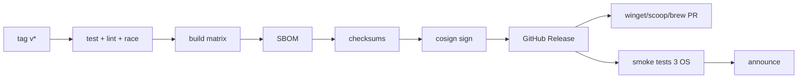
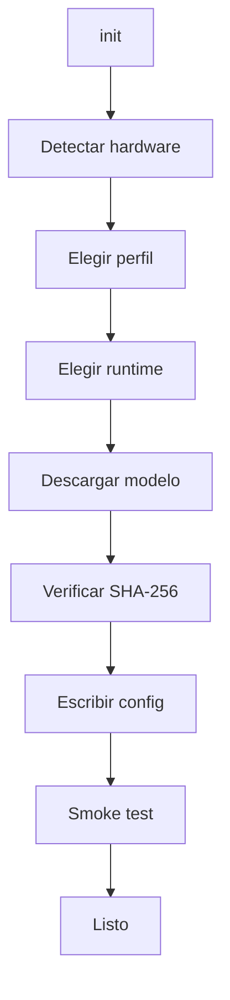

# 07 — Instalador, distribución y ciclo de vida

> **Estado:** Especificación v1.0 · **Fecha:** 2026-10-28
> **Objetivo:** que un usuario pase de cero a un agente funcionando en **< 5 minutos** (sin contar la
> descarga del modelo), en Windows, macOS y Linux, sin privilegios de administrador y con
> verificación criptográfica.

---

## 1. Principios

| ID | Principio | Implementación |
| :--- | :--- | :--- |
| I-01 | **Una orden** | Script de una línea o gestor de paquetes |
| I-02 | **Sin admin** | Instalación en el HOME del usuario por defecto |
| I-03 | **Verificable** | SHA-256 + firma cosign + SBOM |
| I-04 | **Reversible** | `uninstall` + `--purge` explícito |
| I-05 | **Idempotente** | Reinstalar no rompe; actualizar preserva datos |
| I-06 | **Offline-ready** | Instalación desde archivo + modelo local |
| I-07 | **Sin sorpresas** | No modifica PATH sin avisar; no telemetría por defecto |
| I-08 | **Fallar claro** | Cada error dice qué pasó y qué hacer |

---

## 2. Matriz de plataformas y artefactos

| Plataforma | Arquitectura | Artefacto | Instalación recomendada |
| :--- | :--- | :--- | :--- |
| Windows 10/11 | amd64 | `liquidharness_<v>_windows_amd64.zip` | Winget / Scoop / PowerShell |
| Windows 10/11 | arm64 | `..._windows_arm64.zip` | PowerShell |
| macOS 13+ | amd64 | `..._darwin_amd64.tar.gz` | Homebrew / script |
| macOS 13+ | arm64 | `..._darwin_arm64.tar.gz` | Homebrew / script |
| Linux | amd64 | `..._linux_amd64.tar.gz` | Script / deb / rpm |
| Linux | arm64 | `..._linux_arm64.tar.gz` | Script |
| Docker | amd64/arm64 | `ghcr.io/liquidharness/liquidharness:<v>` | `docker run` |

### 2.1 Sabores del binario

| Sabor | Build | Tamaño | Runtime | Uso |
| :--- | :--- | ---: | :--- | :--- |
| **`liquidharness`** | `CGO_ENABLED=0` | ~20–30 MB | HTTP a `llama-server` | **Default** |
| `liquidharness-embedded` | CGO + llama.cpp | ~80–150 MB | In-process | Un solo proceso, power users |
| `liquidharness-headless` | `CGO_ENABLED=0` | ~20 MB | HTTP | CI/contenedores (sin TUI) |

El instalador descarga el sabor estándar salvo `--embedded`.

### 2.2 Nombres y checksums

```text
dist/
├── liquidharness_1.0.0_windows_amd64.zip
├── liquidharness_1.0.0_windows_arm64.zip
├── liquidharness_1.0.0_darwin_amd64.tar.gz
├── liquidharness_1.0.0_darwin_arm64.tar.gz
├── liquidharness_1.0.0_linux_amd64.tar.gz
├── liquidharness_1.0.0_linux_arm64.tar.gz
├── checksums.txt
├── checksums.txt.sig
├── liquidharness_1.0.0_sbom.spdx.json
└── liquidharness_1.0.0_metadata.json
```

`checksums.txt`:

```text
9f2c...  liquidharness_1.0.0_windows_amd64.zip
1a7b...  liquidharness_1.0.0_darwin_arm64.tar.gz
...
```

---

## 3. Build reproducible

### 3.1 Comando

```bash
VERSION=$(git describe --tags --always --dirty)
COMMIT=$(git rev-parse --short HEAD)
DATE=$(date -u +%Y-%m-%dT%H:%M:%SZ)

CGO_ENABLED=0 GOOS=windows GOARCH=amd64 go build \
  -trimpath \
  -buildvcs=true \
  -ldflags "-s -w \
    -X github.com/liquidharness/liquidharness/internal/version.Version=${VERSION} \
    -X github.com/liquidharness/liquidharness/internal/version.Commit=${COMMIT} \
    -X github.com/liquidharness/liquidharness/internal/version.Date=${DATE}" \
  -o dist/liquidharness.exe ./cmd/liquidharness
```

### 3.2 GoReleaser

```yaml
# .goreleaser.yaml (extracto)
version: 2

project_name: liquidharness

before:
  hooks:
    - go mod verify
    - go test ./...

builds:
  - id: liquidharness
    main: ./cmd/liquidharness
    binary: liquidharness
    env: [CGO_ENABLED=0]
    flags: [-trimpath]
    ldflags:
      - -s -w
      - -X github.com/liquidharness/liquidharness/internal/version.Version={{.Version}}
      - -X github.com/liquidharness/liquidharness/internal/version.Commit={{.Commit}}
      - -X github.com/liquidharness/liquidharness/internal/version.Date={{.Date}}
    goos: [windows, darwin, linux]
    goarch: [amd64, arm64]

archives:
  - id: default
    formats: [tar.gz]
    format_overrides:
      - goos: windows
        formats: [zip]
    name_template: >-
      {{ .ProjectName }}_{{ .Version }}_{{ .Os }}_{{ .Arch }}

checksum:
  name_template: checksums.txt

sboms:
  - artifacts: archive

signs:
  - cmd: cosign
    signature: "${artifact}.sig"
    args: ["sign-blob", "--yes", "--output-signature=${signature}", "${artifact}"]
    artifacts: checksum

brews:
  - repository:
      owner: liquidharness
      name: homebrew-tap
    homepage: https://liquidharness.dev
    description: Local-first agent harness for LFM2.5
    license: Apache-2.0
    install: |
      bin.install "liquidharness"
      generate_completions_from_executable(bin/"liquidharness", "completion")

scoops:
  - repository:
      owner: liquidharness
      name: scoop-bucket
    homepage: https://liquidharness.dev
    description: Local-first agent harness for LFM2.5
    license: Apache-2.0

winget:
  - publisher: LiquidHarness
    package_identifier: LiquidHarness.LiquidHarness
    short_description: Local-first agent harness for LFM2.5
    license: Apache-2.0
    publisher_url: https://liquidharness.dev
```

### 3.3 CI de release



Reglas:

- Un tag `v*` dispara el workflow.
- No se publica si falla un test, lint, `govulncheck` o el smoke test.
- Los artefactos se firman con OIDC keyless (sin claves de larga vida).
- El release es **inmutable**: si hay un bug, se publica una versión nueva.

---

## 4. Instalación en Windows

### 4.1 Winget

```powershell
winget install LiquidHarness.LiquidHarness
```

- Manifiesto generado por GoReleaser y enviado a `microsoft/winget-pkgs`.
- Instala en `%LOCALAPPDATA%\Programs\LiquidHarness`.
- Añade al PATH de usuario (no de sistema).
- `winget upgrade` y `winget uninstall` funcionan.

### 4.2 Scoop

```powershell
scoop bucket add liquidharness https://github.com/liquidharness/scoop-bucket
scoop install liquidharness
```

### 4.3 PowerShell (sin admin)

```powershell
irm https://get.liquidharness.dev/install.ps1 | iex
```

Con parámetros:

```powershell
& ([scriptblock]::Create((irm https://get.liquidharness.dev/install.ps1))) `
  -Version 1.0.0 `
  -Prefix "$env:LOCALAPPDATA\Programs\LiquidHarness" `
  -NoPath
```

### 4.4 Script `install.ps1` (diseño)

```powershell
#Requires -Version 5.1
[CmdletBinding()]
param(
    [string]$Version = "latest",
    [string]$Prefix  = "$env:LOCALAPPDATA\Programs\LiquidHarness",
    [switch]$NoPath,
    [switch]$DryRun,
    [switch]$Embedded
)

$ErrorActionPreference = "Stop"
[Net.ServicePointManager]::SecurityProtocol = [Net.SecurityProtocolType]::Tls12

function Get-Arch {
    switch ($env:PROCESSOR_ARCHITECTURE) {
        "AMD64" { "amd64" }
        "ARM64" { "arm64" }
        default { throw "Unsupported architecture: $env:PROCESSOR_ARCHITECTURE" }
    }
}

function Resolve-Version($v) {
    if ($v -ne "latest") { return $v }
    $r = Invoke-RestMethod "https://api.github.com/repos/liquidharness/liquidharness/releases/latest"
    return $r.tag_name.TrimStart("v")
}

$arch = Get-Arch
$ver  = Resolve-Version $Version
$asset = "liquidharness_${ver}_windows_${arch}.zip"
$base  = "https://github.com/liquidharness/liquidharness/releases/download/v${ver}"
$tmp   = Join-Path $env:TEMP "liquidharness-$([guid]::NewGuid())"

if ($DryRun) {
    Write-Host "Would install $asset to $Prefix"
    return
}

New-Item -ItemType Directory -Force -Path $tmp, $Prefix | Out-Null

try {
    Write-Host "Downloading $asset..."
    Invoke-WebRequest "$base/$asset" -OutFile "$tmp\$asset" -UseBasicParsing
    Invoke-WebRequest "$base/checksums.txt" -OutFile "$tmp\checksums.txt" -UseBasicParsing

    $expected = (Get-Content "$tmp\checksums.txt" |
        Where-Object { $_ -match [regex]::Escape($asset) } |
        ForEach-Object { ($_ -split '\s+')[0] })
    if (-not $expected) { throw "Checksum not found for $asset" }

    $actual = (Get-FileHash "$tmp\$asset" -Algorithm SHA256).Hash.ToLower()
    if ($actual -ne $expected.ToLower()) {
        throw "Checksum mismatch: expected $expected, got $actual"
    }

    Expand-Archive "$tmp\$asset" -DestinationPath $tmp -Force
    $exe = Get-ChildItem $tmp -Filter "liquidharness.exe" -Recurse | Select-Object -First 1
    if (-not $exe) { throw "liquidharness.exe not found in archive" }

    $target = Join-Path $Prefix "liquidharness.exe"
    Copy-Item $exe.FullName $target -Force
    Unblock-File $target

    if (-not $NoPath) {
        $userPath = [Environment]::GetEnvironmentVariable("Path", "User")
        if ($userPath -notlike "*$Prefix*") {
            [Environment]::SetEnvironmentVariable("Path", "$userPath;$Prefix", "User")
            Write-Host "Added $Prefix to your user PATH. Restart your terminal."
        }
    }

    & $target version
    Write-Host "`nInstalled LiquidHarness $ver to $Prefix"
    Write-Host "Next: liquidharness init"
}
finally {
    Remove-Item $tmp -Recurse -Force -ErrorAction SilentlyContinue
}
```

Notas de seguridad:

- TLS 1.2+ explícito.
- Checksum obligatorio; si falla, aborta.
- No requiere admin.
- No ejecuta el binario con privilegios elevados.
- `Unblock-File` evita el bloqueo de Mark-of-the-Web.
- Firma Authenticode verificada por SmartScreen/AppLocker (ver §9).

### 4.5 MSI/NSIS (opcional)

Para despliegues corporativos:

- MSI por usuario, sin admin, con `ALLUSERS=0`.
- NSIS vía GoReleaser (`nsis`) para un instalador gráfico.
- No es el camino principal; complica el mantenimiento.

---

## 5. Instalación en macOS

### 5.1 Homebrew

```bash
brew install liquidharness/tap/liquidharness
```

### 5.2 Script

```bash
curl -fsSL https://get.liquidharness.dev | sh
```

### 5.3 `install.sh` (diseño)

```bash
#!/usr/bin/env sh
set -eu

VERSION="${LIQUIDHARNESS_VERSION:-latest}"
PREFIX="${LIQUIDHARNESS_PREFIX:-$HOME/.local/bin}"
DRY_RUN=0
NO_PATH=0

usage() {
  cat <<'EOF'
Install LiquidHarness.

Usage: install.sh [options]

Options:
  --version <v>   Install a specific version (default: latest)
  --prefix <dir>  Install directory (default: ~/.local/bin)
  --no-path       Do not modify shell profile
  --dry-run       Print actions without installing
  -h, --help      Show this help
EOF
}

while [ $# -gt 0 ]; do
  case "$1" in
    --version) VERSION="$2"; shift 2 ;;
    --prefix)  PREFIX="$2"; shift 2 ;;
    --no-path) NO_PATH=1; shift ;;
    --dry-run) DRY_RUN=1; shift ;;
    -h|--help) usage; exit 0 ;;
    *) echo "unknown option: $1" >&2; usage; exit 2 ;;
  esac
done

need() { command -v "$1" >/dev/null 2>&1 || { echo "missing: $1" >&2; exit 1; }; }
need curl
need tar
need uname

os="$(uname -s | tr '[:upper:]' '[:lower:]')"
case "$os" in
  linux)  os="linux" ;;
  darwin) os="darwin" ;;
  *) echo "unsupported OS: $os" >&2; exit 1 ;;
esac

arch="$(uname -m)"
case "$arch" in
  x86_64|amd64) arch="amd64" ;;
  arm64|aarch64) arch="arm64" ;;
  *) echo "unsupported arch: $arch" >&2; exit 1 ;;
esac

if [ "$VERSION" = "latest" ]; then
  VERSION="$(curl -fsSL https://api.github.com/repos/liquidharness/liquidharness/releases/latest \
    | sed -n 's/.*"tag_name": *"v\([^"]*\)".*/\1/p' | head -n1)"
  [ -n "$VERSION" ] || { echo "cannot resolve latest version" >&2; exit 1; }
fi

asset="liquidharness_${VERSION}_${os}_${arch}.tar.gz"
base="https://github.com/liquidharness/liquidharness/releases/download/v${VERSION}"
tmp="$(mktemp -d)"
trap 'rm -rf "$tmp"' EXIT INT TERM

echo "Installing LiquidHarness ${VERSION} (${os}/${arch})"
if [ "$DRY_RUN" -eq 1 ]; then
  echo "Would download ${base}/${asset} to ${PREFIX}"
  exit 0
fi

curl -fsSL "${base}/${asset}" -o "${tmp}/${asset}"
curl -fsSL "${base}/checksums.txt" -o "${tmp}/checksums.txt"

expected="$(grep " ${asset}\$" "${tmp}/checksums.txt" | awk '{print $1}')"
[ -n "$expected" ] || { echo "checksum not found for ${asset}" >&2; exit 1; }

if command -v sha256sum >/dev/null 2>&1; then
  actual="$(sha256sum "${tmp}/${asset}" | awk '{print $1}')"
else
  actual="$(shasum -a 256 "${tmp}/${asset}" | awk '{print $1}')"
fi
[ "$actual" = "$expected" ] || { echo "checksum mismatch" >&2; exit 1; }

if command -v cosign >/dev/null 2>&1; then
  curl -fsSL "${base}/checksums.txt.sig" -o "${tmp}/checksums.txt.sig"
  cosign verify-blob --signature "${tmp}/checksums.txt.sig" "${tmp}/checksums.txt" \
    || { echo "signature verification failed" >&2; exit 1; }
fi

tar -xzf "${tmp}/${asset}" -C "$tmp"
mkdir -p "$PREFIX"
install -m 0755 "${tmp}/liquidharness" "${PREFIX}/liquidharness"

if [ "$NO_PATH" -eq 0 ]; then
  case ":$PATH:" in
    *":$PREFIX:"*) ;;
    *)
      for rc in "$HOME/.profile" "$HOME/.bashrc" "$HOME/.zshrc"; do
        [ -f "$rc" ] || continue
        grep -q 'liquidharness PATH' "$rc" 2>/dev/null && continue
        printf '\n# liquidharness PATH\nexport PATH="%s:$PATH"\n' "$PREFIX" >> "$rc"
        echo "Updated $rc"
      done
      ;;
  esac
fi

"$PREFIX/liquidharness" version
echo "Installed to $PREFIX. Next: liquidharness init"
```

### 5.4 Notarización

- Binario firmado con Developer ID Application.
- `notarytool submit --wait` + `stapler staple`.
- Sin notarización, Gatekeeper bloquea en macOS 13+.

---

## 6. Instalación en Linux

### 6.1 Script

```bash
curl -fsSL https://get.liquidharness.dev | sh
```

- Instala en `~/.local/bin`.
- No usa `sudo`.
- Si `~/.local/bin` no está en PATH, imprime la línea exacta a añadir.
- Detecta musl vs glibc (aunque el binario es estático, por si acaso).

### 6.2 Paquetes

| Formato | Herramienta | Estado |
| :--- | :--- | :--- |
| `.deb` | nfpm | v1.1 |
| `.rpm` | nfpm | v1.1 |
| AUR | PKGBUILD | post-1.0 |
| Snap/Flatpak | — | No (binario CLI) |

### 6.3 Docker

```bash
docker run --rm -it \
  -v "$PWD:/workspace" \
  -v "$HOME/.local/share/liquidharness:/data" \
  -p 127.0.0.1:8787:8787 \
  ghcr.io/liquidharness/liquidharness:1.0.0
```

- Imagen distroless/no-root.
- El modelo se monta o se descarga a un volumen.
- No se expone a `0.0.0.0` por defecto.

---

## 7. Primera ejecución: `liquidharness init`

### 7.1 Flujo



### 7.2 Detección

| Dato | Fuente | Uso |
| :--- | :--- | :--- |
| SO/arch | `runtime.GOOS/GOARCH` | Artefacto |
| RAM | `gopsutil` o APIs nativas | Perfil |
| CPU cores | `runtime.NumCPU()` | Contexto/paralelismo |
| GPU | Detección best-effort (Metal/CUDA/Vulkan) | Aceleración |
| Disco | `statfs` | Espacio para modelo |
| Runtime existente | `GET /health` en 8080/8000/1234 | Reutilizar |
| `llama-server` | PATH | Runtime gestionado |

### 7.3 Perfiles

| Perfil | Modelo | Cuantización | Contexto | RAM aprox. | Uso |
| :--- | :--- | :--- | ---: | ---: | :--- |
| `fast` | LFM2.5-2.6B | Q4_K_M | 16K | ~2.2 GB | 8 GB RAM |
| **`balanced`** | LFM2.5-2.6B | Q5_K_M | 32K | ~3.0 GB | 16 GB RAM |
| `quality` | LFM2.5-8B-A1B | Q4_K_M | 32K | ~6.5 GB | 24 GB RAM |
| `max` | LFM2.5-24B-A2B | Q4_K_M | 32K | ~16 GB | 32 GB+ |
| `remote` | Configurable | — | — | — | Servidor existente |

Los valores son estimaciones; el wizard muestra el cálculo y permite override.

### 7.4 Runtime

| Opción | Cuándo | Acción |
| :--- | :--- | :--- |
| **Gestionado** | No hay endpoint sano | Descargar `llama-server` + modelo, arrancar |
| **Existente** | `GET /health` OK | Guardar URL y modelo |
| **Embebido** | Sabor `-embedded` | Cargar en proceso |
| **Remoto** | Usuario lo pide | Guardar URL + API key en keyring |

### 7.5 Smoke test

```text
1. health check del runtime
2. /v1/models → modelo presente
3. chat "Reply with OK" → respuesta no vacía
4. tool call de prueba (fs_list en un temp dir) → resultado válido
5. escribir/leer config
6. medir latencia y mostrar
```

Si falla, el wizard explica y ofrece:

- reintentar,
- cambiar de perfil,
- abrir `doctor`,
- modo offline con instrucciones.

### 7.6 Config generada

```toml
# ~/.config/liquidharness/config.toml
config_version = 1

[general]
profile = "balanced"
workspace = "."
language = "en"

[model]
provider = "openai-compatible"
base_url = "http://127.0.0.1:8080/v1"
name = "LFM2.5-2.6B"
context_window = 32768
max_output_tokens = 2048

[agent]
max_steps = 24
max_tool_calls = 32

[policy]
mode = "ask"
allow_shell = false
allow_network = false

[ui]
theme = "liquid-dark"
```

Permisos: `0600` en Unix; ACL de usuario en Windows.

---

## 8. Gestión de modelos

### 8.1 Manifiesto

```json
{
  "schema": 1,
  "models": [
    {
      "id": "lfm25-2.6b-q5km",
      "name": "LFM2.5-2.6B",
      "quantization": "Q5_K_M",
      "context": 32768,
      "size_bytes": 2013265920,
      "sha256": "…",
      "url": "https://huggingface.co/LiquidAI/LFM2.5-2.6B-GGUF/resolve/main/…",
      "license": "LFM Open License v1.0",
      "license_url": "https://www.liquid.ai/…",
      "min_ram_bytes": 4294967296
    }
  ]
}
```

- El manifiesto se firma y se sirve desde `get.liquidharness.dev/models.json`.
- El instalador fija una versión del manifiesto; no confía en el último sin verificar.
- Mirror corporativo configurable (`LIQUIDHARNESS_MODEL_MIRROR`).

### 8.2 Comandos

```text
liquidharness models list
liquidharness models pull lfm25-2.6b-q5km
liquidharness models verify
liquidharness models use lfm25-2.6b-q5km
liquidharness models remove lfm25-2.6b-q5km
liquidharness models path
```

### 8.3 Descarga

- Reanudable (`Range` + `.part`).
- Progreso con bytes/velocidad/ETA.
- Verificación SHA-256 al final; si falla, borra el `.part`.
- Lock para evitar descargas concurrentes.
- Espacio libre comprobado antes de empezar.
- Timeout y reintentos con backoff.
- Licencia mostrada y aceptada antes de descargar.

### 8.4 Cache

```text
<data>/models/
├── lfm25-2.6b-q5km/
│   ├── model.gguf
│   ├── model.gguf.sha256
│   ├── LICENSE
│   └── manifest.json
└── ...
```

- No se borra al actualizar el binario.
- `models remove` pide confirmación.
- `models verify` recalcula hashes.

---

## 9. Firma y cadena de suministro

### 9.1 Windows

- Authenticode con certificado EV/OV.
- Timestamp RFC 3161.
- SmartScreen reputation se construye con el tiempo.
- `signtool verify /pa /v liquidharness.exe` en CI.

### 9.2 macOS

- Developer ID Application.
- Hardened Runtime + entitlements mínimos.
- Notarización + staple.
- `spctl --assess --type execute --verbose`.

### 9.3 Linux

- Binario estático; no requiere firma del SO.
- cosign keyless sobre checksums.
- SBOM SPDX adjunto.
- Reproducible build verificable (opcional).

### 9.4 Verificación por el usuario

```bash
cosign verify-blob \
  --certificate-identity-regexp 'https://github.com/liquidharness/liquidharness/.*' \
  --certificate-oidc-issuer https://token.actions.githubusercontent.com \
  --signature checksums.txt.sig checksums.txt
sha256sum -c checksums.txt
```

---

## 10. Actualización

### 10.1 Comando

```bash
liquidharness update
liquidharness update --check
liquidharness update --channel beta
```

### 10.2 Flujo

```text
1. consultar release (canal stable/beta)
2. comparar semver
3. descargar artefacto + checksums + firma
4. verificar
5. extraer a directorio temporal
6. swap atómico:
   - Unix: rename(bin.new, bin)
   - Windows: MoveFileEx con replace; si está bloqueado, programar al reiniciar
7. ejecutar `version` para confirmar
8. si falla, restaurar binario anterior (`.old`)
```

### 10.3 Canales

| Canal | Frecuencia | Audiencia |
| :--- | :--- | :--- |
| `stable` | Releases | Todos |
| `beta` | RC | Testers |
| `nightly` | Cada merge | Desarrolladores |

- El canal se guarda en config.
- `update` nunca actualiza el modelo automáticamente; avisa si hay uno nuevo.
- Las migraciones de DB se ejecutan al arrancar la nueva versión, con backup previo.

### 10.4 Rollback

- Se conserva el binario anterior como `liquidharness.old` hasta el siguiente arranque exitoso.
- `liquidharness update --rollback` restaura.
- Si la DB migró, el rollback requiere restaurar el backup (se avisa).

---

## 11. Desinstalación

### 11.1 Por gestor

```bash
winget uninstall LiquidHarness.LiquidHarness
scoop uninstall liquidharness
brew uninstall liquidharness
```

### 11.2 Script

```bash
liquidharness uninstall          # binario + PATH, conserva datos
liquidharness uninstall --purge  # borra config, datos, modelos y cache
```

- `--purge` muestra qué se borrará y pide confirmación.
- No borra el workspace del usuario.
- En Windows, elimina la entrada de PATH de usuario.
- En Unix, elimina la línea `# liquidharness PATH` de los rc.

---

## 12. Diagnóstico: `liquidharness doctor`

```text
LiquidHarness doctor
────────────────────────────────────────────
✓ OS              windows/amd64 (10.0.22631)
✓ Binary          1.0.0 (commit 9f2c1a7, 2026-10-20)
✓ Config          C:\Users\dev\AppData\Roaming\LiquidHarness\config.toml
✓ Data dir        writable (1.2 GB free)
✓ SQLite          WAL enabled, schema v3
✓ Runtime         http://127.0.0.1:8080/v1 healthy (LFM2.5-2.6B)
✓ Model           Q5_K_M, 2.0 GB, sha256 ok
✓ Tokenizer       exact (/tokenize)
✓ Workspace       C:\Users\dev\project (jail ok)
✓ Permissions     policy=ask, shell=off, network=off
⚠ Disk            4.1 GB free; recommend 8 GB for updates
⚠ GPU             not detected; CPU inference (~28 tok/s)
────────────────────────────────────────────
1 warning · 0 errors
```

- `--json` para CI.
- `--fix` aplica correcciones seguras (crear dirs, migrar config).
- No envía datos fuera.

---

## 13. Troubleshooting

| Síntoma | Causa probable | Solución |
| :--- | :--- | :--- |
| `command not found` | PATH no actualizado | Reiniciar terminal / `source ~/.zshrc` |
| SmartScreen bloquea | Sin reputación/firma | "More info" → "Run anyway"; verificar hash |
| Gatekeeper bloquea | No notarizado | `xattr -d com.apple.quarantine`; reportar |
| `permission denied` | Instalado en `/usr/local` sin permisos | Usar `~/.local/bin` |
| Modelo no descarga | Proxy/firewall | `HTTPS_PROXY`, mirror, descarga manual |
| Checksum mismatch | Descarga corrupta | Borrar cache y reintentar |
| Runtime no arranca | Puerto ocupado | `--port 0` o matar proceso |
| OOM | Contexto/modelo grande | Perfil `fast`, bajar `ctx-size` |
| TUI rota | Terminal sin Unicode | `--ascii` / `--plain` |
| DB locked | Otro proceso | Cerrar otras instancias; WAL |
| Config inválida | Edición manual | `config validate`, `--config` alternativo |
| Actualización falla | Binario en uso | Cerrar y reintentar; rollback |

---

## 14. Criterios de aceptación

- [ ] Instalación limpia en Windows 11, macOS 14 y Ubuntu 24.04 sin admin.
- [ ] `liquidharness init` completa en < 5 min sin contar descarga.
- [ ] Checksum y firma verificados; fallo → aborto.
- [ ] `doctor` detecta y explica los 5 fallos más comunes.
- [ ] `update` preserva config/datos y hace rollback si falla.
- [ ] `uninstall --purge` no deja archivos fuera del workspace.
- [ ] PATH modificado solo con consentimiento y reversible.
- [ ] Sin telemetría por defecto.
- [ ] Documentación de cada método en el README.
- [ ] Smoke test en CI para los 6 artefactos.

---

## 15. Referencias

1. GoReleaser — documentación:
   <https://goreleaser.com/>
2. GoReleaser — NSIS:
   <https://goreleaser.com/customization/package/nsis/>
3. GoReleaser — Scoop:
   <https://goreleaser.com/customization/publish/scoop/>
4. Winget — manifiestos:
   <https://learn.microsoft.com/windows/package-manager/package/manifest>
5. Homebrew — fórmulas:
   <https://docs.brew.sh/Formula-Cookbook>
6. cosign — firmas keyless:
   <https://docs.sigstore.dev/cosign/signing/overview/>
7. Syft — SBOM:
   <https://github.com/anchore/syft>
8. nfpm — paquetes deb/rpm:
   <https://nfpm.goreleaser.com/>
9. Apple — notarización:
   <https://developer.apple.com/documentation/security/notarizing-macos-software-before-distribution>
10. Microsoft — Authenticode:
    <https://learn.microsoft.com/windows/win32/seccrypto/time-stamping-authenticode-signatures>
