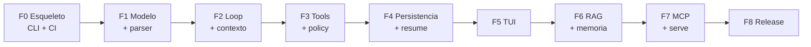
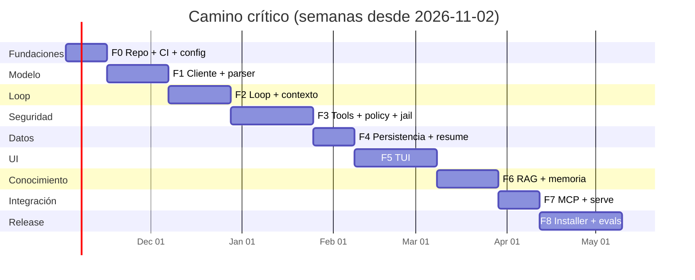

# 08 — Plan de implementación

> **Estado:** Plan aprobado para ejecución · **Versión:** 1.0 · **Fecha:** 2026-10-28
> **Alcance:** de un repositorio vacío a `v1.0.0` publicada, incluyendo los archivos raíz del
> proyecto, la estrategia de pruebas, los hitos, los riesgos y el checklist de release.
> **Regla:** este plan se actualiza al cierre de cada fase; los cambios de alcance requieren un ADR.

---

## 1. Propósito y uso

Este documento responde a cuatro preguntas:

1. **Qué** se construye, en qué orden y con qué criterio de terminado.
2. **Cuándo** se considera cada parte lista (hitos verificables, no fechas de calendario).
3. **Con qué** se construye (árbol de repositorio, archivos raíz, CI/CD, tooling).
4. **Qué puede salir mal** y cómo se detecta y mitiga.

El plan es un contrato operativo, no una predicción. Las fechas son objetivos derivados de la
capacidad declarada en §9; si la capacidad cambia, se recalcula el cronograma y se registra.

### 1.1 Documentos de referencia

| Tema | Documento |
| :--- | :--- |
| Investigación de harnesses | [`01-harness-research.md`](./01-harness-research.md) |
| Modelo y runtime | [`02-lfm25-runtime-research.md`](./02-lfm25-runtime-research.md) |
| Stack Go | [`03-go-stack-research.md`](./03-go-stack-research.md) |
| Arquitectura y paquetes | [`04-architecture.md`](./04-architecture.md) |
| Tools, policy y aprobaciones | [`05-tool-protocol.md`](./05-tool-protocol.md) |
| Sistema de diseño TUI | [`06-design-guide.md`](./06-design-guide.md) |
| Instalación y distribución | [`07-installer.md`](./07-installer.md) |
| Decisiones | [`09-adr.md`](./09-adr.md) |
| Seguridad | [`10-security.md`](./10-security.md) |
| Pruebas y evaluación | [`11-testing-eval.md`](./11-testing-eval.md) |

---

## 2. Supuestos de planificación

| ID | Supuesto | Impacto si falla |
| :--- | :--- | :--- |
| A-01 | Equipo de **2 ingenieros Go senior + 1 ingeniero de producto/TUI a tiempo parcial** | El cronograma se duplica o se recorta alcance |
| A-02 | Un **tech lead** con 30 % de dedicación para revisión y ADRs | Decisiones sin dueño; deuda arquitectónica |
| A-03 | Acceso a un equipo con **16 GB RAM** para probar LFM2.5-2.6B Q5_K_M | No se pueden validar latencias ni evals reales |
| A-04 | **Go 1.27** disponible en CI y en las máquinas del equipo | Bloquea `synctest`, `encoding/json/v2` y el stack TUI v2 |
| A-05 | Certificados de firma (Authenticode, Developer ID) disponibles antes de F8 | Releases sin firma; Gatekeeper/SmartScreen bloquean |
| A-06 | Licencia de los pesos LFM2.5 revisada por legal antes de `v1.0` | No se puede distribuir el instalador con modelo |
| A-07 | No hay requisito de cloud, multi-tenant ni colaboración en v1 | Cambia la arquitectura por completo |
| A-08 | El modelo se sirve por HTTP (`llama-server`) en el camino crítico | El binario embebido pasa a ser crítico (riesgo R-04) |

### 2.1 Restricciones no negociables

- `CGO_ENABLED=0` en el binario estándar; 6 plataformas en cada release.
- El binario no abre puertos fuera de loopback sin token explícito.
- Ninguna tool destructiva se ejecuta sin pasar por policy y, si aplica, aprobación.
- Sin telemetría por defecto (decisión Q-05: `off` salvo opt-in explícito).
- El repositorio no contiene pesos, secretos, ni capturas con datos reales.

---

## 3. Estrategia de entrega

### 3.1 Enfoque: walking skeleton + vertical slices

Se construye primero un **esqueleto caminante** que atraviesa todas las capas con la mínima
funcionalidad real (CLI → agente → modelo HTTP → una tool de lectura → SQLite → salida de texto).
Después se engorda por **rebanadas verticales** que añaden capacidad de extremo a extremo, no por
capas horizontales terminadas al 100 %.



Cada rebanada termina con: demo ejecutable, tests, documentación actualizada y `main` verde.

### 3.2 Reglas de ingeniería

| Regla | Consecuencia |
| :--- | :--- |
| **Trunk-based development** | Ramas ≤ 2 días; integración continua; sin ramas de release largas |
| **Feature flags en config** | `policy.allow_shell`, `policy.allow_network`, `rag.enabled`, `mcp.enabled`; apagadas por defecto |
| **PR ≤ 400 líneas** | Salvo migraciones o generación; revisión obligatoria de 1 persona |
| **Tests en el mismo PR** | Cobertura de dominio ≥ 85 %; sin excepciones "luego lo hago" |
| **Docs en el mismo PR** | Cambia comportamiento → cambia doc (README, guía o ADR) |
| **Sin `TODO` sin issue** | `TODO(#123): ...`; CI falla si hay `TODO` sin referencia |
| **Dependencias con justificación** | Cada `go.mod` nuevo requiere nota en el PR y revisión de licencia |
| **Medir antes de optimizar** | Benchmarks en `internal/.../bench_test.go`; sin micro-optimización especulativa |

### 3.3 Definición de terminado (global)

Una tarea está terminada cuando:

- [ ] El código compila en las 6 plataformas (`GOOS/GOARCH`) con `CGO_ENABLED=0`.
- [ ] Tiene tests unitarios y, si toca I/O, de integración.
- [ ] `go vet`, `golangci-lint`, `gofumpt` y `govulncheck` pasan.
- [ ] No introduce dependencias sin aprobación.
- [ ] Está documentada (doc comment + doc del proyecto si aplica).
- [ ] Es observable (log estructurado o evento de auditoría si tiene efectos).
- [ ] Está detrás de un flag si es incompleta o experimental.
- [ ] El PR fue revisado y el CI está verde.

---

## 4. Fases, duración y hitos

### 4.1 Resumen

| Fase | Nombre | Semanas | Hito | Resultado demostrable |
| :--- | :--- | ---: | :--- | :--- |
| **F0** | Fundaciones | 2 | **M0** Repo vivo | `make check` verde; binario `version`; CI en 3 OS |
| **F1** | Modelo y protocolo | 3 | **M1** Primer token | `liquidharness run --print "hola"` responde con LFM2.5 |
| **F2** | Agent loop y contexto | 3 | **M1.5** Turno con tools | El agente lee un archivo y responde citando |
| **F3** | Tools, policy y jail | 4 | **M2** Ejecución segura | Aprobaciones, denegaciones y 0 escapes en suite adversarial |
| **F4** | Persistencia y sesiones | 2 | **M2.5** Resumen tras crash | Matar el proceso y reanudar el turno |
| **F5** | TUI | 4 | **M3** TUI usable | Chat, streaming, aprobación y 7 pantallas a 80×24 |
| **F6** | RAG y memoria | 3 | **M4** Conocimiento local | Indexar 1.000 docs y responder con citas |
| **F7** | MCP, `serve` y headless | 2 | **M5** Integrable | Cliente MCP + servidor + `--json` estable |
| **F8** | Instalación, evals y release | 4 | **M6** v1.0.0 | Instaladores firmados; evals como gate |

**Total:** 27 semanas de ingeniería en serie. Con 2 ingenieros en paralelo en F3–F8, el camino
crítico objetivo es **≈ 20–22 semanas** (ver §8).

### 4.2 Calendario objetivo

| Hito | Fecha objetivo | Criterio de aceptación |
| :--- | :--- | :--- |
| M0 | 2026-11-13 | Repo, CI, lint, Makefile, LICENSE, README, SECURITY |
| M1 | 2026-12-04 | Primer turno real contra `llama-server` |
| M1.5 | 2026-12-18 | Tool call validado y ejecutado con auditoría |
| M2 | 2027-01-29 | Policy + aprobaciones + jail + suite adversarial |
| M2.5 | 2027-02-12 | Persistencia y reanudación verificadas |
| M3 | 2027-03-12 | TUI completa con golden tests |
| M4 | 2027-04-02 | RAG híbrido + memoria con citas |
| M5 | 2027-04-16 | MCP cliente/servidor + headless JSON |
| M6 | 2027-05-14 | `v1.0.0` firmada y publicada |

> Las fechas asumen inicio el **2026-11-02**, sin festivos y con capacidad completa. Se revisan en
> cada hito; un desvío > 1 semana dispara revisión de alcance, no crunch.

---

## 5. Detalle por fase

Cada fase declara: objetivo, entregables, criterios de salida, riesgos específicos y demo.

### F0 — Fundaciones (2 semanas) → M0

**Objetivo:** que cualquier persona clone, compile, pruebe y entienda el proyecto en < 15 minutos.

**Entregables**

- `go.mod` con Go 1.27, módulo `github.com/liquidharness/liquidharness`.
- Árbol inicial de paquetes de [`04-architecture.md`](./04-architecture.md) §4 (vacío pero con doc comments).
- `cmd/liquidharness/main.go` mínimo + `internal/cli` con `version`, `--help`, `--json`.
- `internal/version` con `Version`, `Commit`, `Date` por `ldflags`.
- `internal/config` con TOML + env + flags, defaults y validación.
- `internal/telemetry` con `slog`, redacción básica y niveles.
- `Makefile`, `.golangci.yml`, `.editorconfig`, `.gitattributes`, `.gitignore`.
- `LICENSE` (Apache-2.0), `NOTICE`, `README.md`, `SECURITY.md`, `CONTRIBUTING.md`, `CHANGELOG.md`.
- `.env.example`; `.env` ignorado.
- CI `ci.yml` en Linux/macOS/Windows; `nightly.yml` esqueleto.
- Plantillas de issue/PR, `CODEOWNERS`, `dependabot.yml`.
- ADR-0001 … ADR-0010 en estado `Accepted`.

**Criterios de salida**

- [ ] `make check` pasa en las 3 OS y en local.
- [ ] `liquidharness version --json` devuelve versión, commit, fecha, go version, os/arch.
- [ ] `liquidharness --help` lista los comandos de v1 (aunque devuelvan `not implemented`).
- [ ] La config se carga desde archivo, entorno y flags con precedencia documentada.
- [ ] El binario pesa < 8 MB en F0 y arranca < 50 ms.
- [ ] `LICENSE` y `NOTICE` revisados; cabeceras SPDX en todos los `.go`.
- [ ] `README.md` permite compilar desde cero sin leer otro documento.

**Demo:** clonar en una máquina limpia, `make build`, `./liquidharness version`.

**Riesgos:** toolchain 1.27 no disponible en CI (mitigación: cachear toolchain y fijar `go-version-file`);
fricción de lint v2 (mitigación: empezar con `default: standard` y añadir linters por PR).

---

### F1 — Modelo y protocolo (3 semanas) → M1

**Objetivo:** hablar con LFM2.5 de forma fiable, con streaming, y parsear tool calls de ambos formatos.

**Entregables**

- `internal/llm/openai.go`: cliente OpenAI-compatible (`/v1/chat/completions`, `/v1/models`).
- `internal/llm/stream.go`: SSE incremental, cancelación, timeouts, reintentos con backoff.
- `internal/llm/wire.go`: DTOs de wire separados del dominio.
- `internal/llm/parse_lfm.go`: parser de `<|tool_call_start|>…<|tool_call_end|>` (Pythonic y JSON).
- `internal/llm/supervisor.go`: arranque/parada/health check de `llama-server`.
- `internal/llm/fake.go`: modelo determinista para tests y evals de PR.
- `internal/agent/prompt.go`: system prompt versionado (`prompt_hash`).
- `liquidharness models list|pull|verify|use|path` (descarga y verificación SHA-256).
- `liquidharness doctor` v1: comprueba endpoint, modelo, DB, permisos y disco.
- `liquidharness run --print` (one-shot, sin tools todavía).

**Criterios de salida**

- [ ] `run --print "Responde OK"` contra LFM2.5-2.6B Q5_K_M devuelve texto en < 3 s (modelo caliente).
- [ ] El parser acepta: Pythonic, JSON, llamada múltiple, llamada partida por streaming, texto antes/después.
- [ ] El parser **rechaza** llamadas malformadas con error tipado, sin ejecutar nada.
- [ ] `httptest` cubre 200, 400, 429, 500, timeout, body truncado y SSE malformado.
- [ ] `models verify` detecta un archivo corrupto (hash distinto) y no lo usa.
- [ ] `doctor --json` devuelve un contrato estable y códigos de salida correctos.
- [ ] La cancelación con `Ctrl+C` cierra la conexión en < 200 ms y no deja goroutines.

**Demo:** `liquidharness run --print "Resume este README"` con streaming visible.

**Riesgos:** variaciones del template entre versiones de `llama-server` (mitigación: tests con fixtures
reales y `--chat-template` explícito); latencia de arranque del modelo (mitigación: supervisor con
health check y mensaje de progreso).

---

### F2 — Agent loop y contexto (3 semanas) → M1.5

**Objetivo:** un turno completo con múltiples pasos, presupuesto, compactación y tools.

**Entregables**

- `internal/agent/loop.go`, `turn.go`, `budget.go`, `context.go`, `compact.go`.
- Máquina de estados de [`04-architecture.md`](./04-architecture.md) §6.1 con transiciones válidas.
- Presupuesto de tokens por turno: entrada, salida, tools, compactación.
- Detección de bucles: llamadas repetidas, mismo resultado, ping-pong entre tools.
- Compactación: resumen extractivo + poda de resultados antiguos; prefijo estable para KV cache.
- Ejecución secuencial y paralela de tools (solo R0/R1 independientes).
- `internal/tools/registry.go` + `fs_read`, `fs_list`, `fs_search` (sin escritura todavía).
- Streaming de eventos al CLI: `turn.started`, `model.delta`, `tool.started`, `tool.finished`.
- Tests de conformidad de `ports.Model` y `ports.Tool`.

**Criterios de salida**

- [ ] Un turno puede encadenar ≥ 5 tool calls y terminar con respuesta final.
- [ ] El presupuesto se respeta: nunca se supera el contexto configurado; si se supera, compacta o falla con código 10.
- [ ] La compactación reduce ≥ 40 % de tokens sin perder la última instrucción del usuario (test).
- [ ] El loop detecta un bucle en ≤ 3 repeticiones y termina con un mensaje accionable.
- [ ] `go test -race ./internal/agent/...` limpio; `synctest` para timers y cancelación.
- [ ] Los eventos de streaming son ordenados y monotonónicos por `seq`.

**Demo:** "Lee `docs/files/project.md`, dime el objetivo y cita la línea".

**Riesgos:** compactación que rompe el prefijo y destruye el KV cache (mitigación: prefijo inmutable
+ medir `cached_tokens`); sobreingeniería del presupuesto (mitigación: empezar con una fórmula simple
y ajustar con datos de evals).

---

### F3 — Tools, policy y jail (4 semanas) → M2

**Objetivo:** que el agente pueda **modificar** archivos sin poder escapar del workspace ni actuar sin
permiso.

**Entregables**

- `internal/fsx/jail.go`: resolución canónica, symlinks, `..`, UNC, ADS, case-insensitivity, TOCTOU.
- `internal/policy`: motor de reglas, modos (`read-only`/`ask`/`allow`), condiciones, riesgo R0–R5.
- `internal/tools`: `fs_create`, `fs_edit`, `fs_delete`, `fs_move`, `todo_write`, `ask_user`.
- Aprobaciones en CLI: prompt interactivo, `--yes` (R1), `--allow-risk=Rn` (R2+), `--deny`, `--approval-policy`.
- Auditoría: `events` + JSONL append-only con hash de argumentos.
- `internal/sandbox`: base para `shell_exec` (opt-in, F3.5 si Q-03 se aprueba).
- Suite adversarial de path jail (≥ 40 vectores).
- `liquidharness policy test` para validar reglas sin ejecutar tools.

**Criterios de salida**

- [ ] 0 escapes en la suite adversarial (symlink a `/etc`, `..%2f`, UNC, ADS, mayúsculas, hardlink).
- [ ] Toda escritura pasa por `fsx.AtomicWrite` (temp + rename + fsync) y verifica el hash previo.
- [ ] `fs_edit` falla con código 9 si el archivo cambió desde la lectura (conflicto).
- [ ] Las tools R2+ no se ejecutan sin aprobación en modo `ask`; en `read-only` devuelven `POLICY_DENIED`.
- [ ] El audit log permite reconstruir qué se intentó, qué se aprobó y qué se ejecutó.
- [ ] `shell_exec` está deshabilitado por defecto y, si se habilita, corre con timeout, límites y allowlist.
- [ ] Los 20 vectores de [`05-tool-protocol.md`](./05-tool-protocol.md) §13 pasan.

**Demo:** pedir borrar un archivo, denegar, verificar que no se borró y que quedó auditado.

**Riesgos:** TOCTOU en Windows (mitigación: abrir con `FILE_FLAG_OPEN_REPARSE_POINT` y validar handle);
aprobaciones que interrumpen el flujo (mitigación: "allow for session" con scope explícito y visible).

---

### F4 — Persistencia y sesiones (2 semanas) → M2.5

**Objetivo:** que nada se pierda y que una sesión se pueda reanudar tras un crash.

**Entregables**

- `internal/store`: SQLite (`modernc.org/sqlite`), migraciones embebidas, `PRAGMA` de rendimiento.
- Repositorios: sesiones, mensajes, tool calls, aprobaciones, eventos.
- `liquidharness sessions list|show|resume|delete|export`.
- Journal de turno: intención → ejecución → resultado; recuperación idempotente.
- Retención y `vacuum`; backup con `VACUUM INTO`.
- Tests de migración desde cero y desde la versión anterior.

**Criterios de salida**

- [ ] Matar el proceso durante una tool y al reanudar no se duplica la acción (idempotencia por `call_id`).
- [ ] `sessions export --format jsonl` produce un archivo reproducible e importable.
- [ ] Migración de esquema probada con una DB de la release anterior.
- [ ] `PRAGMA journal_mode=WAL`, `synchronous=NORMAL`, `busy_timeout=5000` configurados y medidos.
- [ ] Ninguna consulta bloquea la UI > 16 ms (medido con `EXPLAIN QUERY PLAN` + benchmark).
- [ ] La DB no crece sin límite: retención configurable y prueba de 100k mensajes.

**Demo:** `kill -9` en medio de un turno, reabrir, `sessions resume`, ver el estado consistente.

**Riesgos:** SQLite en volúmenes de red (mitigación: detectar y avisar; recomendar disco local);
corrupción por cierre abrupto (mitigación: WAL + `integrity_check` en `doctor`).

---

### F5 — TUI (4 semanas) → M3

**Objetivo:** una interfaz de terminal que sea la razón para usar el producto, no un wrapper.

**Entregables**

- `internal/tui/theme/tokens.go`: tokens de [`06-design-guide.md`](./06-design-guide.md) §4–§6.
- Componentes: header, status bar, message list, markdown renderer, tool card, diff view,
  approval modal, input, autocomplete, toast, spinner, progress, table, empty state.
- Pantallas: Chat, Approval, Command palette, Sessions, Eval dashboard, Memory inspector y Error
  (las 7 de [`06-design-guide.md`](./06-design-guide.md) §12); overlays de RAG/citas, Help y Wizard.
- Modelos y Doctor se resuelven en CLI en v1; la TUI muestra su estado en la status bar y en el
  command palette.
- Keybindings, help overlay, `NO_COLOR`, ASCII fallback, reduced motion.
- Streaming incremental sin parpadeo; scroll con anclaje; selección y copia.
- Golden tests a 80×24, 120×40 y 160×50; tests de teclas y de resize.
- Capturas en `docs/screenshots/` según el inventario §16.

**Criterios de salida**

- [ ] La TUI arranca en < 150 ms y no bloquea el loop (modelo en goroutine, `tea.Cmd`).
- [ ] Funciona sin TTY (degrada a texto), con `NO_COLOR`, y a 80×24 sin recortes.
- [ ] El modal de aprobación muestra tool, riesgo, argumentos redactados y alcance; `Esc` deniega.
- [ ] `Ctrl+C` cancela el turno y restaura el terminal (alt screen, cursor, bracketed paste).
- [ ] Golden tests estables en las 3 OS (sin diferencias por fuentes; solo celdas).
- [ ] Accesibilidad: contraste ≥ 4.5:1, foco visible, nada depende solo del color.
- [ ] Las capturas del inventario de [`06-design-guide.md`](./06-design-guide.md) §16 están aprobadas
      y referenciadas.

**Demo:** flujo completo de chat con tool call, aprobación, diff y respuesta final, grabado en GIF;
capturas del inventario §16 en `docs/screenshots/`.

**Riesgos:** scope creep visual (mitigación: catálogo cerrado de 22 componentes); diferencias de
terminal (mitigación: CI con `termenv` profile forzado y tests de golden sin color).

---

### F6 — RAG y memoria (3 semanas) → M4

**Objetivo:** que el agente sepa cosas del usuario y de sus documentos, con citas verificables.

**Entregables**

- `internal/rag`: ingesta, normalización, chunking (Markdown/código/texto), embeddings, índice.
- Búsqueda híbrida: coseno sobre BLOB float32 + FTS5 BM25 + fusión + dedupe.
- `liquidharness rag index|search|reindex|stats`.
- `internal/memory`: extracción, dedupe, TTL, namespaces, redacción de secretos.
- `memory_add`, `memory_search`, `memory_forget`; pantalla de inspección/edición.
- Citas en la respuesta: path, líneas, heading; clic/enter abre el archivo.
- Embeddings vía endpoint (`/v1/embeddings`) con fallback a búsqueda léxica si no hay modelo.

**Criterios de salida**

- [ ] Indexar 1.000 documentos (< 50 MB) en < 5 min en un equipo de referencia.
- [ ] `rag search` en 10k chunks < 50 ms p95.
- [ ] La respuesta cita ≥ 1 fuente correcta en el golden set de RAG (≥ 90 %).
- [ ] Reindexar solo procesa archivos con `sha256` distinto (incremental verificado).
- [ ] `memory forget --all` borra y el siguiente turno no la recupera (test de extremo a extremo).
- [ ] Ningún secreto detectado se escribe en memoria ni en logs (test con patrones sintéticos).
- [ ] La UI permite ver por qué se recuperó un chunk (score y fuente).

**Demo:** indexar `docs/`, preguntar por una decisión de arquitectura y abrir la cita.

**Riesgos:** embeddings de baja calidad en LFM2.5 (mitigación: modelo de embeddings dedicado opcional);
chunking que rompe código (mitigación: fallback por líneas + tests con fixtures reales).

---

### F7 — MCP, `serve` y headless (2 semanas) → M5

**Objetivo:** integrarse con el ecosistema y con CI sin acoplarse a la TUI.

**Entregables**

- `internal/mcpclient`: transporte stdio y Streamable HTTP, discovery, namespaces, allowlist.
- Bridge MCP → `ports.Tool` con validación de esquema y riesgo heredado (mínimo R1).
- `liquidharness serve`: HTTP local (loopback + token), endpoints de sesión y turno.
- `liquidharness serve --mcp`: servidor MCP con tools de solo lectura por defecto.
- `--json` estable en todos los comandos; `--print` sin TUI.
- Documento de contrato de API (`docs/api.md`, generado o versionado).
- Tests de interoperabilidad con 2 servidores MCP de referencia.

**Criterios de salida**

- [ ] El cliente MCP descubre tools y las expone al modelo con nombre namespaced (`server__tool`).
- [ ] Una tool MCP maliciosa (descripción con instrucciones) no altera la policy (test).
- [ ] `serve` rechaza peticiones sin token y no escucha en `0.0.0.0` por defecto.
- [ ] `--json` cumple el esquema documentado y los códigos de salida 0–10.
- [ ] El servidor MCP no expone escritura sin aprobación explícita.
- [ ] Un cliente externo (script Python/Node) completa un turno contra `serve`.

**Demo:** conectar un servidor MCP de filesystem y usarlo desde LiquidHarness; luego consumir
LiquidHarness desde otro cliente MCP.

**Riesgos:** tool poisoning vía descripciones (mitigación: tratar descripciones como datos, allowlist,
aprobación); complejidad de transporte (mitigación: empezar solo stdio, HTTP después).

---

### F8 — Instalación, evals y release (4 semanas) → M6

**Objetivo:** que un desconocido instale, confíe y use el producto; y que no lo rompamos después.

**Entregables**

- `liquidharness init` completo (wizard, detección, perfiles, smoke test).
- `models` con manifiesto, descarga reanudable, verificación, cache y `use`.
- `doctor` completo con `--bench` y `--json`.
- `update` con canales, verificación de firma y rollback; `uninstall` con `--purge`.
- Instaladores: `install.ps1`, `install.sh`; Winget, Scoop, Homebrew; `.deb`/`.rpm` (v1.1).
- Firma: Authenticode (Windows), Developer ID + notarización (macOS), cosign (Linux).
- SBOM SPDX, `checksums.txt`, attestations de build.
- Docker multi-arch (distroless, non-root).
- Framework de evals: datasets `smoke`, `core`, `adversarial`, `regression`; runner, assertions,
  judge calibrado, reporte JSON/Markdown; integración CI/nightly.
- Benchmark suite y presupuestos de rendimiento.
- Documentación final: README, guía de usuario, troubleshooting, FAQ, migración.
- `v1.0.0` tag, release notes, anuncio.

**Criterios de salida**

- [ ] `init` completa en < 5 min sin contar descarga, en Windows/macOS/Linux limpios.
- [ ] Instalación sin admin en las 3 OS; `PATH` solo con consentimiento.
- [ ] Todos los artefactos tienen checksum, firma verificable y SBOM.
- [ ] `update` verifica firma antes de reemplazar y puede volver a la versión anterior.
- [ ] `uninstall` conserva datos; `--purge` los borra y lo confirma.
- [ ] Golden set `core` ≥ umbral acordado; `adversarial` 100 % en jail/policy.
- [ ] Pass rate no cae > 3 % respecto a la release anterior.
- [ ] `doctor` diagnostica los 10 fallos más comunes con remedio accionable.
- [ ] Release checklist (§15) completo y firmado por 2 revisores.

**Demo:** máquina virtual limpia → `winget install`/`brew install` → `init` → primer turno.

**Riesgos:** certificados de firma (mitigación: iniciar trámite en F5, no en F8); cuotas de GitHub
Actions para macOS (mitigación: cachear y limitar matriz); evals no deterministas (mitigación:
temperature 0.1, seeds cuando el backend lo permita, repeticiones y umbrales).

---

## 6. WBS y estimaciones

Las estimaciones son **días-persona** (d), incluyen tests y documentación, no incluyen revisión.

| ID | Épica / tarea | d | Fase | Depende de |
| :--- | :--- | ---: | :--- | :--- |
| E-01 | Repo, tooling, CI, plantillas, licencia | 6 | F0 | — |
| E-02 | Config (TOML/env/flags), paths, logging, version | 8 | F0 | E-01 |
| E-03 | CLI skeleton + códigos de salida + `--json` | 5 | F0/F7 | E-02 |
| E-04 | Cliente OpenAI-compatible + streaming + reintentos | 12 | F1 | E-02 |
| E-05 | Parser LFM (Pythonic/JSON) + tests de fixtures | 8 | F1 | E-04 |
| E-06 | Supervisor `llama-server` + health checks | 5 | F1 | E-04 |
| E-07 | Gestión de modelos (manifest, pull, verify, cache) | 9 | F1/F8 | E-02 |
| E-08 | Modelo fake determinista + harness de tests | 4 | F1 | E-04 |
| E-09 | Agent loop + máquina de estados + budgets | 14 | F2 | E-04, E-05 |
| E-10 | Context manager + compactación + KV prefijo | 10 | F2 | E-09 |
| E-11 | Registro de tools + `fs_read/list/search` | 8 | F2 | E-02 |
| E-12 | Path jail + `fsx` (atómico, walk, detect) | 10 | F3 | E-11 |
| E-13 | Policy engine + riesgo + reglas + `policy test` | 12 | F3 | E-12 |
| E-14 | Tools de escritura (`create/edit/delete/move`) | 12 | F3 | E-12, E-13 |
| E-15 | Aprobaciones CLI + auditoría + redacción | 8 | F3 | E-13 |
| E-16 | `shell_exec` opt-in + sandbox base | 8 | F3.5 | E-13 |
| E-17 | SQLite store + migraciones + repositorios | 12 | F4 | E-02 |
| E-18 | Journal de turno + resume + idempotencia | 8 | F4 | E-17, E-09 |
| E-19 | Sesiones CLI (`list/show/resume/export`) | 4 | F4 | E-17 |
| E-20 | Tokens de diseño + tema + renderer markdown | 10 | F5 | E-01 |
| E-21 | Componentes base (lista, tarjetas, modal, input) | 14 | F5 | E-20 |
| E-22 | 7 pantallas + navegación + keybindings | 16 | F5 | E-21 |
| E-23 | Streaming TUI + cancelación + resize | 6 | F5 | E-22 |
| E-24 | Golden tests + capturas + accesibilidad | 6 | F5 | E-22 |
| E-25 | Ingesta + chunking + índice + FTS5 | 12 | F6 | E-17 |
| E-26 | Embeddings + búsqueda híbrida + citas | 12 | F6 | E-25 |
| E-27 | Memoria (extracción, dedupe, TTL, UI) | 10 | F6 | E-17 |
| E-28 | Cliente MCP + bridge + allowlist | 10 | F7 | E-11, E-13 |
| E-29 | Servidor MCP + `serve` HTTP + token | 10 | F7 | E-09, E-28 |
| E-30 | `init` wizard + perfiles + smoke test | 10 | F8 | E-07, E-19 |
| E-31 | `doctor` completo + `--bench` | 6 | F8 | E-06, E-17 |
| E-32 | Instaladores (ps1/sh/winget/scoop/brew) | 10 | F8 | E-01 |
| E-33 | Firma, SBOM, checksums, Docker | 8 | F8 | E-32 |
| E-34 | `update` + rollback + `uninstall` | 6 | F8 | E-32 |
| E-35 | Framework de evals + datasets + judge | 16 | F8 | E-09, E-14 |
| E-36 | Benchmarks + optimización guiada | 6 | F8 | E-09, E-26 |
| E-37 | Docs de usuario, FAQ, troubleshooting | 8 | F8 | todas |
| **Total** | | **≈ 350 d** | | |

Con 2 ingenieros full-time (≈ 10 d/semana efectivos) y 1 parcial (≈ 3 d/semana), la capacidad es
≈ 13 d/semana → **≈ 27 semanas**. El paralelismo de F5 (TUI) con F3/F4 permite acercarse a 20–22.

---

## 7. Hitos y criterios de aceptación

| Hito | Nombre | Criterio verificable | Evidencia |
| :--- | :--- | :--- | :--- |
| **M0** | Repo vivo | `make check` verde en 3 OS | Run de CI enlazado |
| **M1** | Primer token | Turno one-shot contra LFM2.5 | Demo + traza |
| **M1.5** | Turno con tools | Lectura + respuesta con cita | Test de integración |
| **M2** | Ejecución segura | 0 escapes; aprobaciones auditadas | Reporte adversarial |
| **M2.5** | Resumen tras crash | `kill -9` + resume consistente | Video + test |
| **M3** | TUI usable | 7 pantallas, golden tests, 80×24 | Capturas aprobadas |
| **M4** | Conocimiento local | RAG con citas ≥ 90 % | Reporte de eval |
| **M5** | Integrable | MCP cliente/servidor + `--json` | Script de interoperabilidad |
| **M6** | v1.0.0 | Release firmada + checklist | GitHub Release |

Un hito no se cierra por fecha: se cierra por evidencia. Si falta un criterio, el hito se declara
**parcial** y se registra el desvío.

---

## 8. Camino crítico y dependencias



Dependencias duras:

- `agent` no puede empezar sin `ports.Model` estable (F1).
- `policy` necesita el descriptor de tools y el jail (F2/F3).
- La TUI puede empezar en paralelo a F3 con un modelo fake y el contrato de eventos congelado.
- RAG depende de la DB y del endpoint de embeddings.
- `init` depende de `models` y de `doctor`.
- Las evals dependen del loop y de las tools reales; el harness de evals puede empezar antes con fakes.

---

## 9. Equipo, roles y capacidad

| Rol | Dedicación | Responsabilidades |
| :--- | ---: | :--- |
| **Tech lead / arquitecto** | 30 % | ADRs, revisión de diseño, desbloqueo, release gate |
| **Ingeniero Go #1 (core)** | 100 % | `agent`, `llm`, `policy`, `tools`, `sandbox` |
| **Ingeniero Go #2 (plataforma)** | 100 % | `store`, `rag`, `memory`, `mcp`, `cli`, CI/CD, instaladores |
| **Ingeniero de producto/TUI** | 50 % | `tui`, tokens, componentes, capturas, microcopy |
| **QA / evals** | 30 % | Datasets, judge, benchmarks, matriz de pruebas |
| **Diseño** | 15 % | Revisión de TUI, accesibilidad, capturas |
| **Seguridad** | 10 % | Threat model, revisión de jail/policy, pentest ligero |
| **Legal** | 5 % | Licencias (Apache-2.0, LFM), marcas, privacidad |

### 9.1 RACI por área

| Área | R | A | C | I |
| :--- | :--- | :--- | :--- | :--- |
| Arquitectura | Tech lead | Tech lead | Go #1, Go #2 | Todos |
| Agent loop | Go #1 | Tech lead | QA | Producto |
| Tools/policy | Go #1 | Tech lead | Seguridad | Todos |
| TUI | Producto/TUI | Tech lead | Diseño | Todos |
| Persistencia/RAG | Go #2 | Tech lead | QA | Producto |
| Release | Go #2 | Tech lead | Seguridad, Legal | Todos |
| Evals | QA | Tech lead | Go #1 | Producto |

---

## 10. Árbol final del repositorio

```text
liquidharness/
├── .github/
│   ├── CODEOWNERS
│   ├── dependabot.yml
│   ├── ISSUE_TEMPLATE/
│   │   ├── bug_report.yml
│   │   ├── feature_request.yml
│   │   └── config.yml
│   ├── PULL_REQUEST_TEMPLATE.md
│   └── workflows/
│       ├── ci.yml
│       ├── nightly.yml
│       ├── release.yml
│       └── docs.yml
├── .editorconfig
├── .env.example
├── .gitattributes
├── .gitignore
├── .golangci.yml
├── .goreleaser.yaml
├── CHANGELOG.md
├── CODE_OF_CONDUCT.md
├── CONTRIBUTING.md
├── LICENSE
├── Makefile
├── NOTICE
├── README.md
├── SECURITY.md
├── go.mod
├── go.sum
├── cmd/
│   └── liquidharness/
│       └── main.go
├── internal/
│   ├── agent/
│   ├── app/
│   ├── cli/
│   ├── config/
│   ├── core/
│   ├── eval/
│   ├── fsx/
│   ├── llm/
│   ├── mcpclient/
│   ├── memory/
│   ├── policy/
│   ├── ports/
│   ├── rag/
│   ├── sandbox/
│   ├── store/
│   ├── telemetry/
│   ├── tools/
│   ├── tui/
│   └── version/
├── docs/
│   ├── api.md
│   ├── faq.md
│   ├── troubleshooting.md
│   ├── legal/
│   ├── files/            # este conjunto
│   └── screenshots/
├── evals/
│   ├── baseline.json
│   ├── datasets/
│   │   ├── smoke.jsonl
│   │   ├── core.jsonl
│   │   ├── adversarial.jsonl
│   │   └── regression.jsonl
│   └── fixtures/
├── scripts/
│   ├── install.sh
│   ├── install.ps1
│   └── dev/
│       ├── check-docs.sh
│       ├── ensure-model.sh
│       └── gen-manifest.sh
├── testdata/
│   ├── lfm/
│   ├── jail/
│   └── rag/
└── tools/
    └── tools.go          # dependencias de tooling con build tag
```

Reglas:

- `testdata/` no contiene binarios grandes ni datos personales.
- `evals/fixtures/` usa rutas sintéticas y contenido ficticio.
- `docs/screenshots/` solo capturas aprobadas; las de trabajo van a `docs/screenshots/wip/` (ignorado).
- Nada de `vendor/` salvo decisión explícita (ADR) por reproducibilidad.

---

## 11. Especificación de archivos raíz

Esta sección define **qué debe contener** cada archivo, con plantillas listas para copiar. Los
artefactos públicos van en **inglés**; los documentos internos pueden ir en español.

### 11.1 `README.md` (inglés)

**Requisitos**

- ≤ 120 líneas visibles antes de "Documentation"; el detalle vive en `docs/`.
- Responde en 10 segundos: qué es, para quién, por qué local, cómo se instala.
- Sin capturas con datos reales; una imagen/GIF optimizado (< 2 MB).
- Badges solo si son estables (CI, release, license, Go version).
- Incluye el aviso de licencia del modelo (no es Apache-2.0).

**Plantilla**

````markdown
# LiquidHarness

> A local-first agent harness for Liquid AI LFM2.5. Your files, your machine, your rules.

[](...)
[](...)
[](LICENSE)

LiquidHarness is a single-binary agent runtime that runs LFM2.5 on your computer. It reads,
searches, summarizes and edits the files you point it at — with explicit approvals, a workspace
jail and a full audit trail. No cloud account. No data leaves your machine unless you ask.

## Why

- **Local by default.** The model runs on your hardware; the harness never phones home.
- **Safe by construction.** Risky tools require approval; the filesystem jail is enforced in code.
- **Small and fast.** One Go binary, no runtime dependencies, starts in milliseconds.
- **Inspectable.** Every tool call, approval and result is recorded and queryable.

## Requirements

- Windows 10/11, macOS 13+, or Linux (x64/arm64)
- 8 GB RAM minimum; 16 GB recommended
- ~3 GB disk for the default model (LFM2.5-2.6B Q5_K_M)

## Install

```bash
# macOS / Linux
curl -fsSL https://get.liquidharness.dev | sh

# Windows (PowerShell)
irm https://get.liquidharness.dev/install.ps1 | iex

# Package managers
brew install liquidharness/tap/liquidharness
winget install LiquidHarness.LiquidHarness
scoop install liquidharness
```

Then:

```bash
liquidharness init      # detect hardware, download a model, run a smoke test
liquidharness           # open the TUI
```

## Quick start

```bash
liquidharness run --print "Summarize docs/architecture.md"
liquidharness rag index ./docs
liquidharness run "Which ADR decided SQLite?"
liquidharness eval run --dataset smoke
```

## How it works

```text
you → TUI/CLI → agent loop → LFM2.5 (llama-server)
                     ↓
              policy + approvals
                     ↓
            tools (fs, rag, memory) → workspace
                     ↓
                 SQLite (state, audit)
```

## Safety

- The model is untrusted input; its tool calls are validated against JSON Schema.
- Writes and deletes require approval by default (`ask` policy).
- Shell and network tools are disabled unless you enable them.
- Every action is audited locally.

See [SECURITY.md](SECURITY.md) for the threat model and reporting process.

## Configuration

Config lives in the OS config directory (`liquidharness config path`). Environment variables use
the `LIQUIDHARNESS_` prefix. See [`.env.example`](.env.example) and
[docs/files/04-architecture.md](docs/files/04-architecture.md).

## Documentation

- [Architecture](docs/files/04-architecture.md)
- [Tool protocol](docs/files/05-tool-protocol.md)
- [Design guide](docs/files/06-design-guide.md)
- [Installer](docs/files/07-installer.md)
- [Testing & evals](docs/files/11-testing-eval.md)

## Contributing

See [CONTRIBUTING.md](CONTRIBUTING.md). We use trunk-based development, Conventional Commits and
require tests with every change.

## License

The harness is [Apache-2.0](LICENSE). LFM2.5 model weights are distributed under the
[LFM Open License v1.0](https://www.liquid.ai/lfm-open-license) and are **not** covered by the
Apache-2.0 license. See [NOTICE](NOTICE).
````

**Anti-patrones:** prometer "AGI", "coding agent autónomo" o "funciona con cualquier modelo";
comparar con competidores sin datos; capturas desactualizadas; instrucciones que requieren `sudo`.

---

### 11.2 `LICENSE`, `NOTICE` y cabeceras SPDX

**Decisión:** Apache License 2.0 (ADR-0010). Se incluye el texto canónico **sin modificaciones**,
descargado de `https://www.apache.org/licenses/LICENSE-2.0.txt`. No se reescribe a mano.

`NOTICE` (obligatorio si se distribuye un binario):

```text
LiquidHarness
Copyright 2026 The LiquidHarness Authors

This product includes software developed at
The LiquidHarness Authors (https://liquidharness.dev).

The LFM2.5 model weights are licensed separately under the
LFM Open License v1.0 and are not part of this distribution's
Apache-2.0 licensed source code.
```

Cabecera por archivo `.go`:

```go
// Copyright 2026 The LiquidHarness Authors
// SPDX-License-Identifier: Apache-2.0
```

Reglas:

- `LICENSE` se verifica en CI (`make license-check`) contra el hash del texto canónico.
- Dependencias: `go-licenses check` (o `go mod licenses`) falla con licencias no permitidas
  (GPL/AGPL/SSPL) salvo excepción documentada en `docs/legal/`.
- Los pesos **nunca** se empaquetan en el binario ni en el repo; el instalador los descarga aparte
  y muestra la licencia antes de descargar.

---

### 11.3 `.gitignore`

```gitignore
# Binaries and build output
/dist/
/bin/
/liquidharness
/liquidharness.exe
/liquidharness-embedded
/liquidharness-embedded.exe
*.test
*.out
coverage.txt
coverage.html
profile.cov

# Go workspace
go.work
go.work.sum

# Local configuration and secrets
.env
.env.local
.env.*.local
*.pem
*.key
*.p12
*.pfx
secrets/
.liquidharness/*
!.liquidharness/policy.toml.example

# Models and large data
*.gguf
*.safetensors
*.bin
/models/
/cache/
/data/

# Databases and journals
*.db
*.db-wal
*.db-shm
*.sqlite
*.sqlite3

# Screenshots in progress
docs/screenshots/wip/

# OS and editors
.DS_Store
Thumbs.db
desktop.ini
.idea/
.vscode/
*.swp
*~

# Tooling caches
.golangci-lint-cache/
.gocache/
.tmp/
tmp/
```

Notas:

- No se ignora `docs/screenshots/*.png` (son artefactos revisados).
- `.env.example` **sí** se commitea; `.env` no.
- `testdata/` con fixtures pequeños sí se commitea; binarios no.

---

### 11.4 `.gitattributes` y `.editorconfig`

`.gitattributes`:

```gitattributes
* text=auto eol=lf
*.go text eol=lf
*.md text eol=lf
*.yml text eol=lf
*.yaml text eol=lf
*.ps1 text eol=crlf
*.bat text eol=crlf
*.png binary
*.jpg binary
*.gif binary
*.gguf binary
```

`.editorconfig`:

```ini
root = true

[*]
charset = utf-8
end_of_line = lf
insert_final_newline = true
trim_trailing_whitespace = true
indent_style = tab
indent_size = 4

[*.{md,yml,yaml,json,toml}]
indent_style = space
indent_size = 2

[Makefile]
indent_style = tab

[*.ps1]
end_of_line = crlf
```

---

### 11.5 `.env.example` y política de `.env`

**Decisión:** un solo nombre canónico, `.env.example`, para evitar dos fuentes de verdad
(`.env.template` se descarta; si un instalador necesita una plantilla, copia `.env.example`).
`.env` está ignorado y **nunca** se commitea. Precedencia: flags > entorno > `.env` > TOML > defaults.

```dotenv
# LiquidHarness — environment overrides
# Copy to .env and edit. Never commit .env.
# All variables are optional; defaults are shown.

# --- Runtime ---------------------------------------------------------------
LIQUIDHARNESS_PROFILE=balanced
LIQUIDHARNESS_LOG_LEVEL=info
LIQUIDHARNESS_LOG_FORMAT=text          # text | json
LIQUIDHARNESS_TELEMETRY=off            # off | local | anonymous (opt-in)

# --- Model ----------------------------------------------------------------
LIQUIDHARNESS_MODEL_BASE_URL=http://127.0.0.1:8080/v1
LIQUIDHARNESS_MODEL_NAME=lfm2.5-2.6b
LIQUIDHARNESS_MODEL_API_KEY=           # prefer the OS keyring
LIQUIDHARNESS_MODEL_CONTEXT_WINDOW=32768
LIQUIDHARNESS_MODEL_MAX_TOKENS=2048
LIQUIDHARNESS_MODEL_TEMPERATURE=0.1
LIQUIDHARNESS_MODEL_TOP_K=50
LIQUIDHARNESS_MODEL_TIMEOUT=120s
LIQUIDHARNESS_MODEL_AUTOSTART=true

# --- Workspace and policy -------------------------------------------------
LIQUIDHARNESS_WORKSPACE=.
LIQUIDHARNESS_POLICY_MODE=ask          # read-only | ask | allow
LIQUIDHARNESS_POLICY_ALLOW_SHELL=false
LIQUIDHARNESS_POLICY_ALLOW_NETWORK=false
LIQUIDHARNESS_TOOLS_ALLOWLIST=        # comma-separated tool names

# --- Storage --------------------------------------------------------------
LIQUIDHARNESS_DATA_DIR=
LIQUIDHARNESS_DB_PATH=
LIQUIDHARNESS_RETENTION_DAYS=180

# --- RAG and memory -------------------------------------------------------
LIQUIDHARNESS_RAG_ENABLED=true
LIQUIDHARNESS_RAG_TOP_K=6
LIQUIDHARNESS_RAG_MAX_TOKENS=3000
LIQUIDHARNESS_MEMORY_ENABLED=true

# --- MCP ------------------------------------------------------------------
LIQUIDHARNESS_MCP_ENABLED=false
LIQUIDHARNESS_MCP_CONFIG=

# --- Server ---------------------------------------------------------------
LIQUIDHARNESS_SERVE_ADDR=127.0.0.1:8787
LIQUIDHARNESS_SERVE_TOKEN=            # required if addr is not loopback
```

Reglas:

- Ningún valor por defecto es un secreto real.
- `LIQUIDHARNESS_MODEL_API_KEY` se documenta pero se recomienda keyring; si se usa `.env`, el
  archivo debe tener permisos `0600` (Unix) y estar fuera de cualquier workspace indexado.
- CI usa variables de entorno, nunca `.env`.
- `doctor` avisa si `.env` está dentro del workspace y el RAG está habilitado.

---

### 11.6 `Makefile`

```makefile
SHELL := /bin/sh
BINARY := liquidharness
PKG := github.com/liquidharness/liquidharness
VERSION ?= $(shell git describe --tags --always --dirty 2>/dev/null || echo dev)
COMMIT ?= $(shell git rev-parse --short HEAD 2>/dev/null || echo none)
DATE ?= $(shell date -u +%Y-%m-%dT%H:%M:%SZ)
LDFLAGS := -s -w \
  -X $(PKG)/internal/version.Version=$(VERSION) \
  -X $(PKG)/internal/version.Commit=$(COMMIT) \
  -X $(PKG)/internal/version.Date=$(DATE)

.DEFAULT_GOAL := help
.PHONY: help build build-embedded test test-race cover lint fmt fmt-check vet vuln bench \
        check run tui eval docs-check install-local clean snapshot tools

help: ## Show this help
	@grep -hE '^[a-zA-Z_-]+:.*?## ' $(MAKEFILE_LIST) | sort | awk 'BEGIN {FS = ":.*?## "}; {printf "  %-18s %s\n", $$1, $$2}'

build: ## Build the standard binary (CGO disabled)
	CGO_ENABLED=0 go build -trimpath -ldflags "$(LDFLAGS)" -o bin/$(BINARY) ./cmd/liquidharness

build-embedded: ## Build with embedded llama.cpp (requires CGO + toolchain)
	CGO_ENABLED=1 go build -tags embedded -trimpath -ldflags "$(LDFLAGS)" -o bin/$(BINARY)-embedded ./cmd/liquidharness

test: ## Run unit and integration tests
	go test ./...

test-race: ## Run tests with the race detector
	go test -race -shuffle=on ./...

cover: ## Produce a coverage profile and summary
	go test -coverprofile=coverage.txt -covermode=atomic ./...
	go tool cover -func=coverage.txt | tail -n 1

lint: ## Run golangci-lint
	golangci-lint run ./...

fmt: ## Format code
	gofumpt -w .
	goimports -w .

fmt-check: ## Fail if code is not formatted
	@test -z "$$(gofumpt -l .)" || { gofumpt -l .; echo "run: make fmt"; exit 1; }
	@test -z "$$(goimports -l .)" || { goimports -l .; echo "run: make fmt"; exit 1; }

check: fmt-check vet lint test ## Run all local checks

vet: ## Run go vet
	go vet ./...

vuln: ## Check known vulnerabilities
	govulncheck ./...

bench: ## Run benchmarks
	go test -run '^$$' -bench . -benchmem ./...

run: build ## Run the CLI
	./bin/$(BINARY) $(ARGS)

tui: build ## Open the TUI
	./bin/$(BINARY)

eval: build ## Run the smoke eval set
	./bin/$(BINARY) eval run --dataset smoke

docs-check: ## Validate links and token drift
	./scripts/dev/check-docs.sh

install-local: build ## Install to GOPATH/bin
	go install -trimpath -ldflags "$(LDFLAGS)" ./cmd/liquidharness

clean: ## Remove build artifacts
	rm -rf bin dist coverage.txt coverage.html

snapshot: ## Build a local GoReleaser snapshot
	goreleaser release --snapshot --clean

tools: ## Install development tools
	go install mvdan.cc/gofumpt@latest
	go install golang.org/x/tools/cmd/goimports@latest
	go install github.com/golangci/golangci-lint/v2/cmd/golangci-lint@latest
	go install golang.org/x/vuln/cmd/govulncheck@latest
	go install github.com/goreleaser/goreleaser/v2@latest
```

Notas: `make` es una ayuda para humanos; CI no depende de él para la lógica crítica (usa `go`
directamente) para evitar diferencias entre shells.

---

### 11.7 `.golangci.yml`

```yaml
version: "2"

run:
  timeout: 5m
  tests: true
  go: "1.27"

linters:
  default: standard
  enable:
    - bodyclose
    - contextcheck
    - copyloopvar
    - depguard
    - dupl
    - errorlint
    - exhaustive
    - gocritic
    - gosec
    - misspell
    - nilerr
    - noctx
    - nolintlint
    - prealloc
    - revive
    - rowserrcheck
    - sqlclosecheck
    - unconvert
    - unparam
    - wastedassign
    - whitespace
  settings:
    depguard:
      rules:
        core:
          files:
            - "**/internal/core/**"
          allow:
            - $gostd
        ports:
          files:
            - "**/internal/ports/**"
          allow:
            - $gostd
            - github.com/liquidharness/liquidharness/internal/core
        agent:
          files:
            - "**/internal/agent/**"
          allow:
            - $gostd
            - github.com/liquidharness/liquidharness/internal/core
            - github.com/liquidharness/liquidharness/internal/ports
            - github.com/liquidharness/liquidharness/internal/policy
        adapters:
          files:
            - "**/internal/llm/**"
            - "**/internal/store/**"
            - "**/internal/tools/**"
            - "**/internal/sandbox/**"
            - "**/internal/mcpclient/**"
          deny:
            - pkg: github.com/liquidharness/liquidharness/internal/agent
              desc: adapters must not depend on the agent loop
            - pkg: github.com/liquidharness/liquidharness/internal/tui
              desc: adapters must not depend on the TUI
    gosec:
      excludes:
        - G304 # file path from variable: covered by fsx.Jail tests
    revive:
      rules:
        - name: exported
        - name: package-comments
        - name: context-as-argument
    nolintlint:
      require-explanation: true
      require-specific: true

formatters:
  enable:
    - gofumpt
    - goimports
  settings:
    goimports:
      local-prefixes:
        - github.com/liquidharness/liquidharness

issues:
  max-issues-per-linter: 0
  max-same-issues: 0
```

Reglas: cada `//nolint` exige explicación y linter específico; `depguard` es el guardián de la tabla
de dependencias de [`04-architecture.md`](./04-architecture.md) §4.1.

---

### 11.8 `.goreleaser.yaml`

Se parte del extracto de [`07-installer.md`](./07-installer.md) §3.2 y se añaden:

```yaml
version: 2

project_name: liquidharness
dist: dist

before:
  hooks:
    - go mod verify
    - go test ./...

builds:
  - id: standard
    main: ./cmd/liquidharness
    binary: liquidharness
    env: [CGO_ENABLED=0]
    flags: [-trimpath]
    ldflags:
      - -s -w
      - -X github.com/liquidharness/liquidharness/internal/version.Version={{.Version}}
      - -X github.com/liquidharness/liquidharness/internal/version.Commit={{.Commit}}
      - -X github.com/liquidharness/liquidharness/internal/version.Date={{.Date}}
    goos: [windows, darwin, linux]
    goarch: [amd64, arm64]
  - id: embedded
    main: ./cmd/liquidharness
    binary: liquidharness-embedded
    env: [CGO_ENABLED=1]
    tags: [embedded]
    flags: [-trimpath]
    goos: [linux, darwin]
    goarch: [amd64, arm64]
    # Solo se publica si el runner tiene el toolchain de llama.cpp.

archives:
  - id: standard
    ids: [standard]
    formats: [tar.gz]
    format_overrides:
      - goos: windows
        formats: [zip]
    name_template: >-
      {{ .ProjectName }}_{{ .Version }}_{{ .Os }}_{{ .Arch }}
  - id: embedded
    ids: [embedded]
    formats: [tar.gz]
    name_template: >-
      {{ .ProjectName }}-embedded_{{ .Version }}_{{ .Os }}_{{ .Arch }}

checksum:
  name_template: checksums.txt

sboms:
  - artifacts: archive

signs:
  - cmd: cosign
    signature: "${artifact}.sig"
    certificate: "${artifact}.pem"
    args:
      - sign-blob
      - "--yes"
      - "--output-signature=${signature}"
      - "--output-certificate=${certificate}"
      - "${artifact}"
    artifacts: checksum

changelog:
  use: github
  sort: asc
  groups:
    - title: Features
      regexp: '^feat'
      order: 0
    - title: Fixes
      regexp: '^fix'
      order: 1
    - title: Performance
      regexp: '^perf'
      order: 2
    - title: Documentation
      regexp: '^docs'
      order: 3
  filters:
    exclude: ['^chore', '^test', '^ci']

release:
  github:
    owner: liquidharness
    name: liquidharness
  draft: true
  prerelease: auto
  footer: |
    **Verify before running:**
    ```
    cosign verify-blob --certificate checksums.txt.pem \
      --signature checksums.txt.sig checksums.txt
    sha256sum -c checksums.txt
    ```
```

La matriz de instaladores (Winget, Scoop, Homebrew) se configura aquí o en workflows dedicados; el
detalle está en [`07-installer.md`](./07-installer.md) §3–§6.

---

### 11.9 GitHub Actions

#### `ci.yml`

```yaml
name: ci
on:
  push:
    branches: [main]
  pull_request:
  workflow_dispatch:

permissions:
  contents: read

concurrency:
  group: ci-${{ github.ref }}
  cancel-in-progress: true

jobs:
  test:
    name: test (${{ matrix.os }})
    strategy:
      fail-fast: false
      matrix:
        os: [ubuntu-latest, macos-latest, windows-latest]
    runs-on: ${{ matrix.os }}
    steps:
      - uses: actions/checkout@v5
      - uses: actions/setup-go@v6
        with:
          go-version-file: go.mod
          cache: true
      - run: go mod verify
      - run: go build ./...
      - run: go vet ./...
      - name: Test
        run: go test -shuffle=on -coverprofile=coverage.txt -covermode=atomic ./...
      - name: Test (race)
        if: matrix.os != 'windows-latest'
        run: go test -race -shuffle=on ./...
      - name: Upload coverage
        if: matrix.os == 'ubuntu-latest'
        uses: actions/upload-artifact@v5
        with:
          name: coverage
          path: coverage.txt

  lint:
    name: lint
    runs-on: ubuntu-latest
    steps:
      - uses: actions/checkout@v5
      - uses: actions/setup-go@v6
        with:
          go-version-file: go.mod
          cache: true
      - uses: golangci/golangci-lint-action@v8
        with:
          version: latest

  security:
    name: security
    runs-on: ubuntu-latest
    permissions:
      contents: read
      security-events: write
    steps:
      - uses: actions/checkout@v5
      - uses: actions/setup-go@v6
        with:
          go-version-file: go.mod
      - run: go install golang.org/x/vuln/cmd/govulncheck@latest
      - run: govulncheck ./...
      - uses: github/codeql-action/init@v4
        with:
          languages: go
      - uses: github/codeql-action/analyze@v4

  cross-build:
    name: cross-build
    runs-on: ubuntu-latest
    steps:
      - uses: actions/checkout@v5
      - uses: actions/setup-go@v6
        with:
          go-version-file: go.mod
      - name: Build matrix
        run: |
          set -eu
          for os in windows darwin linux; do
            for arch in amd64 arm64; do
              echo "building $os/$arch"
              CGO_ENABLED=0 GOOS=$os GOARCH=$arch \
                go build -trimpath -o /dev/null ./cmd/liquidharness
            done
          done

  docs:
    name: docs
    runs-on: ubuntu-latest
    steps:
      - uses: actions/checkout@v5
      - uses: actions/setup-go@v6
        with:
          go-version-file: go.mod
      - run: ./scripts/dev/check-docs.sh
```

#### `nightly.yml`

```yaml
name: nightly
on:
  schedule:
    - cron: "0 3 * * *"
  workflow_dispatch:

permissions:
  contents: read

jobs:
  eval:
    name: eval (self-hosted, model cached)
    runs-on: [self-hosted, linux, x64, lfm]
    timeout-minutes: 90
    steps:
      - uses: actions/checkout@v5
      - uses: actions/setup-go@v6
        with:
          go-version-file: go.mod
      - name: Ensure model
        run: ./scripts/dev/ensure-model.sh
      - name: Run eval suites
        run: |
          go run ./cmd/liquidharness eval run --dataset core \
            --model local --report out/core.json
          go run ./cmd/liquidharness eval run --dataset adversarial \
            --model local --report out/adversarial.json
      - name: Gate
        run: go run ./cmd/liquidharness eval gate --baseline evals/baseline.json --report out/core.json
      - uses: actions/upload-artifact@v5
        if: always()
        with:
          name: eval-report
          path: out/
```

#### `release.yml`

```yaml
name: release
on:
  push:
    tags: ["v*"]

permissions:
  contents: write
  packages: write
  id-token: write
  attestations: write

jobs:
  release:
    runs-on: ubuntu-latest
    steps:
      - uses: actions/checkout@v5
        with:
          fetch-depth: 0
      - uses: actions/setup-go@v6
        with:
          go-version-file: go.mod
      - uses: sigstore/cosign-installer@v4
      - uses: goreleaser/goreleaser-action@v7
        with:
          distribution: goreleaser
          version: latest
          args: release --clean
        env:
          GITHUB_TOKEN: ${{ secrets.GITHUB_TOKEN }}
      - uses: actions/attest-build-provenance@v3
        with:
          subject-path: dist/*
      - name: Publish checksums
        run: sha256sum dist/* > dist/checksums-final.txt
```

Reglas de CI:

- `docs.yml` ejecuta `scripts/dev/check-docs.sh` (enlaces, anchors y drift de tokens) en PRs que
  toquen `docs/` o `internal/tui/theme/`.
- Acciones fijadas por SHA en el repo real; las etiquetas se muestran por legibilidad.
- Sin secretos en PRs de forks; los jobs que los necesitan se saltan con `if`.
- `nightly` solo corre en runner propio con modelo cacheado; nunca descarga pesos en cada ejecución.
- `release` es el único job con `contents: write`.

---

### 11.10 `SECURITY.md`, `CONTRIBUTING.md`, `CODE_OF_CONDUCT.md`, `CHANGELOG.md`

**`SECURITY.md`** (inglés, ≤ 80 líneas):

- Versiones soportadas (última minor + anterior).
- Cómo reportar en privado (GitHub Security Advisories; email de respaldo).
- SLA: acuse ≤ 72 h, triage ≤ 7 d, fix crítico ≤ 7 d, alto ≤ 30 d, medio ≤ 90 d.
- Alcance: harness, instaladores, cadena de suministro. **Fuera de alcance:** comportamiento del
  modelo, jailbreaks de prompting sin impacto en tools, denegación de servicio local.
- Prácticas: firma de releases, SBOM, `govulncheck`, revisión de dependencias.
- Créditos y política de divulgación coordinada.

**`CONTRIBUTING.md`**:

- Requisitos: Go 1.27, `make tools`, `make check`.
- Flujo: issue → branch `feat/…` → PR pequeño → review → squash merge.
- Convención de commits: Conventional Commits (`feat:`, `fix:`, `docs:`, `refactor:`).
- Tests obligatorios; cobertura de dominio ≥ 85 %.
- Cómo añadir una tool (enlace a arquitectura §18.1) y un proveedor (§18.2).
- DCO o CLA: **DCO** (`Signed-off-by`), sin CLA para reducir fricción.
- Código de conducta y canal de reporte.

**`CODE_OF_CONDUCT.md`**: Contributor Covenant 2.1, sin modificaciones, con contacto.

**`CHANGELOG.md`**: formato Keep a Changelog + SemVer; generado por GoReleaser para releases y
curado a mano para hitos. Secciones: Added, Changed, Deprecated, Removed, Fixed, Security.

---

### 11.11 Plantillas, `CODEOWNERS` y Dependabot

`.github/CODEOWNERS`:

```text
*                       @liquidharness/core
/internal/agent/        @liquidharness/core
/internal/policy/       @liquidharness/security @liquidharness/core
/internal/tools/        @liquidharness/core
/internal/tui/          @liquidharness/design @liquidharness/core
/internal/store/        @liquidharness/platform
/.github/workflows/     @liquidharness/platform
/docs/                  @liquidharness/docs
/SECURITY.md            @liquidharness/security
```

`.github/dependabot.yml`:

```yaml
version: 2
updates:
  - package-ecosystem: gomod
    directory: /
    schedule: { interval: weekly, day: monday }
    open-pull-requests-limit: 5
    groups:
      go-minor:
        patterns: ["*"]
        update-types: ["minor", "patch"]
  - package-ecosystem: github-actions
    directory: /
    schedule: { interval: weekly }
```

Plantillas de issue: `bug_report.yml` (versión, OS, pasos, log redactado, `doctor --json`),
`feature_request.yml` (problema, propuesta, alternativas, impacto en seguridad) y `config.yml`
(enlaces a docs y discusiones).

`PULL_REQUEST_TEMPLATE.md`: qué cambia, por qué, cómo se probó, checklist (tests, docs, seguridad,
dependencias), captura si toca UI.

---

### 11.12 `go.mod` inicial

```text
module github.com/liquidharness/liquidharness

go 1.27.0

require (
    charm.land/bubbles/v2 v2.0.0
    charm.land/bubbletea/v2 v2.0.0
    charm.land/lipgloss/v2 v2.0.0
    github.com/BurntSushi/toml v1.5.0
    github.com/modelcontextprotocol/go-sdk v1.8.0
    github.com/spf13/cobra v1.10.0
    modernc.org/sqlite v1.40.0
)
```

Las versiones exactas se fijan en F0 tras `go get`; el número de dependencias directas debe
permanecer **≤ 15** (ADR-0001). `go mod tidy` y `go mod verify` son obligatorios en CI.

---

## 12. Estrategia de pruebas y QA (resumen)

El detalle vive en [`11-testing-eval.md`](./11-testing-eval.md). Resumen ejecutivo:

| Nivel | Qué cubre | Dónde corre | Gate |
| :--- | :--- | :--- | :--- |
| Unitario | Dominio, policy, parser, jail, chunking | Cada PR, 3 OS | Cobertura dominio ≥ 85 % |
| Integración | SQLite, HTTP (`httptest`), MCP, FS real | Cada PR | 0 fallos |
| E2E | CLI + modelo fake; TUI con `teatest` | Cada PR | 0 fallos |
| Golden TUI | 80×24, 120×40, 160×50 | Cada PR | 0 diffs sin aprobar |
| Adversarial | Jail, policy, injection, MCP poisoning | Cada PR + nightly | 100 % bloqueados |
| Evals | Comportamiento del agente | Nightly + release | ≥ umbral; no −3 % |
| Rendimiento | Arranque, tool read, RAG, loop | Nightly | SLOs de arquitectura |
| Caos | Crash, disco lleno, modelo caído | Semanal | Recuperación correcta |

Reglas:

- Un bug corregido añade un test que falla sin el fix.
- Los tests no dependen de red ni de un modelo real, salvo los marcados `//go:build integration`.
- Los evals usan `temperature=0.1` y repeticiones; el judge se calibra contra humanos (κ ≥ 0.6).
- Los tests de TUI comparan celdas, no píxeles, y fuerzan perfil de color para ser deterministas.

---

## 13. Registro de riesgos

| ID | Riesgo | Prob. | Impacto | Mitigación | Disparador | Dueño |
| :--- | :--- | :---: | :---: | :--- | :--- | :--- |
| R-01 | Tool calling de LFM2.5 poco fiable (Pythonic/JSON, llamadas partidas) | Alta | Alto | Parser tolerante + validación + reintento correctivo + evals de tools | Tasa de éxito < 95 % en `core` | Go #1 |
| R-02 | Licencia LFM incompatible con distribución comercial | Media | Crítico | Revisión legal temprana; instalador descarga pesos aparte; no empaquetar | Legal no aprueba antes de F8 | Legal |
| R-03 | Escapes del workspace jail (symlink, TOCTOU, Windows) | Media | Crítico | Suite adversarial, `openat`/handle validation, revisión de seguridad | Cualquier escape en CI | Seguridad |
| R-04 | Build embebido (CGO/llama.cpp) inviable en 6 plataformas | Alta | Medio | Mantenerlo opt-in y fuera del camino crítico; HTTP como default | Falla el build embedded 2 releases | Go #2 |
| R-05 | Scope creep de la TUI | Alta | Medio | Catálogo cerrado de componentes; capturas como contrato | Nueva pantalla no prevista | Producto |
| R-06 | Evals no deterministas / flaky | Alta | Medio | Temperature baja, seeds, repeticiones, bandas de tolerancia | Pass rate varía > 5 % entre runs | QA |
| R-07 | Windows sin sandbox robusto para `shell_exec` | Media | Alto | `shell_exec` off por defecto; Job Objects post-1.0; allowlist | Q-03 se aprueba sin sandbox | Seguridad |
| R-08 | Certificados de firma tardíos | Media | Alto | Iniciar trámite en F5; plan B: release sin firma con aviso | Sin cert a 4 semanas de M6 | Release |
| R-09 | Rotura de API de Bubble Tea v2 / MCP SDK | Media | Medio | Pinear versiones; envolver en adaptadores; tests de contrato | Cambio breaking en minor | Go #2 |
| R-10 | Contexto 131K prometido pero RAM insuficiente | Alta | Medio | Default 32K; perfiles; aviso claro; no prometer 131K | Usuarios reportan OOM | Producto |
| R-11 | Corrupción de SQLite por cierre abrupto | Baja | Alto | WAL, `integrity_check`, backups, resume idempotente | `doctor` detecta corrupción | Go #2 |
| R-12 | Dependencias con licencias incompatibles | Baja | Alto | `go-licenses` en CI; revisión en cada PR | Licencia no permitida | Legal |
| R-13 | Fuga de secretos en logs/auditoría | Media | Crítico | Redacción por patrón + tests; nunca loguear contenido completo | Hallazgo en revisión | Seguridad |
| R-14 | Cronograma optimista (27 semanas) | Alta | Medio | Hitos por evidencia; recorte de alcance (p. ej. MCP server a 1.1) | Desvío > 2 semanas en M2 | Tech lead |
| R-15 | Modelo demasiado grande para el hardware objetivo | Media | Alto | Perfil `fast` Q4 16K; `remote`; requisitos honestos | > 30 % de usuarios con < 16 GB | Producto |

El registro se revisa en cada hito; un riesgo con impacto **Crítico** y probabilidad ≥ Media bloquea
el release hasta que exista mitigación verificada.

---

## 14. KPIs y métricas de éxito

| KPI | Definición | Objetivo v1 | Fuente |
| :--- | :--- | :---: | :--- |
| Time to first answer | Instalación + `init` + primer turno | < 10 min (sin descarga) | Estudio de usabilidad |
| Install success rate | Instalaciones que terminan en `doctor` OK | ≥ 95 % | Telemetría opt-in / encuestas |
| Crash-free sessions | Sesiones sin panic/exit inesperado | ≥ 99.5 % | Logs locales opt-in |
| Tool call success | Llamadas válidas ejecutadas sin error de schema | ≥ 95 % | Evals + auditoría |
| Approval friction | Aprobaciones por turno | ≤ 1.5 media | Auditoría |
| Jail escapes | Escapes confirmados | 0 | Suite adversarial |
| Eval pass rate | `core` golden set | ≥ 85 % | Nightly |
| RAG citation accuracy | Citas correctas en `core` | ≥ 90 % | Evals |
| p95 first token | Modelo caliente | < 1.5 s | `doctor --bench` |
| p95 loop overhead | Por paso | < 15 ms | Trazas |
| Binary size | Estándar, sin modelo | < 30 MB | Release |
| Direct deps | `go.mod` | ≤ 15 | CI |
| Coverage | `core`/`agent`/`policy` | ≥ 85 % | CI |
| Docs freshness | Docs actualizados en el mismo PR | 100 % | Revisión |

Los KPIs de comportamiento (tool success, evals) son **gates**, no dashboards: si bajan, no se
publica.

---

## 15. Checklist de release `v1.0.0`

### 15.1 Código y calidad

- [ ] `main` verde en las 3 OS; sin tests skipped sin justificación.
- [ ] `go vet`, `golangci-lint`, `gofumpt`, `govulncheck`, `-race` limpios.
- [ ] Cobertura de dominio ≥ 85 %; benchmarks dentro de SLO.
- [ ] Sin `TODO` sin issue; sin `panic` en librerías.
- [ ] `go mod tidy` sin cambios; dependencias directas ≤ 15.
- [ ] Cross-build de las 6 plataformas reproducible.

### 15.2 Seguridad

- [ ] Threat model revisado; suite adversarial 100 %.
- [ ] `shell_exec` y `http_fetch` deshabilitados por defecto; probado.
- [ ] Redacción de secretos verificada con fixtures sintéticos.
- [ ] Firma de todos los artefactos; `cosign verify` documentado.
- [ ] SBOM generado y adjunto; `checksums.txt` firmado.
- [ ] `SECURITY.md` con SLA y canal privado.
- [ ] Revisión de dependencias y licencias.

### 15.3 Producto y documentación

- [ ] `init` probado en VMs limpias (Windows 11, macOS 14, Ubuntu 24.04).
- [ ] README, FAQ, troubleshooting y guía de migración actualizados.
- [ ] 7 capturas aprobadas y enlazadas.
- [ ] `--help` de todos los comandos revisado; mensajes en inglés.
- [ ] Accesibilidad: `NO_COLOR`, ASCII, contraste, teclado.
- [ ] Licencia LFM mostrada antes de descargar el modelo.

### 15.4 Distribución

- [ ] Winget, Scoop y Homebrew actualizados y probados.
- [ ] Docker multi-arch publicado y escaneado.
- [ ] `update --check` y `--rollback` probados contra la versión anterior.
- [ ] `uninstall` y `--purge` probados.
- [ ] Release notes generadas y revisadas; fecha y versión correctas.

### 15.5 Post-release

- [ ] Monitorizar issues y crashes durante 7 días.
- [ ] Publicar `v1.0.1` si hay regresiones críticas.
- [ ] Retrospectiva y actualización del plan.
- [ ] Cerrar ADRs pendientes (Q-01 … Q-06).

---

## 16. Backlog post-1.0 (no bloquea v1)

| Prioridad | Elemento | Valor | Notas |
| :--- | :--- | :--- | :--- |
| P1 | `shell_exec` con sandbox completo por OS (Job Objects, seccomp, sandbox-exec) | Alto | Depende de Q-03/Q-06 |
| P1 | `.deb`/`.rpm` y AUR | Medio | nfpm; v1.1 |
| P1 | Reranker local y `sqlite-vec` estable | Medio | Mejora RAG |
| P1 | OTLP export de trazas | Medio | Observabilidad enterprise |
| P2 | Servidor MCP con escritura aprobada | Medio | Ecosistema |
| P2 | Multi-sesión concurrente en `serve` | Medio | Requiere aislamiento |
| P2 | Descarga delta de modelos y actualizaciones | Bajo | Ancho de banda |
| P2 | i18n de la TUI (es/en) | Bajo | Microcopy |
| P3 | Web UI local | Bajo | No es el foco |
| P3 | Plugins dinámicos (WASM) | Bajo | Seguridad primero |
| P3 | Fine-tuning / adapters | Bajo | Fuera de alcance |
| P3 | Colaboración multi-usuario | Bajo | Contradice local-first |

---

## 17. Gobernanza y control de cambios

- **Cambio de alcance:** issue + ADR + actualización de este plan; aprobación del tech lead y producto.
- **Cambio de arquitectura:** ADR nuevo que supersede; nunca se edita uno aceptado.
- **Cambio de contrato de tool:** versión de protocolo (`Tool Protocol v1`) y ventana de compatibilidad.
- **Cambio de config:** deprecated + warning durante una minor; eliminación en la siguiente major.
- **Congelación:** desde M6−1 semana solo fixes; excepción con aprobación de 2 revisores.
- **Post-mortem:** obligatorio para incidentes de seguridad, corrupción de datos o release roto.

---

## 18. Criterios de aceptación del plan

- [ ] Cada fase tiene objetivo, entregables, criterios de salida y demo.
- [ ] Cada hito es verificable con evidencia, no con una fecha.
- [ ] El árbol final y todos los archivos raíz tienen especificación o plantilla.
- [ ] Las plantillas son copiables y no contradicen [`04-architecture.md`](./04-architecture.md).
- [ ] Los riesgos tienen dueño, mitigación y disparador.
- [ ] Los gates de calidad y seguridad están integrados en CI.
- [ ] El plan cabe en la capacidad declarada o declara explícitamente el recorte.
- [ ] Un ingeniero nuevo puede empezar con este documento y el README sin preguntar.
