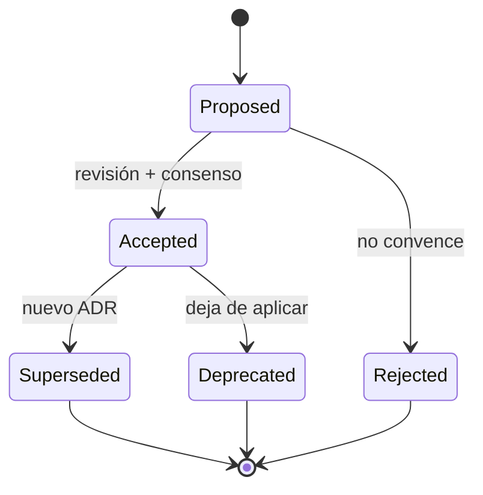

# 09 — Architecture Decision Records (ADR)

> **Estado:** Decisiones aceptadas para v1 · **Versión:** 1.0 · **Fecha:** 2026-10-28
> **Alcance:** las 10 decisiones estructurales que gobiernan el diseño, la seguridad y la
> distribución de LiquidHarness. Cualquier cambio requiere un ADR nuevo que superseda al anterior.
> **Regla:** un ADR aceptado es inmutable. Se corrige con otro ADR, nunca editando la historia.

---

## 1. Cómo leer y escribir ADRs

### 1.1 Ciclo de vida



| Estado | Significado |
| :--- | :--- |
| **Proposed** | En discusión; no obliga. |
| **Accepted** | Obliga; el código y los docs deben cumplirla. |
| **Superseded** | Reemplazada por otro ADR; se conserva por trazabilidad. |
| **Deprecated** | Ya no aplica, pero no hay reemplazo directo. |
| **Rejected** | Se evaluó y se descartó; se conserva para no repetir el debate. |

### 1.2 Plantilla

```markdown
## ADR-NNNN — Título

- **Estado:** Proposed | Accepted | Superseded by ADR-XXXX | Deprecated | Rejected
- **Fecha:** YYYY-MM-DD
- **Decisores:** roles
- **Supersede:** ADR-XXXX (si aplica)
- **Documentos relacionados:** enlaces

### Contexto
Fuerzas, restricciones y problema. Sin solución.

### Decisión
Qué se decide, en una frase, y luego el detalle normativo (MUST/SHOULD).

### Consecuencias
Positivas, negativas y neutrales. Qué se vuelve más fácil y qué más difícil.

### Alternativas consideradas
Tabla con opción, pros, contras y por qué se descartó.

### Notas de implementación
Paquetes, flags, migraciones, tests.

### Referencias
Enlaces internos y externos.
```

### 1.3 Índice

| ADR | Título | Estado | Impacto |
| :--- | :--- | :--- | :--- |
| [0001](#adr-0001--go-127-monolito-modular-hexagonal-y-un-solo-binario) | Go 1.27, monolito modular hexagonal y un solo binario | Accepted | Estructural |
| [0002](#adr-0002--runtime-http-openai-compatible-por-defecto-embebido-opt-in) | Runtime HTTP OpenAI-compatible por defecto; embebido opt-in | Accepted | Estructural |
| [0003](#adr-0003--sqlite-puro-go-con-fts5-y-vectores-en-blob) | SQLite puro Go con FTS5 y vectores en BLOB | Accepted | Datos |
| [0004](#adr-0004--bubble-tea-v2-para-la-tui) | Bubble Tea v2 para la TUI | Accepted | UI |
| [0005](#adr-0005--modelo-canónico-de-mensajes-y-adaptadores-de-proveedor) | Modelo canónico de mensajes y adaptadores de proveedor | Accepted | Contratos |
| [0006](#adr-0006--policy-aprobaciones-y-workspace-jail-no-bypasseables) | Policy, aprobaciones y workspace jail no bypasseables | Accepted | Seguridad |
| [0007](#adr-0007--mcp-en-ambas-direcciones-cliente-y-servidor) | MCP en ambas direcciones (cliente y servidor) | Accepted | Integración |
| [0008](#adr-0008--evaluación-como-paquete-de-primera-clase-y-gate-de-release) | Evaluación como paquete de primera clase y gate de release | Accepted | Calidad |
| [0009](#adr-0009--toml--entorno--flags-con-paths-xdgappdata) | TOML + entorno + flags con paths XDG/AppData | Accepted | Configuración |
| [0010](#adr-0010--apache-20-para-el-harness-licencia-lfm-separada-para-los-pesos) | Apache-2.0 para el harness; licencia LFM separada para los pesos | Accepted | Legal |

---

## ADR-0001 — Go 1.27, monolito modular hexagonal y un solo binario

- **Estado:** Accepted
- **Fecha:** 2026-10-28
- **Decisores:** Architecture, Engineering
- **Supersede:** —
- **Documentos relacionados:** [`03-go-stack-research.md`](./03-go-stack-research.md),
  [`04-architecture.md`](./04-architecture.md), [`07-installer.md`](./07-installer.md)

### Contexto

`project.md` pide Go 1.22+ y un harness local-first. El producto debe distribuirse como un binario
sin runtime, funcionar en Windows/macOS/Linux x64/arm64 y ser fácil de instalar por usuarios no
técnicos. El equipo es pequeño (2–3 ingenieros) y el dominio es un loop con tools, no un servicio
distribuido.

Go 1.27 (agosto de 2026) aporta lo que el diseño necesita: `encoding/json/v2` (más rápido y estricto),
`uuid` en la stdlib, métodos genéricos, `testing/synctest` para tests de concurrencia y el perfil
`goroutineleak`. Mantener 1.22 obligaría a dependencias externas y a renunciar a tests deterministas.

### Decisión

1. **Go 1.27** como versión mínima y única del proyecto (`go 1.27.0` en `go.mod`).
2. **Un solo módulo** `github.com/HugoFernandoColmenares/LiquidHarness`.
3. **Monolito modular hexagonal**: `cmd/liquidharness` + `internal/{core,ports,agent,policy,tools,llm,store,rag,memory,eval,sandbox,mcpclient,tui,cli,config,fsx,telemetry,version,app}`.
4. **Un binario** para CLI, TUI y modo headless; sin servicios auxiliares obligatorios (el
   `llama-server` es opcional y gestionado).
5. **Regla de dependencias** aplicada por `depguard`: `core` no importa nada interno; `agent` no
   importa adaptadores; `app` es el único composition root.
6. **Sin framework de DI, sin ORM, sin plugins dinámicos** en v1.

### Consecuencias

**Positivas**

- Despliegue trivial: copiar un archivo; sin JVM, Node ni Python.
- Cross-compile con `CGO_ENABLED=0` para 6 plataformas desde un solo runner.
- Tests rápidos y deterministas; `synctest` elimina sleeps en tests de timeout.
- Menos superficie de ataque y menos dependencias que un stack políglota.

**Negativas**

- Go 1.27 es reciente: algunos usuarios y CI pueden no tenerlo; se documenta y se fija toolchain.
- El binario embebido requiere CGO y rompe la pureza de "un binario estático" (ver ADR-0002).
- Un monolito exige disciplina de límites; sin `depguard` se degrada en un acoplamiento.

**Neutrales**

- El rendimiento es suficiente para el loop; el cuello de botella es el modelo, no Go.
- La TUI en terminal limita la expresividad frente a una web UI (decisión consciente).

### Alternativas consideradas

| Opción | Pros | Contras | Veredicto |
| :--- | :--- | :--- | :--- |
| **Rust** | Rendimiento, seguridad de memoria | Curva, ecosistema TUI menos maduro, tiempo de compilación | Rechazada |
| **Python** | Ecosistema ML, prototipado | Distribución pesada, GIL, arranque lento | Rechazada |
| **TypeScript/Node** | TUI web, ecosistema | Runtime obligatorio, tamaño, supply chain | Rechazada |
| **Microservicios** | Aislamiento | Latencia, operación, contradice local-first | Rechazada |
| **Go 1.22** | Compatibilidad | Sin `synctest`, `json/v2`, uuid; más dependencias | Rechazada |
| **Monolito con plugins** | Extensibilidad | Seguridad, complejidad, ABI | Rechazada (MCP cubre extensibilidad) |

### Notas de implementación

- `go.mod` fija `go 1.27.0`; CI usa `go-version-file: go.mod`.
- `internal/app` es el único paquete que construye concretos; el resto recibe interfaces.
- `depguard` en `.golangci.yml` codifica la tabla de [`04-architecture.md`](./04-architecture.md) §4.1.
- `cmd/liquidharness/main.go` solo parsea, delega y traduce errores a códigos de salida.

### Referencias

- [`03-go-stack-research.md`](./03-go-stack-research.md) §2.
- [`04-architecture.md`](./04-architecture.md) §3–§4.
- Go 1.27 release notes (verificado 2026-10-28).

---

## ADR-0002 — Runtime HTTP OpenAI-compatible por defecto; embebido opt-in

- **Estado:** Accepted
- **Fecha:** 2026-10-28
- **Decisores:** Architecture, ML, Release
- **Supersede:** —
- **Documentos relacionados:** [`02-lfm25-runtime-research.md`](./02-lfm25-runtime-research.md),
  [`07-installer.md`](./07-installer.md)

### Contexto

LFM2.5 se distribuye como pesos (safetensors/GGUF) y necesita un motor de inferencia. Las opciones
reales son: (a) hablar HTTP con `llama-server` u otro servidor OpenAI-compatible, (b) embeber
`llama.cpp` con CGO, (c) usar una implementación pura Go experimental (`goccy/go-llama`), (d) exigir
un servicio externo.

El binario estándar debe ser `CGO_ENABLED=0` y funcionar en 6 plataformas. Embeber `llama.cpp`
multiplica el tamaño (80–150 MB), requiere toolchain C/C++ por plataforma y complica la firma y la
reproducibilidad. Además, muchos usuarios ya tienen `llama-server`, LM Studio u Ollama.

### Decisión

1. **Default:** cliente HTTP OpenAI-compatible contra `http://127.0.0.1:8080/v1` (configurable).
2. **Runtime gestionado opcional:** el harness puede descargar y supervisar `llama-server` como
   proceso hijo (health check, backoff, SIGTERM), sin embeberlo.
3. **Build embebido opt-in:** `liquidharness-embedded` con `-tags embedded` y CGO, solo Linux/macOS
   en v1; se publica si el toolchain está disponible, nunca es requisito.
4. **Puro Go experimental:** `goccy/go-llama` solo como adaptador de investigación, fuera del camino
   crítico y sin promesas de rendimiento.
5. **Contrato:** `ports.Model` abstrae el backend; el loop no sabe si es HTTP, embebido o fake.

### Consecuencias

**Positivas**

- Cross-compile simple y binario pequeño (~20–30 MB).
- El usuario puede usar el runtime que prefiera (llama.cpp, Ollama, LM Studio, servidor remoto).
- Aislamiento de fallos: si el modelo cae, el harness sigue vivo y reporta.
- La firma y la reproducibilidad del binario no dependen de C/C++.

**Negativas**

- Dos procesos que gestionar; el usuario puede tener versiones incompatibles de `llama-server`.
- El rendimiento depende de la calidad del servidor externo.
- El modo "un solo proceso" requiere el sabor embebido, con soporte limitado.

**Neutrales**

- El instalador debe detectar runtimes existentes y explicar la elección.
- Los evals pueden usar un modelo fake sin cambiar el loop.

### Alternativas consideradas

| Opción | Pros | Contras | Veredicto |
| :--- | :--- | :--- | :--- |
| **Solo embebido (CGO)** | Un proceso, control total | Tamaño, toolchain, 6 plataformas, firma | Rechazada como default |
| **Solo subprocess** | Simple | Sin control de versión, sin modo embebido | Rechazada (se ofrece como opción) |
| **Puro Go (`goccy`)** | Sin CGO | Inmaduro, lento, cobertura de modelos limitada | Experimental |
| **API cloud** | Calidad | Contradice local-first, privacidad, coste | Rechazada |
| **Ollama como único** | Fácil | Dependencia externa, no siempre disponible | Rechazada como único |

### Notas de implementación

- `internal/llm/openai.go` implementa `ports.Model`; `supervisor.go` gestiona el proceso.
- Config: `model.base_url`, `model.autostart`, `model.path`, `model.context_window`.
- `doctor` comprueba `/health` y `/v1/models`; distingue "no hay runtime" de "modelo equivocado".
- El sabor embebido usa el mismo `ports.Model`; el loop no cambia.

### Referencias

- [`02-lfm25-runtime-research.md`](./02-lfm25-runtime-research.md) §5–§6.
- [`07-installer.md`](./07-installer.md) §7.4.

---

## ADR-0003 — SQLite puro Go con FTS5 y vectores en BLOB

- **Estado:** Accepted
- **Fecha:** 2026-10-28
- **Decisores:** Architecture, Platform
- **Supersede:** —
- **Documentos relacionados:** [`03-go-stack-research.md`](./03-go-stack-research.md),
  [`04-architecture.md`](./04-architecture.md) §10–§12

### Contexto

El harness necesita persistir sesiones, mensajes, tool calls, aprobaciones, eventos de auditoría,
memorias, documentos y chunks con embeddings. Los requisitos son: cero operaciones, un archivo,
transacciones, búsqueda léxica y búsqueda vectorial, y funcionamiento offline en Windows/macOS/Linux.

Las opciones: SQLite (con o sin CGO), bbolt/Badger (KV), DuckDB (analítica), Postgres+pgvector
(servidor), Qdrant/Chroma (servicio), o un índice en memoria serializado.

### Decisión

1. **SQLite** como único almacén, con `modernc.org/sqlite` (traducción pura Go, `CGO_ENABLED=0`).
2. **WAL** (`journal_mode=WAL`), `synchronous=NORMAL`, `busy_timeout=5000`, un solo writer.
3. **FTS5** para búsqueda léxica (`unicode61 remove_diacritics 2`).
4. **Embeddings como `BLOB` float32** en `chunks.embedding`; similitud coseno calculada en Go.
5. **Búsqueda híbrida** `0.6 * cosine + 0.4 * normalized(bm25)`, con `top_k=6` por defecto.
6. **`sqlite-vec` opcional** (build tag / extensión) para índices ANN; nunca requisito.
7. **Migraciones embebidas** (`embed.FS`) y `schema_version`; backup con `VACUUM INTO`.

### Consecuencias

**Positivas**

- Un archivo portable, fácil de inspeccionar, exportar y borrar.
- Sin servidor, sin puertos, sin credenciales.
- SQL + transacciones + FTS en el mismo motor.
- `CGO_ENABLED=0` mantiene el cross-compile y la firma simples.
- Reconstruible: si el índice se corrompe, se reindexa desde los documentos.

**Negativas**

- La búsqueda vectorial en Go es O(n) por consulta; a 100k chunks puede superar 50 ms.
- Un solo writer limita la concurrencia; las escrituras se serializan.
- `modernc.org/sqlite` es más lento que el binding C y añade ~10 MB al binario.
- FTS5 no está en todas las builds de SQLite; hay que verificar en `doctor`.

**Neutrales**

- El esquema es explícito y versionado; no hay ORM que oculte el SQL.
- `sqlite-vec` queda como optimización futura, no como dependencia.

### Alternativas consideradas

| Opción | Pros | Contras | Veredicto |
| :--- | :--- | :--- | :--- |
| **SQLite CGO (`mattn`)** | Rápido, maduro | Rompe cross-compile, toolchain C | Rechazada |
| **bbolt** | Puro Go, simple | Sin SQL/FTS, consultas manuales | Rechazada |
| **Badger** | KV rápido | Sin SQL/FTS, LSM complejo | Rechazada |
| **Postgres + pgvector** | Potente | Servidor, operación, no local-first | Rechazada |
| **DuckDB** | Analítica | Pesado, no transaccional para OLTP | Rechazada |
| **Qdrant/Chroma** | ANN | Servicio extra, contenedor, latencia | Rechazada |
| **Índice en memoria + JSON** | Simple | Sin durabilidad ni consultas | Rechazada |

### Notas de implementación

- Esquema en [`04-architecture.md`](./04-architecture.md) §10.1; migraciones en `internal/store/migrations/`.
- `PRAGMA integrity_check` en `doctor`; `VACUUM` programable.
- La similitud coseno se implementa con `float32` y se testea contra una referencia.
- `sqlite-vec` se activa con `-tags sqlite_vec` y se detecta en runtime; si falta, fallback a BLOB.
- Tests de migración desde cero y desde la versión anterior; benchmark con 10k y 100k chunks.

### Referencias

- [`03-go-stack-research.md`](./03-go-stack-research.md) §6.
- [`04-architecture.md`](./04-architecture.md) §10–§12.

---

## ADR-0004 — Bubble Tea v2 para la TUI

- **Estado:** Accepted
- **Fecha:** 2026-10-28
- **Decisores:** Product, Design, Engineering
- **Supersede:** —
- **Documentos relacionados:** [`06-design-guide.md`](./06-design-guide.md)

### Contexto

La TUI es el producto para la mayoría de usuarios: chat con streaming, tarjetas de tools, diffs,
modales de aprobación, tablas y múltiples pantallas. Debe funcionar en terminales modestas (80×24),
sin TTY, con `NO_COLOR`, y ser testeable en CI.

Opciones: Bubble Tea (Elm architecture), tview (widgets imperativos), gocui, una web UI local, o
readline + texto plano.

### Decisión

1. **Bubble Tea v2** (`charm.land/bubbletea/v2`) como runtime de la TUI.
2. **Lip Gloss v2** (`charm.land/lipgloss/v2`) para estilos y layout; **Bubbles v2** para componentes
   base (textarea, viewport, spinner, table, list).
3. **Arquitectura Elm**: `Init/Update/View`, comandos para I/O, sin bloqueos en `Update`.
4. **Tokens de diseño** en `internal/tui/theme/tokens.go`; los componentes no usan literales.
5. **Tests golden** con `teatest` a 80×24, 120×40 y 160×50; comparación por celdas, no píxeles.
6. **Degradación**: sin TTY → modo texto; `NO_COLOR` → sin color; terminal angosta → layout compacto.

### Consecuencias

**Positivas**

- Modelo de estado predecible y testeable; ideal para streaming y cancelación.
- Ecosistema maduro de componentes y estilos.
- v2 separa I/O de Lip Gloss (Lip Gloss es puro), lo que simplifica tests.
- La misma lógica de eventos sirve para CLI y TUI.

**Negativas**

- El ecosistema v2 es reciente; pueden aparecer breaking changes en minors.
- La comparación de golden tests puede ser frágil entre terminales; hay que fijar perfil y tamaño.
- La accesibilidad en terminal es limitada; se compensa con ASCII y contraste.

**Neutrales**

- La TUI no reemplaza al CLI headless; ambos consumen el mismo `app`.
- El diseño visual se restringe a lo que una terminal puede hacer.

### Alternativas consideradas

| Opción | Pros | Contras | Veredicto |
| :--- | :--- | :--- | :--- |
| **tview** | Widgets listos | Imperativo, difícil de testear, estilos rígidos | Rechazada |
| **gocui** | Ligero | Poco ecosistema, mantenimiento incierto | Rechazada |
| **Web UI local** | Expresiva | Rompe "terminal-first", más superficie | Rechazada para v1 |
| **Readline + texto** | Simple | Sin diffs, sin modales, mala UX | Rechazada |
| **Bubble Tea v1** | Estable | Sin las mejoras v2; Lip Gloss con I/O | Rechazada |

### Notas de implementación

- `internal/tui/app.go` implementa `tea.Model`; las pantallas son submodelos.
- El loop del agente corre en una goroutine y envía eventos por un canal; `Update` solo muta estado.
- `tea.WithAltScreen()`, `tea.WithMouseCellMotion()` opcional, `tea.WithoutSignalHandler()` para
  controlar el shutdown.
- Golden tests con `teatest.NewTestModel` y un `golden` file por tamaño; actualización explícita con
  `-update`.
- Capturas en `docs/screenshots/` según [`06-design-guide.md`](./06-design-guide.md) §16.

### Referencias

- [`06-design-guide.md`](./06-design-guide.md) §1–§15.
- [`03-go-stack-research.md`](./03-go-stack-research.md) §5.

---

## ADR-0005 — Modelo canónico de mensajes y adaptadores de proveedor

- **Estado:** Accepted
- **Fecha:** 2026-10-28
- **Decisores:** Architecture, Engineering
- **Supersede:** —
- **Documentos relacionados:** [`04-architecture.md`](./04-architecture.md) §5,
  [`05-tool-protocol.md`](./05-tool-protocol.md) §9

### Contexto

LFM2.5 usa un formato ChatML con tokens especiales y tool calls Pythonic dentro de
`<|tool_call_start|>…<|tool_call_end|>`; el backend OpenAI-compatible puede devolver `tool_calls`
JSON. Además, el proyecto quiere poder cambiar de proveedor (Ollama, LM Studio, remoto) sin reescribir
el loop, la persistencia ni la UI.

Si el loop usa directamente los tipos del wire (OpenAI), cada proveedor contamina el dominio y los
tests dependen de un servidor.

### Decisión

1. **Modelo canónico** en `internal/core`: `Message`, `ToolCall`, `ToolResult`, `ToolError`,
   `Citation`, `Event`, `Session`.
2. **DTOs de wire separados** en `internal/llm/wire.go`; el adaptador traduce en ambos sentidos.
3. **El loop solo ve `core` + `ports`**; nunca JSON de proveedor.
4. **IDs de tool call generados por el harness** cuando el modelo no los emite (LFM a menudo no lo hace).
5. **Parser tolerante** que acepta Pythonic y JSON, llamadas múltiples y partidas por streaming.
6. **`Reasoning` separado de `Content`** (` thinking…</think>`), para no mezclar razonamiento con respuesta.
7. **Versionado del protocolo** (`Tool Protocol v1`) y del prompt (`prompt_hash`).

### Consecuencias

**Positivas**

- Cambiar de backend es escribir un adaptador, no tocar el loop.
- La persistencia es estable y legible; los evals son reutilizables.
- Tests con `FakeModel` sin red ni GPU.
- La UI y la auditoría comparten tipos.

**Negativas**

- Duplicación controlada entre `core` y `wire` (deliberada, no DRY mal aplicado).
- El parser debe cubrir las rarezas de cada modelo; es código crítico.
- Cualquier campo nuevo requiere actualizar el mapeo y los tests.

**Neutrales**

- El modelo canónico no es un estándar externo; es una decisión interna documentada.
- El wire OpenAI se usa como lingua franca, pero no se filtra.

### Alternativas consideradas

| Opción | Pros | Contras | Veredicto |
| :--- | :--- | :--- | :--- |
| **Usar tipos OpenAI en todo** | Menos código | Acopla dominio, difícil de evolucionar | Rechazada |
| **Un loop por proveedor** | Simple al inicio | Duplicación, bugs divergentes | Rechazada |
| **Librería de terceros** | Rápida | Dependencia, tipos ajenos, licencia | Rechazada |
| **Solo texto + regex** | Sin schema | Frágil, inseguro | Rechazada |

### Notas de implementación

- `core.Message` en [`04-architecture.md`](./04-architecture.md) §5.1.
- `llm.parse_lfm.go` con tabla de casos y `testdata/lfm/*.txt`.
- El parser devuelve `[]ToolCall` + `Content` + `Reasoning`; nunca ejecuta.
- `ToolCall.Arguments` es `json.RawMessage` validado contra JSON Schema 2020-12 antes de ejecutar.
- `prompt_hash` = SHA-256 del system prompt + versión del protocolo; se guarda en `eval_runs`.

### Referencias

- [`02-lfm25-runtime-research.md`](./02-lfm25-runtime-research.md) §2–§3.
- [`05-tool-protocol.md`](./05-tool-protocol.md) §9.

---

## ADR-0006 — Policy, aprobaciones y workspace jail no bypasseables

- **Estado:** Accepted
- **Fecha:** 2026-10-28
- **Decisores:** Security, Architecture
- **Supersede:** —
- **Documentos relacionados:** [`05-tool-protocol.md`](./05-tool-protocol.md) §4–§7,
  [`10-security.md`](./10-security.md)

### Contexto

El modelo es no confiable: puede alucinar rutas, ser manipulado por prompt injection (directa o
indirecta vía archivos/RAG/MCP) o emitir llamadas destructivas. El producto escribe archivos reales
en la máquina del usuario. La seguridad no puede depender de que el prompt diga "no borres".

Se necesita un mecanismo determinista, fuera del modelo, que decida qué se permite, pida aprobación
cuando corresponda y garantice que ninguna ruta escape del workspace.

### Decisión

1. **Policy engine determinista** en `internal/policy`, evaluado **antes** de ejecutar cualquier tool.
2. **Clases de riesgo R0–R5** (R0 lectura, R1 escritura aditiva, R2 destructiva, R3 ejecución,
   R4 red, R5 administrativa) asignadas por la tool, no por el modelo.
3. **Modos** `read-only`, `ask` (default), `allow`; reglas por tool, ruta, extensión, tamaño y hora.
4. **Aprobación explícita** para R2+ en modo `ask`; la aprobación tiene scope (`once`, `session`,
   `workspace`) y se audita. `Esc`/timeout deniega.
5. **Workspace jail** en resolución de paths (`fsx.Jail`): canonicalización, symlinks, `..`, UNC,
   ADS, case-insensitivity, y validación de handle para TOCTOU.
6. **No bypass**: no hay flag "sin policy" en v1; `--yes` solo auto-aprueba R1 y `--allow-risk=Rn` R2+, nunca salta la policy.
7. **Shell y red deshabilitados por defecto**; si se habilitan, siguen sujetos a policy y sandbox.
8. **Toda decisión y ejecución se audita** (hash de argumentos, no contenido completo).

### Consecuencias

**Positivas**

- La seguridad es propiedad del harness, no del prompt.
- El usuario ve exactamente qué se va a hacer antes de que ocurra.
- Los escapes se previenen en código y se prueban adversarialmente.
- La auditoría permite explicar y reproducir.

**Negativas**

- Fricción: el usuario aprueba escrituras/destrucciones con frecuencia.
- Complejidad de policy y jail; es código crítico con alta cobertura.
- El sandbox de shell por OS es difícil (Windows Job Objects, seccomp, sandbox-exec).

**Neutrales**

- El modo `allow` existe para usuarios avanzados, pero sigue pasando por jail y auditoría.
- La aprobación en headless requiere `--yes` (R1) o `--allow-risk=Rn` (R2+) o `--deny` explícitos; nunca hay default silencioso.

### Alternativas consideradas

| Opción | Pros | Contras | Veredicto |
| :--- | :--- | :--- | :--- |
| **Confiar en el prompt** | Cero fricción | Trivial de bypassear | Rechazada |
| **Solo sandbox de OS** | Aislamiento fuerte | Complejo, no cubre semántica de tools | Complementaria |
| **Auto-approve** | UX fluida | Destructivo, impredecible | Rechazada |
| **Solo allowlist de tools** | Simple | No distingue rutas ni intención | Insuficiente |
| **Capability tokens** | Granular | Complejo para v1 | Post-1.0 |

### Notas de implementación

- `policy.Authorize(ctx, session, call) Decision`; `Decision{Allow|Ask|Deny, Reason, Scope}`.
- `fsx.Jail.Resolve(path)` devuelve un path canónico o `ErrOutsideWorkspace`.
- `fsx.AtomicWrite` con temp + rename + fsync; `fs_edit` verifica hash previo.
- Tests adversariales: ≥ 40 vectores en `testdata/jail/`; 20 vectores de protocolo.
- La UI muestra tool, riesgo, ruta y diff; el audit guarda `args_hash`.

### Referencias

- [`05-tool-protocol.md`](./05-tool-protocol.md) §4–§7 y §13.
- [`10-security.md`](./10-security.md) §3–§5.

---

## ADR-0007 — MCP en ambas direcciones (cliente y servidor)

- **Estado:** Accepted
- **Fecha:** 2026-10-28
- **Decisores:** Architecture, Product
- **Supersede:** —
- **Documentos relacionados:** [`05-tool-protocol.md`](./05-tool-protocol.md) §10,
  [`03-go-stack-research.md`](./03-go-stack-research.md) §7

### Contexto

El ecosistema de agentes converge en MCP (Model Context Protocol): JSON-RPC 2.0 sobre stdio o
Streamable HTTP, con primitivas de tools, resources y prompts. LiquidHarness necesita (a) consumir
servidores MCP para ampliar capacidades sin recompilar y (b) exponerse como servidor MCP para que
otros clientes usen sus tools de conocimiento local.

Un sistema de plugins dinámicos propio sería más trabajo, más superficie de ataque y menos
interoperable.

### Decisión

1. **MCP cliente y servidor** en v1, usando el SDK oficial `github.com/modelcontextprotocol/go-sdk`
   (spec de referencia 2026-07-28).
2. **Transportes:** stdio (default) y Streamable HTTP; sin SSE legacy salvo compatibilidad.
3. **Namespacing:** `server__tool` para evitar colisiones; allowlist por servidor.
4. **Riesgo heredado:** toda tool MCP es mínimo R1; las de escritura requieren aprobación.
5. **Defensa contra tool poisoning:** descripciones y resultados son **datos**, no instrucciones; no
   se permite que un servidor MCP cambie la policy, el system prompt o el workspace.
6. **Servidor MCP de LiquidHarness:** solo lectura por defecto (`fs_read`, `fs_list`, `fs_search`,
   `rag_search`, `memory_search`); escritura opt-in con aprobación.
7. **Configuración explícita** (`[[mcp.servers]]`), sin auto-discovery de red.

### Consecuencias

**Positivas**

- Extensibilidad real sin plugins ni recompilar.
- Interoperabilidad con el ecosistema (Claude Desktop, IDEs, otros agentes).
- El servidor MCP convierte a LiquidHarness en proveedor de contexto local.
- Un solo contrato (JSON Schema) para tools internas y externas.

**Negativas**

- Superficie de ataque nueva: servidores maliciosos, descripciones envenenadas, SSRF vía HTTP.
- El SDK y la spec evolucionan; hay que pinear y testear.
- La latencia de un servidor MCP externo puede romper el presupuesto del turno.

**Neutrales**

- MCP no reemplaza las tools internas; las complementa.
- Los resources/prompts se soportan de forma incremental (v1: tools + resources de lectura).

### Alternativas consideradas

| Opción | Pros | Contras | Veredicto |
| :--- | :--- | :--- | :--- |
| **Solo cliente MCP** | Menos trabajo | No permite integración inversa | Rechazada |
| **Solo servidor MCP** | Ecosistema | No amplía capacidades | Rechazada |
| **Plugins dinámicos (WASM)** | Potente | Seguridad, ABI, complejidad | Post-1.0 |
| **Protocolo propio** | Control | No interoperable | Rechazada |
| **HTTP genérico** | Simple | Sin discovery ni schema | Rechazada |

### Notas de implementación

- `internal/mcpclient/{client,bridge,policy}.go`; `bridge` adapta `mcp.Tool` a `ports.Tool`.
- Timeout por llamada (default 30 s), cancelación por contexto, límite de tamaño de resultado.
- El servidor MCP se activa con `serve --mcp`; loopback + token si es HTTP.
- Tests de interoperabilidad con `@modelcontextprotocol/server-filesystem` y un servidor de prueba.
- Un servidor MCP que devuelva instrucciones en la descripción se trata como texto y se muestra
  marcado como "contenido de terceros".

### Referencias

- [`05-tool-protocol.md`](./05-tool-protocol.md) §10.
- MCP spec 2026-07-28 (verificado 2026-10-28).
- `github.com/modelcontextprotocol/go-sdk` v1.8+.

---

## ADR-0008 — Evaluación como paquete de primera clase y gate de release

- **Estado:** Accepted
- **Fecha:** 2026-10-28
- **Decisores:** QA, Architecture, Product
- **Supersede:** —
- **Documentos relacionados:** [`11-testing-eval.md`](./11-testing-eval.md),
  [`04-architecture.md`](./04-architecture.md) §13

### Contexto

Un harness de agentes no se valida solo con tests unitarios: el comportamiento emerge de la
interacción modelo + prompt + tools + contexto. Los cambios de prompt, de parser o de política
pueden mejorar un caso y romper diez. Sin un conjunto dorado y métricas, cada release es una
apuesta.

Además, el modelo es local y no determinista; se necesita una forma de medir sin convertir CI en
un servicio caro y lento.

### Decisión

1. **Paquete `internal/eval`** con datasets versionados (JSONL/YAML), runner, assertions, judge y
   reporte.
2. **Cuatro conjuntos:** `smoke` (rápido, PR), `core` (comportamiento, nightly), `adversarial`
   (seguridad, cada PR/nightly), `regression` (bugs históricos).
3. **Assertions deterministas** sobre trayectoria: tools llamadas, args válidos, rutas dentro del
   jail, número de pasos, citas, ausencia de secretos.
4. **LLM-as-judge** solo para calidad subjetiva, calibrado contra humanos (κ ≥ 0.6) y con rúbrica
   explícita; nunca es el único gate.
5. **Gate de release:** `core` ≥ umbral y caída ≤ 3 % respecto a la release anterior; `adversarial`
   100 % bloqueado.
6. **CI:** modelo fake en PR; modelo real en nightly con runner propio y modelo cacheado.
7. **Resultados persistidos** en `eval_runs` para comparar tendencias y adjuntar al release.

### Consecuencias

**Positivas**

- Las regresiones de comportamiento se detectan antes del usuario.
- Los cambios de prompt/modelo se comparan con datos, no con opiniones.
- Los bugs se convierten en casos de regresión permanentes.
- El release tiene evidencia objetiva.

**Negativas**

- Mantener datasets y rúbricas es trabajo continuo.
- El judge introduce coste y sesgo; requiere calibración.
- Los evals con modelo real son lentos y caros; el nightly puede flaquear.
- Un umbral mal calibrado bloquea releases legítimos.

**Neutrales**

- Los evals no sustituyen tests unitarios ni revisión humana.
- El modelo fake permite tests rápidos, pero no mide calidad real.

### Alternativas consideradas

| Opción | Pros | Contras | Veredicto |
| :--- | :--- | :--- | :--- |
| **Solo tests unitarios** | Rápido | No cubre comportamiento emergente | Insuficiente |
| **Solo pruebas manuales** | Realista | No repetible, no escala | Rechazada |
| **Benchmarks públicos** | Comparables | No miden el producto | Complementaria |
| **Solo LLM-as-judge** | Flexible | Sesgo, coste, no determinista | Rechazada como único |
| **Sin gate** | Velocidad | Regresiones silenciosas | Rechazada |

### Notas de implementación

- `eval run --dataset core --model local --report out.json`.
- `eval gate --baseline evals/baseline.json --report out.json` devuelve exit code 1 si falla.
- Cada caso declara `workspace` fixtures, `input`, `expect` (tools, args, citations, max_steps) y
  `judge` opcional.
- El runner aísla cada caso en un directorio temporal y limpia al terminar.
- `prompt_hash` y versión del modelo se guardan con el resultado.

### Referencias

- [`11-testing-eval.md`](./11-testing-eval.md) §5–§9.
- [`04-architecture.md`](./04-architecture.md) §13.

---

## ADR-0009 — TOML + entorno + flags con paths XDG/AppData

- **Estado:** Accepted
- **Fecha:** 2026-10-28
- **Decisores:** Platform, Product
- **Supersede:** —
- **Documentos relacionados:** [`04-architecture.md`](./04-architecture.md) §14,
  [`07-installer.md`](./07-installer.md) §7.6

### Contexto

El usuario necesita configurar modelo, workspace, policy, RAG, MCP y logging. Las opciones son un
archivo (TOML/YAML/JSON), variables de entorno, flags, o una librería tipo Viper que lo mezcle todo.
También hay que decidir dónde viven config, datos, cache, modelos y logs en tres sistemas operativos.

Requisitos: editable a mano, diff-friendly, validable con mensajes claros, override por entorno para
CI/contenedores, y paths que respeten las convenciones de cada OS.

### Decisión

1. **TOML** como formato de configuración (`config.toml`), con comentarios y secciones.
2. **Precedencia:** flags > variables de entorno > `.env` (solo desarrollo) > `config.toml` > defaults.
3. **Prefijo `LIQUIDHARNESS_`** para todas las variables; mapeo `seccion.clave` → `LIQUIDHARNESS_SECCION_CLAVE`.
4. **Paths:**
   - Windows: `%APPDATA%\LiquidHarness` (config), `%LOCALAPPDATA%\LiquidHarness\data` (datos),
     `%LOCALAPPDATA%\LiquidHarness\cache` (cache/modelos).
   - macOS: `~/Library/Application Support/LiquidHarness` (config/datos), `~/Library/Caches/LiquidHarness`.
   - Linux: `$XDG_CONFIG_HOME/liquidharness`, `$XDG_DATA_HOME/liquidharness`, `$XDG_CACHE_HOME/liquidharness`.
5. **Sin Viper**: parseo con `BurntSushi/toml` + `os.Getenv` + `flag`/`cobra`, y validación explícita.
6. **Secretos en keyring** (Windows Credential Manager, macOS Keychain, Secret Service); `.env` solo
   para desarrollo y nunca se commitea.
7. **Config de workspace** en `<workspace>/.liquidharness/policy.toml`, separada de la global.

### Consecuencias

**Positivas**

- El archivo es legible, comentable y versionable (sin secretos).
- El override por entorno funciona en CI y contenedores sin trucos.
- Menos dependencias y menos magia que Viper.
- Los paths cumplen las expectativas de cada OS y facilitan el uninstall.

**Negativas**

- Hay que implementar el mapeo y la validación a mano (más código, pero testeable).
- TOML no soporta todos los tipos de YAML (suficiente para este dominio).
- Dos niveles de config (global + workspace) pueden confundir; se documenta la precedencia.

**Neutrales**

- `.env` es una comodidad de desarrollo, no el mecanismo principal.
- La config se puede exportar/importar para reproducibilidad.

### Alternativas consideradas

| Opción | Pros | Contras | Veredicto |
| :--- | :--- | :--- | :--- |
| **YAML** | Flexible | Indentación, ambigüedad, más dependencias | Rechazada |
| **JSON** | Universal | Sin comentarios, verboso | Rechazada |
| **Viper** | Todo en uno | Magia, dependencias, precedencia opaca | Rechazada |
| **Solo flags** | Simple | Inusable para config estable | Rechazada |
| **Base de datos de config** | Dinámica | No editable, no diff-friendly | Rechazada |

### Notas de implementación

- `internal/config/{config,defaults,env,paths}.go`; `Config.Validate()` devuelve errores con campo y
  archivo.
- `liquidharness config path|show|validate|init`.
- `doctor` muestra la fuente efectiva de cada valor (flag/env/file/default).
- Tests de precedencia y de paths en las 3 OS (con `t.Setenv` y `GOOS` simulado donde aplique).

### Referencias

- [`04-architecture.md`](./04-architecture.md) §14.
- [`07-installer.md`](./07-installer.md) §7.6.

---

## ADR-0010 — Apache-2.0 para el harness; licencia LFM separada para los pesos

- **Estado:** Accepted
- **Fecha:** 2026-10-28
- **Decisores:** Legal, Product, Engineering
- **Supersede:** —
- **Documentos relacionados:** [`08-implementation-plan.md`](./08-implementation-plan.md) §11.2,
  [`07-installer.md`](./07-installer.md) §8

### Contexto

El proyecto distribuye (a) código del harness y (b) un instalador que descarga pesos LFM2.5. Son dos
obras con licencias distintas: el código puede ser permisivo, pero los pesos tienen su propia
licencia (LFM Open License v1.0) con condiciones de uso comercial.

Elegir mal la licencia del código bloquea adopción empresarial o impide el modelo de negocio. Elegir
una licencia copyleft para el harness puede ahuyentar contribuciones y complicar la distribución.

### Decisión

1. **Harness: Apache License 2.0** (texto canónico, sin modificaciones).
2. **Pesos: LFM Open License v1.0**, mostrada y aceptada antes de la descarga; **nunca** se
   empaquetan en el binario ni en el repositorio.
3. **`NOTICE`** con atribución y aclaración de que los pesos no son Apache-2.0.
4. **Cabeceras SPDX** en todos los archivos fuente:
   `// Copyright 2026 The LiquidHarness Authors` + `// SPDX-License-Identifier: Apache-2.0`.
5. **DCO** (`Signed-off-by`) para contribuciones; sin CLA.
6. **Auditoría de licencias** de dependencias en CI; GPL/AGPL/SSPL prohibidas sin excepción
   documentada.
7. **Marcas:** "LiquidHarness" y el logo son marcas del proyecto; Apache-2.0 no concede derechos de
   marca (sección 6).

### Consecuencias

**Positivas**

- Licencia permisiva y bien entendida; compatible con uso comercial y contribuciones.
- Claridad legal: el usuario sabe qué cubre cada licencia.
- El instalador puede descargar pesos sin redistribuirlos.
- Atribución correcta vía `NOTICE`.

**Negativas**

- Apache-2.0 exige avisos y puede ser más burocrática que MIT para algunos contribuidores.
- La licencia de los pesos puede cambiar o requerir revisión legal por versión.
- Si se quiere un modelo de negocio dual, Apache-2.0 no lo impide pero tampoco lo protege.

**Neutrales**

- El código de terceros mantiene su licencia; se documenta en `NOTICE`/SBOM.
- La licencia no afecta a la arquitectura, solo a la distribución.

### Alternativas consideradas

| Opción | Pros | Contras | Veredicto |
| :--- | :--- | :--- | :--- |
| **MIT** | Mínima fricción | Sin cláusula de patentes explícita | Rechazada |
| **AGPL-3.0** | Copyleft fuerte | Ahuyenta adopción, complica distribución | Rechazada |
| **BSL 1.1** | Protege negocio | No es open source, fricción | Rechazada |
| **Propietaria** | Control | Sin comunidad, sin confianza | Rechazada |
| **Apache-2.0 + CLA** | Más control | Fricción para contribuir | Rechazada (DCO) |

### Notas de implementación

- `LICENSE` verificado por hash en CI; `NOTICE` incluido en cada archivo de release.
- `go-licenses check ./...` (o equivalente) en CI; allowlist: Apache-2.0, MIT, BSD-2/3, ISC, MPL-2.0.
- `init` muestra la licencia LFM y requiere aceptación explícita antes de descargar.
- El SBOM SPDX lista dependencias y licencias; los pesos no aparecen como parte del binario.

### Referencias

- [`08-implementation-plan.md`](./08-implementation-plan.md) §11.2.
- [`07-installer.md`](./07-installer.md) §8.
- Apache License 2.0: `https://www.apache.org/licenses/LICENSE-2.0`.
- LFM Open License v1.0: `https://www.liquid.ai/lfm-open-license`.

---

## 2. Decisiones pendientes (no son ADR todavía)

Estas preguntas están abiertas y se resolverán con un ADR nuevo cuando haya evidencia. No bloquean
F0–F2, pero sí F3/F8.

| ID | Pregunta | Fecha límite | Candidata a ADR | Estado |
| :--- | :--- | :--- | :--- | :--- |
| Q-01 | Runtime embebido: CGO vs puro Go vs subprocess | F2 | ADR-0011 | Abierta; default HTTP (ADR-0002) |
| Q-02 | Variante mínima de LFM2.5 para v1 (2.6B vs 8B-A1B) | F1 | ADR-0012 | Abierta; default 2.6B |
| Q-03 | `shell_exec` en v1 o post-1.0 | F3 | ADR-0013 | Abierta; default off |
| Q-04 | Términos comerciales de los pesos | Antes de 1.0 | Legal memo | Abierta |
| Q-05 | Telemetría: ninguna vs opt-in | F0 | ADR-0014 | Default off |
| Q-06 | Sandbox de Windows: Job Objects ahora o post-1.0 | F8 | ADR-0015 | Abierta; default post-1.0 |

---

## 3. Convenciones

1. **Numeración secuencial**, sin reutilizar números.
2. **Un ADR por decisión**; no se agrupan decisiones no relacionadas.
3. **Contexto sin solución**: si el contexto ya propone la solución, está sesgado.
4. **Consecuencias honestas**: incluir lo que se vuelve peor.
5. **Alternativas reales**: al menos dos, con motivo de descarte.
6. **Enlaces internos** a la documentación afectada.
7. **Revisión:** tech lead + un ingeniero del área + seguridad si toca datos/ejecución.
8. **Inmutabilidad:** cambios de decisión → ADR nuevo con `Supersedes`.
9. **Implementación:** un ADR aceptado debe reflejarse en código, tests y docs en el mismo ciclo.
10. **Revisión anual:** los ADR se revisan en cada major; si dejan de aplicar, se marcan `Deprecated`.

---

## 4. Criterios de aceptación de este documento

- [ ] Las 10 decisiones tienen contexto, decisión, consecuencias y alternativas.
- [ ] Cada ADR enlaza a los documentos que implementan la decisión.
- [ ] No hay contradicciones con [`04-architecture.md`](./04-architecture.md) ni con
      [`05-tool-protocol.md`](./05-tool-protocol.md).
- [ ] Las decisiones pendientes están trazadas con dueño y fecha límite.
- [ ] Un lector nuevo entiende **por qué** se eligió cada opción, no solo **qué**.
